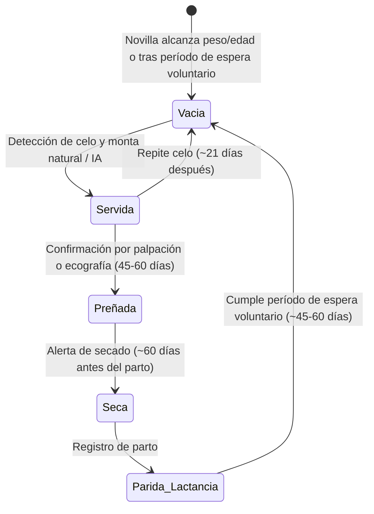

# FincaControl - Manejo Reproductivo y Ciclo de Cría

Esta guía describe el ciclo de vida reproductivo de la hembra bovina, la máquina de estados y las reglas automatizadas para optimizar el Intervalo Entre Partos (IEP) y la tasa de natalidad en FincaControl.

---

## 1. Máquina de Estados Reproductivos de la Hembra

Una hembra en edad reproductiva pasa por los siguientes estados:

---

## 2. Parámetros Temporales y Fórmulas de Predicción

Para bovinos en sistemas de doble propósito (cruces *Bos taurus* x *Bos indicus*):

| Evento | Parámetro Promedio | Fórmula / Regla |
| :--- | :--- | :--- |
| **Duración de Gestación** | 283 días (Rango: 278 - 290 días) | $\text{Fecha Parto Proyectada} = \text{Fecha Servicio} + 283 \text{ días}$ |
| **Alerta de Secado** | 60 días antes del parto | $\text{Fecha Secado} = \text{Fecha Parto Proyectada} - 60 \text{ días}$ |
| **Traslado a Maternidad** | 15 días antes del parto | $\text{Fecha Maternidad} = \text{Fecha Parto Proyectada} - 15 \text{ días}$ |
| **Intervalo Entre Partos (IEP)**| Meta: < 400 - 420 días | $\text{IEP} = \text{Fecha Parto Actual} - \text{Fecha Parto Anterior}$ |

---

## 3. Flujo Integrado de Registro de Parto

El registro de un parto es una transacción atómica que afecta tres módulos del sistema:

1. **Actualización de la Madre:**
   * Cambia su estado reproductivo a `En Lactancia`.
   * Registra el número de partos acumulados ($N + 1$).
   * Inicializa una nueva curva de producción lechera en el Módulo de Producción.
2. **Creación Automática de la Cría (`Animal`):**
   * Se solicita: `ID_Hierro` o número de arete provisional, `Sexo` (Macho / Hembra), `Peso_Kg` al nacer.
   * Se asignan automáticamente las relaciones de parentesco:  
     * `Madre_ID` = ID de la vaca que parió.  
     * `Padre_ID` = ID del toro o código del semen del servicio que originó la preñez.
3. **Validación Preventiva de Endogamia:**
   * Al registrar un servicio, advertir si el macho seleccionado comparte padre o madre con la hembra (coeficiente de parentesco cercano).

---

## 4. Checklist de Implementación
- [ ] Implementar un *scheduler* o cálculo dinámico local para el semáforo de vacas por secar y vacas por parir.
- [ ] Validar que una vaca preñada no pueda ser registrada como servida sin antes registrar aborto o parto.
- [ ] Permitir partos múltiples (gemelares) registrando más de una cría para el mismo evento.
