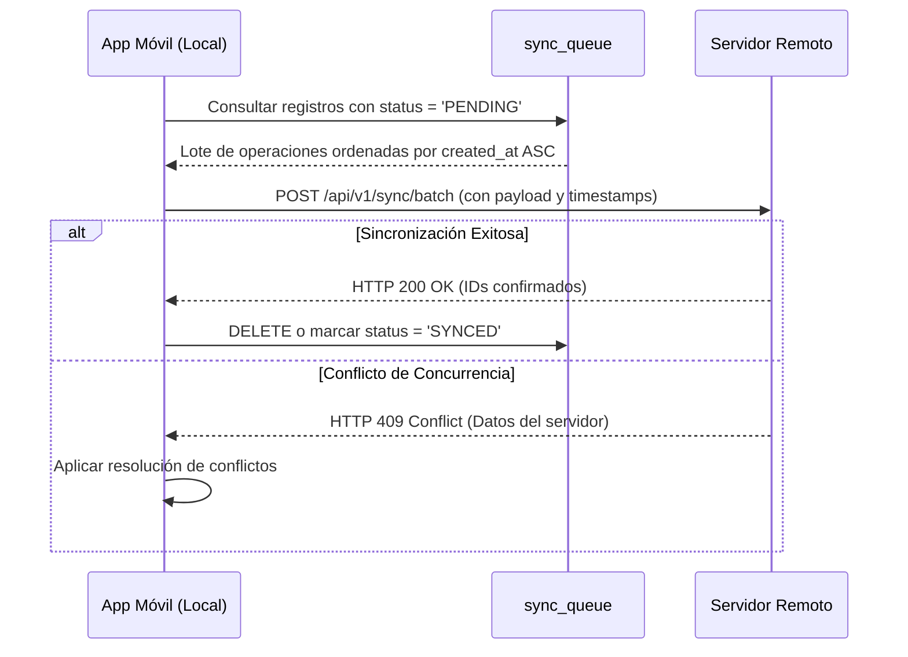

# FincaControl - Offline-First & Sincronización

Esta guía define las mejores prácticas y procedimientos técnicos para garantizar que la aplicación móvil opere al 100% sin conexión a internet en potreros y vaqueras, sincronizando datos de forma segura cuando se restablezca la conectividad.

---

## 1. Principios de la Arquitectura Offline-First

1. **Persistencia Local Primero:** Cualquier operación de creación, actualización o eliminación (CRUD) se escribe y confirma inmediatamente en la base de datos local SQLite/Room.
2. **Latencia Cero en Campo:** La interfaz de usuario no debe bloquearse esperando respuestas de red.
3. **Identificadores Únicos Universales (UUID):** Todas las claves primarias deben ser UUID v4 generadas en el dispositivo móvil, nunca enteros autoincrementales centralizados, para evitar colisiones entre dispositivos.

---

## 2. Estructura de la Cola de Sincronización (`sync_queue`)

Cada mutación local debe registrar una entrada en la tabla interna de sincronización:

```sql
CREATE TABLE sync_queue (
    id TEXT PRIMARY KEY,               -- UUID de la operación en cola
    entity_name TEXT NOT NULL,         -- 'Animal', 'RegistroOrdeno', 'EventoSanitario', etc.
    entity_id TEXT NOT NULL,           -- UUID del registro afectado
    operation_type TEXT NOT NULL,      -- 'INSERT', 'UPDATE', 'DELETE'
    payload_json TEXT NOT NULL,        -- Datos serializados de la entidad
    created_at INTEGER NOT NULL,       -- Timestamp UNIX en milisegundos (UTC)
    status TEXT NOT NULL DEFAULT 'PENDING', -- 'PENDING', 'SYNCING', 'FAILED', 'CONFLICT'
    retry_count INTEGER NOT NULL DEFAULT 0,
    last_error TEXT
);
```

---

## 3. Protocolo de Sincronización Delta

Cuando el listener de conectividad detecta red (WiFi o datos móviles):



---

## 4. Estrategia de Resolución de Conflictos

1. **Última Escritura Gana (Last-Write-Wins - LWW):** Basado en el campo `updated_at` (UTC) del registro.
2. **Eventos Inmutables (Append-Only):**
   * Los pesajes (`RegistroPesaje`) y los ordeños (`RegistroOrdeno`) son registros históricos inmutables. Nunca generan conflicto de edición: si existen dos registros con la misma fecha y jornada, se valida a nivel de negocio si es un duplicado accidental.
3. **Control de Errores y Reintentos:**
   * Backoff exponencial: 1s, 2s, 4s, 8s hasta un máximo de 5 reintentos antes de alertar al usuario.

---

## 5. Checklist de Verificación para el Desarrollador
- [ ] ¿Todas las entidades utilizan UUID v4 como llave primaria?
- [ ] ¿Los formularios responden inmediatamente al pulsar guardar en modo avión?
- [ ] ¿Las consultas críticas (búsqueda por ID de hierro) tienen índices creados en SQLite?
- [ ] ¿Se maneja la encriptación de datos sensibles en el dispositivo (SQLCipher / Keystore)?
