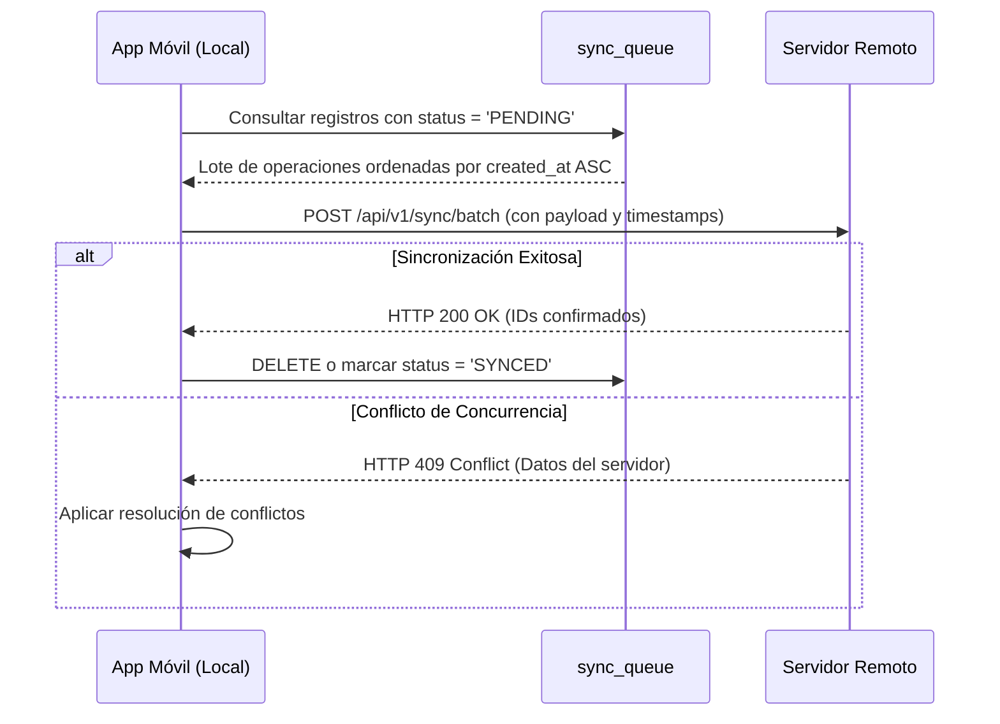

# FincaControl - Offline-First & Sincronización

Esta guía define las mejores prácticas y procedimientos técnicos para garantizar que la aplicación móvil opere al 100% sin conexión a internet en potreros y vaqueras, sincronizando datos de forma segura cuando se restablezca la conectividad.

---

## 1. Principios de la Arquitectura Offline-First

1. **Persistencia Local Primero:** Cualquier operación de creación, actualización o eliminación (CRUD) —incluyendo el alta de animales, eventos y la creación de **nuevas razas personalizadas** en el catálogo— se escribe y confirma inmediatamente en la base de datos local SQLite / almacenamiento local.
2. **Latencia Cero en Campo:** La interfaz de usuario no debe bloquearse esperando respuestas de red.
3. **Separación de Claves e Identificadores:**
   * **UUID Interno (`uuid`):** Clave primaria técnica universal para sincronización sin colisiones entre dispositivos.
   * **Número Identificador del Animal (`id_numero`):** Identificador numérico único dentro del rebaño activo (ej. `042`, `104`), utilizado para búsquedas en vaquera y como clave foránea de genealogía (`madre_numero`, `padre_numero`).
   * **Descripción del Hierro (`hierro`):** Atributo descriptivo de texto (iniciales, letras o figura) que certifica propietario y procedencia del animal en Venezuela.

---

## 2. Esquema Local Base y Cola de Sincronización (`sync_queue`)

Además de las tablas operativas, el esquema local persiste los atributos fisiológicos y el catálogo extensible de razas:

```sql
-- Catálogo extensible de razas bovinas (predeterminadas + creadas por el usuario)
CREATE TABLE catalogo_razas (
    id TEXT PRIMARY KEY,
    nombre TEXT NOT NULL UNIQUE,
    es_personalizada INTEGER NOT NULL DEFAULT 0,
    created_at INTEGER NOT NULL
);

-- Tabla principal de animales con distinción entre Número Identificador e Hierro
CREATE TABLE animales (
    uuid TEXT PRIMARY KEY,
    id_numero TEXT NOT NULL,              -- N° Identificador del animal (único en activos)
    hierro TEXT NOT NULL,                 -- Descripción del hierro (propietario/procedencia)
    nombre_alias TEXT NOT NULL,
    sexo TEXT NOT NULL,                   -- 'Hembra' | 'Macho'
    raza TEXT NOT NULL,                   -- Nombre de raza (FK lógica a catalogo_razas)
    proposito TEXT NOT NULL,
    condicion_fisiologica TEXT NOT NULL,  -- 'Becerro', 'Becerra', 'Maute', 'Mauta', 'Novillo', 'Novilla', 'Toro Reproductor', 'Vaca parida', 'Vaca escotera', 'Vaca seca'
    esta_prenada INTEGER NOT NULL DEFAULT 0, -- 1 = Sí, 0 = No (Solo aplica a Vacas y Novillas)
    madre_numero TEXT,                    -- Referencia al id_numero de la madre
    padre_numero TEXT,                    -- Referencia al id_numero del padre o semen
    peso_actual REAL,
    estado_actual TEXT NOT NULL DEFAULT 'Activo',
    updated_at INTEGER NOT NULL
);

-- Cola de sincronización
CREATE TABLE sync_queue (
    id TEXT PRIMARY KEY,               -- UUID de la operación en cola
    entity_name TEXT NOT NULL,         -- 'Animal', 'CatalogoRaza', 'RegistroOrdeno', 'EventoSanitario', etc.
    entity_id TEXT NOT NULL,           -- UUID del registro afectado
    operation_type TEXT NOT NULL,      -- 'INSERT', 'UPDATE', 'DELETE'
    payload_json TEXT NOT NULL,        -- Datos serializados de la entidad
    created_at INTEGER NOT NULL,       -- Timestamp UNIX en milisegundos (UTC)
    status TEXT NOT NULL DEFAULT 'PENDING', -- 'PENDING', 'SYNCING', 'FAILED', 'CONFLICT'
    retry_count INTEGER NOT NULL DEFAULT 0,
    last_error TEXT
);
```

---

## 3. Protocolo de Sincronización Delta

Cuando el listener de conectividad detecta red (WiFi o datos móviles):



---

## 4. Estrategia de Resolución de Conflictos

1. **Última Escritura Gana (Last-Write-Wins - LWW):** Basado en el campo `updated_at` (UTC) del registro.
2. **Catálogo de Razas (`CatalogoRaza`):** Unión aditiva sin pérdida (*Set Union* por nombre normalizado de raza), permitiendo que las razas registradas offline en cualquier dispositivo se integren al catálogo general de la finca.
3. **Eventos Inmutables (Append-Only):**
   * Los pesajes (`RegistroPesaje`) y los ordeños (`RegistroOrdeno`) son registros históricos inmutables.
4. **Control de Errores y Reintentos:**
   * Backoff exponencial: 1s, 2s, 4s, 8s hasta un máximo de 5 reintentos antes de alertar al usuario.

---

## 5. Checklist de Verificación para el Desarrollador
- [ ] ¿Todas las entidades utilizan UUID v4 como llave primaria de sincronización?
- [ ] ¿Se distingue claramente `id_numero` (identificador individual y clave de genealogía) de `hierro` (descripción de propiedad/procedencia)?
- [ ] ¿Las nuevas razas registradas por el usuario se persisten localmente para futuros registros offline?
- [ ] ¿Las consultas críticas tienen índices creados sobre `id_numero`, `condicion_fisiologica` y `hierro`?
- [ ] ¿Se maneja la encriptación de datos sensibles en el dispositivo (SQLCipher / Keystore)?
