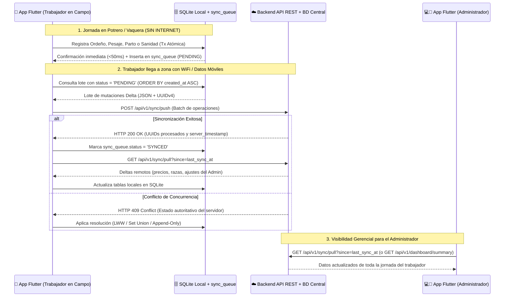

# FincaControl - Arquitectura Offline-First (Flutter + SQLite) & Sincronización Backend

Esta guía define la arquitectura técnica, el **modelo completo de base de datos relacional en SQLite**, la implementación en **Flutter** y el contrato de **API REST del Backend** para garantizar que **FincaControl** opere al 100% sin conexión a internet durante la jornada de trabajo en campo y sincronice automáticamente la información cuando el dispositivo recupere conectividad para que el **Administrador** pueda visualizarla y auditarla en tiempo real.

---

## 1. Flujo Operativo Offline-First: Jornada del Trabajador ➔ Backend ➔ Administrador

En una unidad de producción ganadera venezolana, los corrales, mangas de pesaje y vaqueras carecen con frecuencia de cobertura celular o WiFi. La arquitectura de **FincaControl** en **Flutter** resuelve este escenario mediante tres fases desacopladas:

1. **Fase A – Captura Local durante la Jornada de Trabajo (100% Offline en SQLite):**
   * El trabajador (`Rol: Operador` — vaquero, ordeñador o encargado de campo) abre la app **Flutter** en su dispositivo móvil Android/iOS.
   * Toda lectura y escritura (alta de animales, creación de razas, pesajes con cálculo de GDP, ordeños de mañana/tarde, tratamientos con tiempos de retiro, palpaciones y partos) se ejecuta directamente contra el motor **SQLite local (`sqflite` / `drift`)** con latencia inferior a `50 ms`.
   * Dentro de la misma transacción atómica de SQLite, cada operación `INSERT`, `UPDATE` o `DELETE` registra un evento en la tabla local `sync_queue` con estado `'PENDING'`, su carga útil en JSON (`payload_json`) y marca de tiempo UTC (`created_at`).
2. **Fase B – Detección de Red y Sincronización Automática (`Push & Pull Delta`):**
   * Cuando el trabajador regresa a una zona con cobertura (WiFi de la casa principal de la finca o red móvil 4G), el listener de red en Flutter (`connectivity_plus` / `workmanager` en segundo plano) activa el motor `SyncEngine`.
   * **Subida (`Push`):** La app agrupa los registros `PENDING` de `sync_queue` en orden cronológico (`ORDER BY created_at ASC`) y los envía en un lote transaccional al endpoint del Backend `POST /api/v1/sync/push`.
   * **Descarga (`Pull`):** Una vez confirmado el lote (`HTTP 200 OK`), la app marca los elementos como `SYNCED` y consulta `GET /api/v1/sync/pull?since=<last_sync_timestamp>` para descargar cualquier configuración, precio o registro creado desde otros dispositivos.
3. **Fase C – Consolidación y Visibilidad para el Administrador:**
   * El **Backend** (servidor cloud con base de datos relacional central PostgreSQL/MySQL) persiste los lotes recibidos de los trabajadores.
   * El **Administrador** (propietario o gerente), desde su teléfono móvil o tablet con conexión a internet, ejecuta el `Pull` automático al abrir la app (o recibe notificación), visualizando al instante el censo actualizado, los litros disponibles en el tanque de leche, los pesajes de ceba, las alertas de retiro sanitario y el flujo de caja consolidado.



---

## 2. Stack Tecnológico Recomendado en Flutter

* **Framework UI & Lógica:** Flutter (Dart 3+), arquitectura limpia en capas (*UI / Presentation ➔ Domain / UseCases ➔ Data / Repositories*).
* **Base de Datos Local (Offline):** Paquete `sqflite` (o `drift` para tipado reactivo con `Streams` SQL sobre SQLite).
* **Generación de Claves Primarias:** Paquete `uuid` (`UUID v4`) generado en cliente para evitar colisiones de claves entre múltiples teléfonos operando sin conexión.
* **Detección de Conectividad y Background Sync:** `connectivity_plus` (detección de red en vivo) + `workmanager` (tareas periódicas en segundo plano en Android/iOS).
* **Seguridad Local:** `flutter_secure_storage` para guardar el token JWT de sesión con expiración extendida y hash de PIN local para validación de roles (`ADMIN` vs `OPERADOR`) en modo offline.

---

## 3. Modelo Completo de Base de Datos Relacional (DDL SQLite Local y Espejo en Backend)

El esquema relacional consta de **12 tablas** que soportan íntegramente los 4 procesos principales y los módulos transversales:

```sql
PRAGMA foreign_keys = ON;

-- ============================================================================
-- 1. CONFIGURACIÓN DEL SISTEMA Y PARÁMETROS DE LA FINCA (PROCESO 1)
-- ============================================================================
CREATE TABLE configuracion_finca (
    id INTEGER PRIMARY KEY CHECK (id = 1),
    uuid TEXT NOT NULL UNIQUE,
    nombre_finca TEXT NOT NULL DEFAULT 'Hda. La Esperanza',
    hierro_oficial TEXT NOT NULL DEFAULT 'Hda. La Esperanza (Iniciales HE)',
    proposito_finca TEXT NOT NULL DEFAULT 'Doble Propósito',
    ubicacion TEXT NOT NULL DEFAULT 'Rosario de Perijá, Edo. Zulia',
    capacidad_tanque_litros REAL NOT NULL DEFAULT 2000.0,
    leche_disponible_tanque REAL NOT NULL DEFAULT 0.0,
    precio_ref_leche_usd REAL NOT NULL DEFAULT 0.45,
    precio_ref_carne_kg_usd REAL NOT NULL DEFAULT 1.85,
    meta_gdp_kg_dia REAL NOT NULL DEFAULT 0.70,
    dias_gestacion_promedio INTEGER NOT NULL DEFAULT 283,
    dias_previos_secado INTEGER NOT NULL DEFAULT 60,
    updated_at INTEGER NOT NULL
);

-- ============================================================================
-- 2. USUARIOS Y CONTROL DE ACCESO BASADO EN ROLES - RBAC (MÓDULO 1)
-- ============================================================================
CREATE TABLE usuarios (
    uuid TEXT PRIMARY KEY,
    nombre_completo TEXT NOT NULL,
    correo_o_usuario TEXT NOT NULL UNIQUE,
    password_hash TEXT NOT NULL,
    rol TEXT NOT NULL CHECK (rol IN ('ADMIN', 'OPERADOR')),
    estado_activo INTEGER NOT NULL DEFAULT 1,
    updated_at INTEGER NOT NULL
);

-- ============================================================================
-- 3. CATÁLOGO EXTENSIBLE Y PERSISTENTE DE RAZAS BOVINAS (PROCESO 1 Y 2)
-- ============================================================================
CREATE TABLE catalogo_razas (
    uuid TEXT PRIMARY KEY,
    nombre TEXT NOT NULL UNIQUE COLLATE NOCASE,
    es_personalizada INTEGER NOT NULL DEFAULT 0, -- 0 = Semilla, 1 = Creada por usuario
    created_at INTEGER NOT NULL,
    updated_at INTEGER NOT NULL
);

-- ============================================================================
-- 4. CENSO E INVENTARIO DE ANIMALES (PROCESO 2)
-- Distinción estricta: id_numero (N° Identificador único en activos) vs hierro (Propietario)
-- ============================================================================
CREATE TABLE animales (
    uuid TEXT PRIMARY KEY,
    id_numero TEXT NOT NULL,                 -- N° Identificador del animal (ej. '042', '104', '201')
    hierro TEXT NOT NULL,                    -- Descripción del hierro (iniciales o figura de propiedad)
    nombre_alias TEXT NOT NULL,
    sexo TEXT NOT NULL CHECK (sexo IN ('Hembra', 'Macho')),
    raza TEXT NOT NULL,                      -- Referencia al nombre en catalogo_razas
    proposito TEXT NOT NULL,                 -- 'Doble Propósito', 'Leche', 'Carne / Ceba'
    condicion_fisiologica TEXT NOT NULL,     -- 'Becerro', 'Becerra', 'Maute', 'Mauta', 'Novillo / Torete', 'Novilla de vientre', 'Toro Reproductor', 'Vaca parida (Primípara)', 'Vaca parida (Multípara)', 'Vaca escotera', 'Vaca seca'
    esta_prenada TEXT NOT NULL DEFAULT 'No aplica' CHECK (esta_prenada IN ('Sí', 'No', 'No aplica')),
    peso_actual_kg REAL NOT NULL,
    madre_numero TEXT,                       -- Referencia al id_numero de la madre (nunca al hierro)
    padre_numero TEXT,                       -- Referencia al id_numero del padre o código de semen
    estado_actual TEXT NOT NULL DEFAULT 'Activo' CHECK (estado_actual IN ('Activo', 'Vendido_Canal', 'Muerto', 'Descarte')),
    created_at INTEGER NOT NULL,
    updated_at INTEGER NOT NULL,
    is_deleted INTEGER NOT NULL DEFAULT 0
);

-- Índice único parcial: Un N° Identificador no puede repetirse en animales activos,
-- pero queda LIBERADO automáticamente cuando estado_actual pasa a 'Vendido_Canal'.
CREATE UNIQUE INDEX idx_animales_id_numero_activo
ON animales(id_numero) WHERE estado_actual = 'Activo' AND is_deleted = 0;

CREATE INDEX idx_animales_condicion ON animales(condicion_fisiologica);
CREATE INDEX idx_animales_prenada ON animales(esta_prenada);
CREATE INDEX idx_animales_madre ON animales(madre_numero);

-- ============================================================================
-- 5. REGISTROS DE PESAJE Y CÁLCULO DE GDP (PROCESO 3 - PRODUCCIÓN CARNE)
-- ============================================================================
CREATE TABLE registros_pesaje (
    uuid TEXT PRIMARY KEY,
    animal_uuid TEXT NOT NULL,
    animal_numero TEXT NOT NULL,             -- N° Identificador del ejemplar pesado
    fecha_pesaje TEXT NOT NULL,              -- Formato ISO YYYY-MM-DD
    peso_previo_kg REAL NOT NULL,
    peso_actual_kg REAL NOT NULL,
    dias_transcurridos INTEGER NOT NULL DEFAULT 30,
    gdp_calculada REAL NOT NULL,             -- (peso_actual_kg - peso_previo_kg) / dias_transcurridos
    calificacion_desempeno TEXT NOT NULL,    -- 'Óptimo', 'Normal', 'Alerta'
    usuario_uuid TEXT,
    created_at INTEGER NOT NULL,
    FOREIGN KEY (animal_uuid) REFERENCES animales(uuid)
);

-- ============================================================================
-- 6. HISTORIAL DE BENEFICIO EN CANAL Y LIBERACIÓN DE N° ID (PROCESO 3)
-- ============================================================================
CREATE TABLE ventas_canal (
    uuid TEXT PRIMARY KEY,
    animal_uuid TEXT NOT NULL,
    numero_liberado TEXT NOT NULL,           -- N° Identificador que queda libre para nuevas crías
    hierro TEXT NOT NULL,
    nombre_animal TEXT NOT NULL,
    condicion_fisiologica TEXT NOT NULL,
    raza TEXT NOT NULL,
    peso_vivo_kg REAL NOT NULL,
    precio_kg_usd REAL NOT NULL,
    monto_total_usd REAL NOT NULL,           -- peso_vivo_kg * precio_kg_usd
    comprador_destino TEXT NOT NULL,
    fecha_venta TEXT NOT NULL,
    transaccion_uuid TEXT,                   -- Vínculo con el ingreso en transacciones_financieras
    usuario_uuid TEXT,
    created_at INTEGER NOT NULL,
    FOREIGN KEY (animal_uuid) REFERENCES animales(uuid)
);

-- ============================================================================
-- 7. REGISTROS DE ORDEÑO DIARIO E INOCUIDAD (PROCESO 4 - PRODUCCIÓN LECHE)
-- ============================================================================
CREATE TABLE registros_ordeno (
    uuid TEXT PRIMARY KEY,
    animal_uuid TEXT NOT NULL,
    animal_numero TEXT NOT NULL,             -- N° Identificador de la vaca parida
    fecha_ordeno TEXT NOT NULL,              -- YYYY-MM-DD
    hora_ordeno TEXT NOT NULL,               -- HH:MM
    jornada TEXT NOT NULL CHECK (jornada IN ('Mañana', 'Tarde')),
    litros_medidos REAL NOT NULL,
    es_descarte_retiro INTEGER NOT NULL DEFAULT 0, -- 1 = Leche a descarte (En retiro), 0 = Suma al tanque
    usuario_uuid TEXT,
    created_at INTEGER NOT NULL,
    FOREIGN KEY (animal_uuid) REFERENCES animales(uuid)
);

-- ============================================================================
-- 8. DESPACHOS Y VENTAS COMERCIALES DE LECHE DESDE EL TANQUE (PROCESO 4)
-- ============================================================================
CREATE TABLE ventas_leche (
    uuid TEXT PRIMARY KEY,
    fecha_despacho TEXT NOT NULL,
    litros_despachados REAL NOT NULL,
    precio_litro_usd REAL NOT NULL,
    monto_total_usd REAL NOT NULL,           -- litros_despachados * precio_litro_usd
    comprador_destino TEXT NOT NULL,
    transaccion_uuid TEXT,
    usuario_uuid TEXT,
    created_at INTEGER NOT NULL
);

-- ============================================================================
-- 9. EVENTOS SANITARIOS Y TIEMPOS DE RETIRO EN LECHE Y CARNE (SANIDAD)
-- ============================================================================
CREATE TABLE eventos_sanitarios (
    uuid TEXT PRIMARY KEY,
    animal_uuid TEXT NOT NULL,
    animal_numero TEXT NOT NULL,
    tipo_evento TEXT NOT NULL,               -- 'Tratamiento Antibiótico', 'Desparasitación', 'Vacunación Oficial (INSAI)', 'Vitaminización'
    producto_aplicado TEXT NOT NULL,
    dias_retiro_leche INTEGER NOT NULL DEFAULT 0,
    dias_retiro_carne INTEGER NOT NULL DEFAULT 0,
    fecha_aplicacion TEXT NOT NULL,          -- YYYY-MM-DD
    fecha_liberacion_leche TEXT NOT NULL,    -- fecha_aplicacion + dias_retiro_leche
    fecha_liberacion_carne TEXT NOT NULL,    -- fecha_aplicacion + dias_retiro_carne
    cuarentena_activa INTEGER NOT NULL DEFAULT 1,
    usuario_uuid TEXT,
    created_at INTEGER NOT NULL,
    updated_at INTEGER NOT NULL,
    FOREIGN KEY (animal_uuid) REFERENCES animales(uuid)
);

-- ============================================================================
-- 10. EVENTOS REPRODUCTIVOS, PREÑEZ, SECADO Y PARTOS (REPRODUCCIÓN / PROCESO 4)
-- ============================================================================
CREATE TABLE eventos_reproductivos (
    uuid TEXT PRIMARY KEY,
    hembra_uuid TEXT NOT NULL,
    hembra_numero TEXT NOT NULL,             -- N° Identificador de la vaca o novilla
    tipo_evento TEXT NOT NULL,               -- 'Celo', 'Inseminación / Monta', 'Diagnóstico Preñez', 'Secado', 'Parto', 'Aborto'
    macho_numero_o_semen TEXT,               -- N° Identificador del Toro Reproductor o pajuela
    fecha_evento TEXT NOT NULL,
    resultado_diagnostico TEXT NOT NULL,     -- 'Preñada Confirmada', 'Vacía', 'Preñada Escotera', 'Parto Exitoso', etc.
    cria_uuid TEXT,                          -- UUID del becerro/a dado de alta automáticamente si tipo_evento = 'Parto'
    cria_numero TEXT,                        -- N° Identificador asignado al becerro/a nacido
    impacto_fisiologico TEXT,
    usuario_uuid TEXT,
    created_at INTEGER NOT NULL,
    FOREIGN KEY (hembra_uuid) REFERENCES animales(uuid)
);

-- ============================================================================
-- 11. TRANSACCIONES FINANCIERAS Y COSTOS DIRECTOS (MÓDULO FINANCIERO)
-- ============================================================================
CREATE TABLE transacciones_financieras (
    uuid TEXT PRIMARY KEY,
    codigo_trx TEXT NOT NULL,                -- Ej. 'TRX-1042'
    tipo TEXT NOT NULL CHECK (tipo IN ('Ingreso', 'Egreso')),
    categoria TEXT NOT NULL,                 -- 'Venta de Leche', 'Venta de Ganado / Canal', 'Alimentación / Sal', 'Sanidad / Medicinas', 'Mano de Obra / Jornales', etc.
    monto_usd REAL NOT NULL,
    fecha TEXT NOT NULL,
    concepto TEXT NOT NULL,
    usuario_nombre TEXT NOT NULL,
    created_at INTEGER NOT NULL
);

-- ============================================================================
-- 12. COLA DE SINCRONIZACIÓN DELTA (MOTOR OFFLINE-FIRST)
-- ============================================================================
CREATE TABLE sync_queue (
    id TEXT PRIMARY KEY,                     -- UUID de la operación en cola
    entity_table TEXT NOT NULL,              -- Nombre de la tabla ('animales', 'registros_ordeno', etc.)
    entity_uuid TEXT NOT NULL,               -- UUID del registro afectado
    operation_type TEXT NOT NULL CHECK (operation_type IN ('INSERT', 'UPDATE', 'DELETE')),
    payload_json TEXT NOT NULL,              -- Registro completo serializado en JSON
    device_id TEXT NOT NULL,                 -- Identificador del móvil del trabajador
    usuario_uuid TEXT,                       -- Trabajador que originó el dato en campo
    created_at INTEGER NOT NULL,             -- Timestamp UNIX en milisegundos (UTC)
    status TEXT NOT NULL DEFAULT 'PENDING' CHECK (status IN ('PENDING', 'SYNCING', 'SYNCED', 'FAILED', 'CONFLICT')),
    retry_count INTEGER NOT NULL DEFAULT 0,
    last_error TEXT
);

CREATE INDEX idx_sync_queue_status_created ON sync_queue(status, created_at ASC);
```

---

## 4. Arquitectura del Backend y Especificación de Endpoints (API REST)

El Backend actúa como fuente de verdad centralizada en la nube para consolidar los datos enviados por los dispositivos móviles de los trabajadores y servirlos al **Administrador**.

* **Plataforma Backend (a definir para despliegue):** API RESTful (Node.js/NestJS, Python/FastAPI o Supabase) conectada a una base de datos relacional **PostgreSQL** con esquema idéntico al de SQLite.
* **Autenticación:** JWT (*JSON Web Tokens*) con *Refresh Token* de larga duración para permitir operación prolongada en zonas rurales.

### Catálogo de Endpoints REST (`/api/v1`)

| Método | Endpoint | Propósito y Uso en el Flujo Offline-First | Rol Permitido |
| :---: | :--- | :--- | :---: |
| `POST` | `/api/v1/auth/login` | Autentica al usuario, descarga su perfil RBAC (`ADMIN` / `OPERADOR`) y semilla inicial. | Todos |
| `POST` | `/api/v1/sync/push` | **Endpoint Crítico del Trabajador:** Recibe un lote (`batch`) de operaciones pendientes desde `sync_queue` cuando el móvil recupera internet y las aplica transaccionalmente en la BD central. | `OPERADOR`, `ADMIN` |
| `GET` | `/api/v1/sync/pull` | **Endpoint Crítico del Administrador y Trabajadores:** Devuelve todos los registros creados o modificados en el servidor desde `?since=<timestamp_utc>` para actualizar el SQLite local. | `OPERADOR`, `ADMIN` |
| `GET` / `PUT` | `/api/v1/config` | Consulta o actualiza los parámetros maestros de la finca y su Hierro Oficial. | `ADMIN` (PUT) |
| `GET` / `POST` | `/api/v1/breeds` | Lista o añade nuevas razas personalizadas al catálogo maestro de la finca (*Set Union*). | `OPERADOR`, `ADMIN` |
| `GET` / `POST` | `/api/v1/animals` | Consulta el censo activo o registra nuevas altas de bovinos con `id_numero` e `hierro`. | `OPERADOR`, `ADMIN` |
| `POST` | `/api/v1/animals/:uuid/canal-sale` | Registra la liquidación en canal, desincorpora la res, libera su `id_numero` y crea el ingreso financiero. | `ADMIN` |
| `GET` / `POST` | `/api/v1/weighings` | Consulta o registra pesajes periódicos en báscula con su cálculo de `GDP`. | `OPERADOR`, `ADMIN` |
| `GET` / `POST` | `/api/v1/milkings` | Consulta o registra ordeños diarios (Mañana/Tarde) actualizando el tanque o el descarte sanitario. | `OPERADOR`, `ADMIN` |
| `POST` | `/api/v1/milk-sales` | Registra despachos/ventas comerciales de leche descontando del tanque y sumando a caja. | `ADMIN` |
| `GET` / `POST` | `/api/v1/health-events` | Registra tratamientos veterinarios y consulta animales con tiempos de retiro activos. | `OPERADOR`, `ADMIN` |
| `GET` / `POST` | `/api/v1/reproduction-events` | Registra celos, montas, diagnósticos de preñez, secados y partos (con alta automática de cría). | `OPERADOR`, `ADMIN` |
| `GET` / `POST` | `/api/v1/finance/transactions` | Consulta el libro de caja, asientos manuales/automáticos y métricas de costo por litro (`$/L`). | `ADMIN` |

---

## 5. Estrategia de Resolución de Conflictos

1. **Eventos Operativos de Jornada (`registros_ordeno`, `registros_pesaje`, `eventos_sanitarios`, `transacciones_financieras`):**
   * **Estrategia *Append-Only* (Adición Inmutable por `UUID v4`):** Cada pesaje u ordeño registrado por el trabajador durante su jornada tiene su propio `uuid` único. Al sincronizar con el Backend, nunca sobrescribe los registros de otros trabajadores, sino que se agrega al historial y recalcula el saldo del tanque o el `peso_actual_kg` del animal según el registro de fecha/hora más reciente.
2. **Fichas Maestras (`animales`, `configuracion_finca`):**
   * **Última Escritura Gana (*Last-Write-Wins - LWW*):** Basado en el timestamp `updated_at` (UTC).
3. **Catálogo de Razas (`catalogo_razas`):**
   * **Unión Aditiva sin Pérdida (*Set Union*):** Cualquier raza personalizada creada offline por un trabajador se fusiona por nombre normalizado sin borrar las razas creadas por otros usuarios.
4. **Validación de Unicidad de `id_numero` en Sincronización:**
   * Si dos trabajadores sin conexión asignaron por error el mismo `id_numero` a dos becerros distintos el mismo día, el Backend acepta el primero y marca el segundo con estado `CONFLICT` en la respuesta del `push`, solicitando al Administrador reasignar el número de la segunda cría sin perder su ficha ni su vínculo materno (`madre_numero`).

---

## 6. Checklist de Verificación para el Desarrollador Flutter

- [ ] ¿Todas las tablas de SQLite usan `uuid` (`UUID v4`) como llave primaria técnica y `id_numero` como identificador de negocio del animal?
- [ ] ¿El índice único parcial `idx_animales_id_numero_activo` permite reutilizar un `id_numero` cuando el animal anterior pasa a `estado_actual = 'Vendido_Canal'`?
- [ ] ¿Cada escritura en SQLite inserta atómicamente su evento correspondiente en `sync_queue` dentro de un bloque `db.transaction((txn) async { ... })`?
- [ ] ¿El servicio de sincronización en Flutter envía automáticamente la cola `PENDING` a `POST /api/v1/sync/push` al recuperar internet y permite al Administrador ver los datos mediante `GET /api/v1/sync/pull`?
