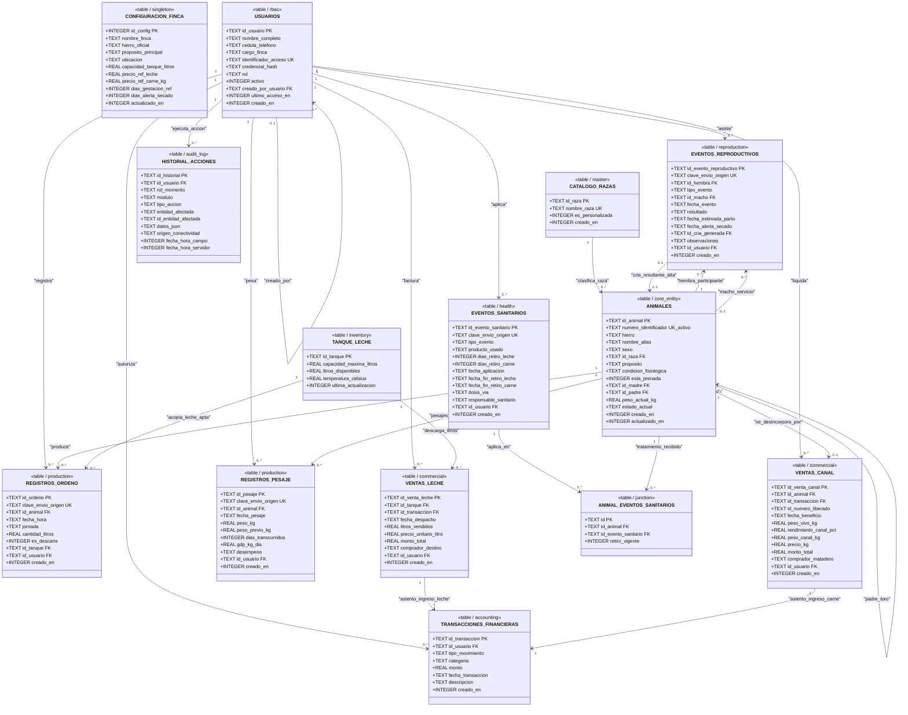

# 🏛️ Diagrama UML y Guía de Tablas: Base de Datos Central Online (SQLite Cloud)
> **Sistema Integral de Gestión Ganadera para Fincas de Doble Propósito (Leche y Carne)**  
> **Equipo de Desarrollo:** Johan Maldonado – José Chacón  
> **Infraestructura Cloud:** SQLite Cloud (Cluster Online Centralizado • *Single Source of Truth*)  
> **Modo Operativo:** 100% Online (Servidor Central) con sincronización desde Terminales de Campo

---

## 1. 🌐 Contexto Arquitectónico: SQLite Cloud como Servidor Central Online

En la arquitectura de **FincaControl**, la base de datos en **SQLite Cloud** actúa como la **Fuente Única de Verdad (*Single Source of Truth*)** alojada en la nube y accesible de forma exclusiva a través de conexiones seguras (TLS/WebSocket y API REST `/api/v1`):

1. **Desacoplamiento Estricto con la Aplicación Móvil:**
   * La base de datos central en **SQLite Cloud** contiene las **14 tablas relacionales completas** del sistema (incluyendo usuarios con roles `RBAC`, catálogo de razas, inventario histórico completo, stock de tanque, contabilidad financiera e `HISTORIAL_ACCIONES` inmutable).
   * Los dispositivos móviles de los trabajadores en campo **no clonan ni replican esta base de datos completa**, sino que operan contra una base de datos local embebida ultra-ligera de solo 3 tablas (`cache_padron_activo`, `cache_referencia_resumen` y `cola_envios_campo`), garantizando velocidad y seguridad.
2. **Paridad Nativa de Motor y Sintaxis:**
   * Al ser SQLite tanto en el cliente local como en la nube (SQLite Cloud), existe paridad absoluta en dialecto SQL, tipos de datos primitivos (`INTEGER`, `REAL`, `TEXT`, `BLOB`), funciones de fecha y soporte para índices condicionales como `CREATE UNIQUE INDEX ... WHERE estado_actual = 'Activo'`.
3. **Idempotencia y Trazabilidad:**
   * Cada tabla transaccional generada en campo cuenta con la restricción `clave_envio_origen UNIQUE` (UUID generado en el teléfono) para evitar inserciones duplicadas ante reintentos de red durante la sincronización hacia SQLite Cloud.

---

## 2. 📊 Diagrama UML de la Base de Datos (Class Diagram - Data Profile)

El siguiente diagrama UML modela la totalidad de las tablas relacionales como entidades estructuradas, detallando atributos, tipos nativos de SQLite, llaves primarias (`PK`), llaves foráneas (`FK`), unicidad (`UK`) y cardinalidades entre tablas:



---

## 3. 📖 Guía Detallada de Tablas (Data Dictionary en SQLite Cloud)

A continuación se detalla la especificación formal de cada tabla para su implementación directa en el clúster de **SQLite Cloud**:

### 3.1. Tabla: `CONFIGURACION_FINCA` (Parámetros del Hato)
* **Propósito:** Almacena la identidad legal de la finca y los valores de calibración zootécnica y comercial. Registro único (`id_config = 1`).
* **Columnas:**
  | Columna | Tipo SQLite | Restricción | Descripción |
  | :--- | :--- | :--- | :--- |
  | `id_config` | `INTEGER` | `PK`, `CHECK (id_config = 1)` | Registro singleton fijo. |
  | `nombre_finca` | `TEXT` | `NOT NULL` | Razón social o nombre del hato (Ej. *"Hacienda La Esperanza"*). |
  | `hierro_oficial` | `TEXT` | `NOT NULL` | Descripción oficial de la marca de hierro registrada del propietario. |
  | `proposito_principal` | `TEXT` | `CHECK IN ('Doble Propósito', 'Leche', 'Carne')` | Sistema de producción. |
  | `ubicacion` | `TEXT` | `NULLABLE` | Estado, municipio o sector rural. |
  | `capacidad_tanque_litros`| `REAL` | `NOT NULL DEFAULT 2000.0` | Capacidad máxima física del tanque de enfriamiento. |
  | `precio_ref_leche` | `REAL` | `NOT NULL DEFAULT 0.45` | Precio referencial del litro de leche ($\text{\$/L}$). |
  | `precio_ref_carne_kg` | `REAL` | `NOT NULL DEFAULT 1.85` | Precio referencial del kilo en pie ($\text{\$/Kg}$). |
  | `dias_gestacion_ref` | `INTEGER` | `NOT NULL DEFAULT 283` | Duración zootécnica de gestación bovina (días). |
  | `dias_alerta_secado` | `INTEGER` | `NOT NULL DEFAULT 60` | Días de anticipación al parto para secar la vaca. |
  | `actualizado_en` | `INTEGER` | `NOT NULL` | Timestamp UNIX (milisegundos) de última modificación. |

---

### 3.2. Tabla: `USUARIOS` (Control de Acceso RBAC y Gestión de Personal)
* **Propósito:** Gestiona las credenciales y perfiles del personal de la finca. Respalda la historia de usuario **`HU-21`**.
* **Regla Crítica:** **Prohibición de Borrado Físico (`DELETE`).** Cuando un trabajador deja la finca, el Administrador establece `activo = 0` (suspensión lógica), revocando el acceso pero preservando el $100\%$ de la trazabilidad en auditoría y producción.
* **Columnas:**
  | Columna | Tipo SQLite | Restricción | Descripción |
  | :--- | :--- | :--- | :--- |
  | `id_usuario` | `TEXT` | `PK` | Identificador universal (UUID v4). |
  | `nombre_completo` | `TEXT` | `NOT NULL` | Nombre del trabajador o administrador. |
  | `cedula_telefono` | `TEXT` | `NULLABLE` | Documento de identidad o teléfono de contacto. |
  | `cargo_finca` | `TEXT` | `NOT NULL` | Cargo (*Mayordomo, Ordeñador, Vaquero, etc.*). |
  | `identificador_acceso` | `TEXT` | `NOT NULL UNIQUE` | Usuario de login (ej. `admin.johan`, `pedro.ordeno`). |
  | `credencial_hash` | `TEXT` | `NOT NULL` | Hash seguro (BCrypt/Argon2) del PIN o contraseña. |
  | `rol` | `TEXT` | `CHECK IN ('ADMINISTRADOR', 'OPERADOR')` | Nivel de permisos según la **Propuesta A**. |
  | `activo` | `INTEGER` | `NOT NULL DEFAULT 1 CHECK (activo IN (0, 1))` | `1` = Acceso habilitado, `0` = Cuenta suspendida. |
  | `creado_por_usuario` | `TEXT` | `FK -> USUARIOS.id_usuario NULLABLE` | Administrador que dio de alta la cuenta. |
  | `ultimo_acceso_en` | `INTEGER` | `NULLABLE` | Timestamp UNIX del último login o sincronización. |
  | `creado_en` | `INTEGER` | `NOT NULL` | Timestamp UNIX de alta. |

---

### 3.3. Tabla: `CATALOGO_RAZAS` (Catálogo Maestro Extensible)
* **Propósito:** Catálogo oficial de razas y cruces locales, administrado 100% en línea por el Administrador.
* **Columnas:**
  | Columna | Tipo SQLite | Restricción | Descripción |
  | :--- | :--- | :--- | :--- |
  | `id_raza` | `TEXT` | `PK` | Slug identificador (ej. `carora`, `gyr-mestizo`). |
  | `nombre_raza` | `TEXT` | `NOT NULL UNIQUE` | Denominación zootécnica de la raza o mestizaje. |
  | `es_personalizada` | `INTEGER` | `DEFAULT 0 CHECK (es_personalizada IN (0, 1))`| `0` = Predeterminada del sistema, `1` = Creada en finca. |
  | `creado_en` | `INTEGER` | `NOT NULL` | Timestamp UNIX de creación. |

---

### 3.4. Tabla: `ANIMALES` (Censo Central del Rebaño)
* **Propósito:** Registro maestro de cada individuo del hato. Soporta genealogía autorreferenciada y la regla de liberación de números identificadores.
* **Regla de Negocio:** Separación estricta entre `numero_identificador` (chapa visible) y `hierro` (marca del propietario).
* **Índice Condicional de Aretes:**  
  `CREATE UNIQUE INDEX uq_numero_id_activo ON ANIMALES(numero_identificador) WHERE estado_actual = 'Activo';`
* **Columnas:**
  | Columna | Tipo SQLite | Restricción | Descripción |
  | :--- | :--- | :--- | :--- |
  | `id_animal` | `TEXT` | `PK` | UUID v4 interno único universal. |
  | `numero_identificador`| `TEXT` | `NOT NULL` | Número visible en oreja/arete. Único solo entre activos. |
  | `hierro` | `TEXT` | `NOT NULL` | Descripción de la marca legal de hierro del animal. |
  | `nombre_alias` | `TEXT` | `NOT NULL` | Nombre o alias común (ej. *"Mariposa"*, *"Canela"*). |
  | `sexo` | `TEXT` | `CHECK IN ('Hembra', 'Macho')` | Sexo zootécnico. |
  | `id_raza` | `TEXT` | `FK -> CATALOGO_RAZAS.id_raza` | Raza del animal. |
  | `proposito` | `TEXT` | `CHECK IN ('Doble Propósito', 'Leche', 'Carne / Ceba')` | Destino productivo. |
  | `condicion_fisiologica`| `TEXT` | `CHECK IN (...)` | Becerro, Becerra, Maute, Mauta, Novillo, Novilla, Toro, Vaca parida, Vaca escotera, Vaca seca. |
  | `esta_prenada` | `INTEGER` | `DEFAULT 0 CHECK (esta_prenada IN (0, 1))` | Solo permitido en hembras adultas (vacas y novillas). |
  | `id_madre` | `TEXT` | `FK -> ANIMALES.id_animal NULLABLE` | Referencia reflexiva a la madre biológica. |
  | `id_padre` | `TEXT` | `FK -> ANIMALES.id_animal NULLABLE` | Referencia reflexiva al toro o código de pajuela. |
  | `peso_actual_kg` | `REAL` | `NOT NULL` | Último peso registrado en báscula. |
  | `estado_actual` | `TEXT` | `CHECK IN ('Activo', 'Desincorporado / Canal', 'Muerto', 'Vendido Vivo')` | Estado actual en la explotación ganadera. |
  | `creado_en` | `INTEGER` | `NOT NULL` | Timestamp UNIX de alta. |
  | `actualizado_en` | `INTEGER` | `NOT NULL` | Timestamp UNIX de última modificación. |

---

### 3.5. Tabla: `TANQUE_LECHE` (Control de Inventario de Leche Comercial)
* **Propósito:** Mantiene el saldo disponible acumulado de leche fría apta para venta comercial.
* **Columnas:**
  | Columna | Tipo SQLite | Restricción | Descripción |
  | :--- | :--- | :--- | :--- |
  | `id_tanque` | `TEXT` | `PK` | UUID v4 o código del tanque (ej. `tanque-01`). |
  | `capacidad_maxima_litros`| `REAL` | `NOT NULL` | Volumen límite físico del tanque. |
  | `litros_disponibles` | `REAL` | `NOT NULL DEFAULT 0.0` | **Stock disponible en tiempo real**. Aumenta con ordeño apto, disminuye con ventas. |
  | `temperatura_celsius` | `REAL` | `DEFAULT 4.0` | Temperatura de conservación. |
  | `ultima_actualizacion` | `INTEGER` | `NOT NULL` | Timestamp UNIX de último movimiento. |

---

### 3.6. Tabla: `REGISTROS_ORDENO` (Producción Diaria de Leche)
* **Propósito:** Registro individual de ordeño. Discrimina automáticamente la leche apta para tanque comercial respecto de la leche con residuos sanitarios (descarte).
* **Columnas:**
  | Columna | Tipo SQLite | Restricción | Descripción |
  | :--- | :--- | :--- | :--- |
  | `id_ordeno` | `TEXT` | `PK` | UUID v4 de la operación. |
  | `clave_envio_origen` | `TEXT` | `NOT NULL UNIQUE` | Clave de idempotencia generada en el móvil offline. |
  | `id_animal` | `TEXT` | `FK -> ANIMALES.id_animal` | Vaca ordeñada. |
  | `fecha_hora` | `TEXT` | `NOT NULL` | Fecha y hora del pesaje de leche. |
  | `jornada` | `TEXT` | `CHECK IN ('Mañana', 'Tarde')`| Turno del ordeño. |
  | `cantidad_litros` | `REAL` | `NOT NULL CHECK (cantidad_litros > 0)` | Volumen producido (litros). |
  | `es_descarte` | `INTEGER` | `DEFAULT 0 CHECK (es_descarte IN (0, 1))` | `1` = Leche no comercial por retiro médico activo; `0` = Apta para tanque. |
  | `id_tanque` | `TEXT` | `FK -> TANQUE_LECHE.id_tanque NULLABLE` | Tanque al que se sumaron los litros aptos. |
  | `id_usuario` | `TEXT` | `FK -> USUARIOS.id_usuario` | Trabajador u operador que ejecutó el ordeño. |
  | `creado_en` | `INTEGER` | `NOT NULL` | Timestamp UNIX de inserción en el servidor. |

---

### 3.7. Tabla: `VENTAS_LECHE` (Despacho Comercial de Leche)
* **Propósito:** Registro comercial 100% Online de descarga y venta de leche fría desde el tanque hacia el comprador/planta.
* **Columnas:**
  | Columna | Tipo SQLite | Restricción | Descripción |
  | :--- | :--- | :--- | :--- |
  | `id_venta_leche` | `TEXT` | `PK` | UUID v4 de la venta. |
  | `id_tanque` | `TEXT` | `FK -> TANQUE_LECHE.id_tanque` | Tanque de origen del que se restan los litros. |
  | `id_transaccion` | `TEXT` | `FK -> TRANSACCIONES_FINANCIERAS.id_transaccion UNIQUE` | Asiento contable de ingreso automático. |
  | `fecha_despacho` | `TEXT` | `NOT NULL` | Fecha de entrega del camión cisterna. |
  | `litros_vendidos` | `REAL` | `NOT NULL CHECK (litros_vendidos > 0)` | Litros descargados del stock del tanque. |
  | `precio_unitario_litro`| `REAL` | `NOT NULL CHECK (precio_unitario_litro > 0)` | Precio acordado por litro ($\text{\$/L}$). |
  | `monto_total` | `REAL` | `NOT NULL CHECK (monto_total > 0)` | Liquidación total ($\text{Litros} \times \text{Precio}$). |
  | `comprador_destino` | `TEXT` | `NOT NULL` | Nombre de la receptoría, quesera o planta láctea. |
  | `id_usuario` | `TEXT` | `FK -> USUARIOS.id_usuario` | Administrador que autorizó la venta. |
  | `creado_en` | `INTEGER` | `NOT NULL` | Timestamp UNIX de la transacción. |

---

### 3.8. Tabla: `REGISTROS_PESAJE` (Control Ponderal y Ganancia Diaria de Peso - GDP)
* **Propósito:** Registra pesajes individuales en báscula/manga y calcula de forma estandarizada la Ganancia Diaria de Peso (`GDP`).
* **Columnas:**
  | Columna | Tipo SQLite | Restricción | Descripción |
  | :--- | :--- | :--- | :--- |
  | `id_pesaje` | `TEXT` | `PK` | UUID v4 del pesaje. |
  | `clave_envio_origen` | `TEXT` | `NOT NULL UNIQUE` | Clave de idempotencia del móvil. |
  | `id_animal` | `TEXT` | `FK -> ANIMALES.id_animal` | Bovino pesado. |
  | `fecha_pesaje` | `TEXT` | `NOT NULL` | Fecha de pesaje en báscula. |
  | `peso_kg` | `REAL` | `NOT NULL CHECK (peso_kg > 0)` | Peso medido actual. |
  | `peso_previo_kg` | `REAL` | `DEFAULT 0.0` | Peso registrado en la sesión anterior. |
  | `dias_transcurridos` | `INTEGER` | `DEFAULT 0` | Días entre la sesión previa y la actual. |
  | `gdp_kg_dia` | `REAL` | `DEFAULT 0.0` | Ganancia diaria calculada: $(\text{peso\_kg} - \text{previo}) / \text{dias}$. |
  | `desempeno` | `TEXT` | `CHECK IN ('Excelente', 'Normal', 'Estancado', 'Inicial')` | Clasificación zootécnica de la ganancia. |
  | `id_usuario` | `TEXT` | `FK -> USUARIOS.id_usuario` | Operador que realizó el pesaje. |
  | `creado_en` | `INTEGER` | `NOT NULL` | Timestamp UNIX de registro. |

---

### 3.9. Tabla: `VENTAS_CANAL` (Beneficio en Matadero y Liberación de N° Identificador)
* **Propósito:** Registra la liquidación de reses a matadero (100% Online). Cambia el animal a `'Desincorporado / Canal'` y libera formalmente su número de arete para futuras crías.
* **Columnas:**
  | Columna | Tipo SQLite | Restricción | Descripción |
  | :--- | :--- | :--- | :--- |
  | `id_venta_canal` | `TEXT` | `PK` | UUID v4 de la venta. |
  | `id_animal` | `TEXT` | `FK -> ANIMALES.id_animal UNIQUE` | Res beneficiada. |
  | `id_transaccion` | `TEXT` | `FK -> TRANSACCIONES_FINANCIERAS.id_transaccion UNIQUE` | Asiento contable de ingreso generado en caja. |
  | `id_numero_liberado` | `TEXT` | `NOT NULL` | **Número identificador que queda libre en el censo activo.** |
  | `fecha_beneficio` | `TEXT` | `NOT NULL` | Fecha de entrega a matadero. |
  | `peso_vivo_kg` | `REAL` | `NOT NULL CHECK (peso_vivo_kg > 0)` | Peso en báscula antes de matanza. |
  | `rendimiento_canal_pct`| `REAL` | `NOT NULL CHECK (rendimiento_canal_pct > 0 AND <= 100)` | Rendimiento cárnico (ej. $53.5\%$). |
  | `peso_canal_kg` | `REAL` | `NOT NULL CHECK (peso_canal_kg > 0)` | Kilos en canal: $\text{peso\_vivo} \times \text{rendimiento}$. |
  | `precio_kg` | `REAL` | `NOT NULL CHECK (precio_kg > 0)` | Precio acordado por kilo. |
  | `monto_total` | `REAL` | `NOT NULL CHECK (monto_total > 0)` | Importe total liquidado a la finca. |
  | `comprador_matadero` | `TEXT` | `NOT NULL` | Frigorífico o comprador cárnico. |
  | `id_usuario` | `TEXT` | `FK -> USUARIOS.id_usuario` | Administrador que liquidó la operación. |
  | `creado_en` | `INTEGER` | `NOT NULL` | Timestamp UNIX de confirmación. |

---

### 3.10. Tabla: `EVENTOS_SANITARIOS` (Tratamientos Médicos y Tiempos de Retiro)
* **Propósito:** Almacena la prescripción y aplicación de fármacos veterinarios (antibióticos, antiparasitarios, vacunas) y sus períodos de carencia en leche y carne.
* **Columnas:**
  | Columna | Tipo SQLite | Restricción | Descripción |
  | :--- | :--- | :--- | :--- |
  | `id_evento_sanitario` | `TEXT` | `PK` | UUID v4 del evento médico. |
  | `clave_envio_origen` | `TEXT` | `NOT NULL UNIQUE` | Clave de idempotencia del móvil. |
  | `tipo_evento` | `TEXT` | `NOT NULL` | Antibiótico, Vacunación, Desparasitación, etc. |
  | `producto_usado` | `TEXT` | `NOT NULL` | Nombre comercial y principio activo. |
  | `dias_retiro_leche` | `INTEGER` | `NOT NULL DEFAULT 0` | Días de carencia obligatoria en leche. |
  | `dias_retiro_carne` | `INTEGER` | `NOT NULL DEFAULT 0` | Días de carencia obligatoria en carne. |
  | `fecha_aplicacion` | `TEXT` | `NOT NULL` | Fecha de administración del fármaco. |
  | `fecha_fin_retiro_leche`| `TEXT` | `NOT NULL` | $\text{fecha\_aplicacion} + \text{dias\_retiro\_leche}$. |
  | `fecha_fin_retiro_carne`| `TEXT` | `NOT NULL` | $\text{fecha\_aplicacion} + \text{dias\_retiro\_carne}$. |
  | `dosis_via` | `TEXT` | `NULLABLE` | Dosificación y vía (intramuscular, subcutánea, oral). |
  | `responsable_sanitario`| `TEXT` | `NULLABLE` | Médico veterinario o encargado de sanidad. |
  | `id_usuario` | `TEXT` | `FK -> USUARIOS.id_usuario` | Trabajador que administró el producto. |
  | `creado_en` | `INTEGER` | `NOT NULL` | Timestamp UNIX de registro. |

---

### 3.11. Tabla: `ANIMAL_EVENTOS_SANITARIOS` (Tabla de Unión Lote/Individual)
* **Propósito:** Tabla asociativa ($N:M$) que vincula tratamientos masivos o individuales a los animales tratados, gobernando el semáforo de cuarentena sanitaria.
* **Columnas:**
  | Columna | Tipo SQLite | Restricción | Descripción |
  | :--- | :--- | :--- | :--- |
  | `id` | `TEXT` | `PK` | UUID v4 del vínculo. |
  | `id_animal` | `TEXT` | `FK -> ANIMALES.id_animal` | Bovino receptor del tratamiento. |
  | `id_evento_sanitario` | `TEXT` | `FK -> EVENTOS_SANITARIOS.id_evento_sanitario` | Tratamiento aplicado. |
  | `retiro_vigente` | `INTEGER` | `NOT NULL DEFAULT 1 CHECK (retiro_vigente IN (0, 1))` | `1` = Retiro activo (bloquea canal y desvía ordeño). |

---

### 3.12. Tabla: `EVENTOS_REPRODUCTIVOS` (Ciclo Reproductivo y Alta Automática de Crías)
* **Propósito:** Gestiona celos, montas/inseminaciones, diagnósticos de preñez, secados y partos con alta automática del ternero en el censo.
* **Columnas:**
  | Columna | Tipo SQLite | Restricción | Descripción |
  | :--- | :--- | :--- | :--- |
  | `id_evento_reproductivo`| `TEXT` | `PK` | UUID v4 del suceso. |
  | `clave_envio_origen` | `TEXT` | `NOT NULL UNIQUE` | Clave de idempotencia del móvil. |
  | `id_hembra` | `TEXT` | `FK -> ANIMALES.id_animal` | Vaca o novilla servida/palpada. |
  | `tipo_evento` | `TEXT` | `CHECK IN ('Celo', 'Inseminación / Monta', 'Diagnóstico Preñez', 'Secado', 'Parto', 'Aborto')` | Suceso zootécnico. |
  | `id_macho` | `TEXT` | `FK -> ANIMALES.id_animal NULLABLE` | Toro reproductor o código de pajuela. |
  | `fecha_evento` | `TEXT` | `NOT NULL` | Fecha en que ocurrió el suceso. |
  | `resultado` | `TEXT` | `NOT NULL` | Exitoso, Preñada, Vacía, Nacimiento Vivo, etc. |
  | `fecha_estimada_parto` | `TEXT` | `NULLABLE` | $\text{fecha\_evento} + 283 \text{ días}$ (en servicios/preñez). |
  | `fecha_alerta_secado` | `TEXT` | `NULLABLE` | $\text{fecha\_estimada\_parto} - 60 \text{ días}$. |
  | `id_cria_generada` | `TEXT` | `FK -> ANIMALES.id_animal NULLABLE` | **Vínculo foráneo directo a la nueva cría dada de alta.** |
  | `observaciones` | `TEXT` | `NULLABLE` | Anotaciones clínicas del parto o celo. |
  | `id_usuario` | `TEXT` | `FK -> USUARIOS.id_usuario` | Inseminador o vaquero actuante. |
  | `creado_en` | `INTEGER` | `NOT NULL` | Timestamp UNIX de inserción. |

---

### 3.13. Tabla: `TRANSACCIONES_FINANCIERAS` (Caja Operativa de la Finca)
* **Propósito:** Libro diario simplificado de ingresos y egresos. Recibe automáticamente las acreditaciones de ventas de leche y ventas a canal.
* **Columnas:**
  | Columna | Tipo SQLite | Restricción | Descripción |
  | :--- | :--- | :--- | :--- |
  | `id_transaccion` | `TEXT` | `PK` | UUID v4 de la transacción. |
  | `id_usuario` | `TEXT` | `FK -> USUARIOS.id_usuario` | Usuario que registró o autorizó el movimiento. |
  | `tipo_movimiento` | `TEXT` | `CHECK IN ('Ingreso', 'Egreso')` | Sentido del flujo de efectivo. |
  | `categoria` | `TEXT` | `NOT NULL` | *Venta de Leche, Venta de Canal, Alimentación, Sanidad, Jornales, Combustible, etc.* |
  | `monto` | `REAL` | `NOT NULL CHECK (monto > 0)` | Importe monetario ($\text{\$ USD}$). |
  | `fecha_transaccion` | `TEXT` | `NOT NULL` | Fecha del movimiento financiero. |
  | `descripcion` | `TEXT` | `NOT NULL` | Detalle explicativo de la operación. |
  | `creado_en` | `INTEGER` | `NOT NULL` | Timestamp UNIX de registro. |

---

### 3.14. Tabla: `HISTORIAL_ACCIONES` (Bitácora de Auditoría Inmutable)
* **Propósito:** Bitácora inmutable (*append-only*, sin `UPDATE` ni `DELETE`) que audita cada acción realizada por Administradores y Trabajadores.
* **Columnas:**
  | Columna | Tipo SQLite | Restricción | Descripción |
  | :--- | :--- | :--- | :--- |
  | `id_historial` | `TEXT` | `PK` | UUID v4 del asiento de auditoría. |
  | `id_usuario` | `TEXT` | `FK -> USUARIOS.id_usuario` | Autor de la acción (nominalmente trazado). |
  | `rol_momento` | `TEXT` | `NOT NULL` | Rol que ostentaba el usuario al actuar. |
  | `modulo` | `TEXT` | `NOT NULL` | Módulo impactado (*Censo, Ordeño, Pesaje, Sanidad, Reproducción, Finanzas, Usuarios*). |
  | `tipo_accion` | `TEXT` | `NOT NULL` | *Alta, Modificación, Baja, Venta, Bloqueo, Suspensión, Sincronización*. |
  | `entidad_afectada` | `TEXT` | `NOT NULL` | Nombre de la tabla afectada. |
  | `id_entidad_afectada` | `TEXT` | `NOT NULL` | Clave primaria del registro intervenido. |
  | `datos_json` | `TEXT` | `NOT NULL` | Instantánea serializada de los datos insertados o mutados. |
  | `origen_conectividad` | `TEXT` | `CHECK IN ('ONLINE_DIRECTO', 'OFFLINE_SINCRONIZADO')` | Origen de la operación. |
  | `fecha_hora_campo` | `INTEGER` | `NOT NULL` | Timestamp UNIX real de ocurrencia en campo. |
  | `fecha_hora_servidor` | `INTEGER` | `NOT NULL` | Timestamp UNIX de llegada a SQLite Cloud. |

---

## 4. ⚡ Triggers e Índices Esenciales en SQLite Cloud

Para garantizar integridad inmediata en el servidor SQLite Cloud, se definen los siguientes triggers nativos:

```sql
-- 1. Actualización de stock de leche apta al ingresar un ordeño
CREATE TRIGGER IF NOT EXISTS trg_cloud_acumular_leche_tanque
AFTER INSERT ON REGISTROS_ORDENO
FOR EACH ROW
WHEN NEW.es_descarte = 0 AND NEW.id_tanque IS NOT NULL
BEGIN
    UPDATE TANQUE_LECHE 
    SET litros_disponibles = litros_disponibles + NEW.cantidad_litros,
        ultima_actualizacion = NEW.creado_en
    WHERE id_tanque = NEW.id_tanque;
END;

-- 2. Descuento de stock en tanque al efectuar una venta comercial de leche
CREATE TRIGGER IF NOT EXISTS trg_cloud_descontar_leche_tanque
AFTER INSERT ON VENTAS_LECHE
FOR EACH ROW
BEGIN
    UPDATE TANQUE_LECHE 
    SET litros_disponibles = MAX(0.0, litros_disponibles - NEW.litros_vendidos),
        ultima_actualizacion = NEW.creado_en
    WHERE id_tanque = NEW.id_tanque;
END;

-- 3. Desincorporación del animal activo al confirmar su venta en canal
CREATE TRIGGER IF NOT EXISTS trg_cloud_desincorporar_animal_canal
AFTER INSERT ON VENTAS_CANAL
FOR EACH ROW
BEGIN
    UPDATE ANIMALES 
    SET estado_actual = 'Desincorporado / Canal',
        actualizado_en = NEW.creado_en
    WHERE id_animal = NEW.id_animal;
END;
```
