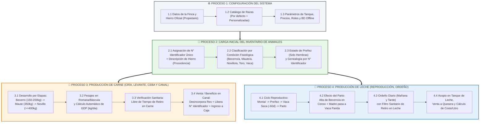
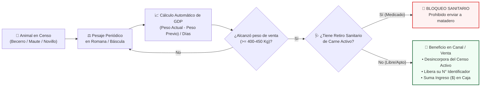
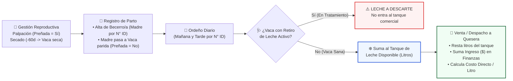

# 📘 Guía de Usuario Orientada a Procesos: FincaControl
> **Manual Paso a Paso desde la Instalación hasta la Puesta en Producción**  
> **Sistema Integral de Gestión Ganadera para Fincas de Doble Propósito (Leche y Carne)**  
> **Equipo de Desarrollo:** Johan Maldonado – José Chacón  
> **Prototipo Interactivo Verificable:** [`agentes/prototipo/index.html`](./agentes/prototipo/index.html)

---

## 📑 Índice General (Orden Lógico de Operación)

1. [🗺️ 0. Esquema General de los Procesos Soportados por el Sistema](#esquema-procesos)
   * [0.1. Mapa Integral de Procesos de FincaControl](#mapa-procesos)
   * [0.2. Secuencia Lógica de Puesta en Producción](#secuencia-logica)
1. [⚙️ Proceso 1: Configuración del Sistema (Puesta a Punto de la Finca)](#proceso-1-configuracion)
   * [1.1. Identidad de la Finca y Hierro Oficial de Propiedad](#config-finca-hierro)
   * [1.2. Gestión del Catálogo Personalizable de Razas Bovinas](#config-catalogo-razas)
   * [1.3. Parámetros Productivos, Comerciales y Control de Acceso (RBAC)](#config-parametros-rbac)
4. [🐄 Proceso 2: Carga Inicial del Inventario de Animales (Censo del Rebaño)](#proceso-2-inventario)
   * [2.1. Reglas de Identificación: Número Identificador vs. Hierro](#regla-id-vs-hierro)
   * [2.2. Clasificación por Condiciones Fisiológicas y Estado de Preñez](#regla-condiciones-fisiologicas)
   * [2.3. Paso a Paso para Registrar el Rebaño Inicial y su Genealogía](#paso-a-paso-censo)
5. [🥩 Proceso 3: Registro de Datos del Proceso de Producción de Carne](#proceso-3-produccion-carne)
   * [3.1. Esquema Operativo del Proceso Cárnico](#esquema-carne)
   * [3.2. Paso a Paso: Pesajes Periódicos y Cálculo de Ganancia Diaria (GDP)](#paso-pesajes-gdp)
   * [3.3. Paso a Paso: Control de Tiempos de Retiro en Carne](#paso-retiro-carne)
   * [3.4. Paso a Paso: Beneficio en Canal, Liberación del N° Identificador y Venta](#paso-beneficio-canal)
6. [🥛 Proceso 4: Registro de Datos del Proceso de Producción de Leche](#proceso-4-produccion-leche)
   * [4.1. Esquema Operativo del Proceso Lechero](#esquema-leche)
   * [4.2. Paso a Paso: Ciclo Reproductivo, Secado y Parto (Alta de Cría y Pase a Lactancia)](#paso-parto-lactancia)
   * [4.3. Paso a Paso: Registro de Ordeño Diario (Mañana y Tarde) e Inocuidad](#paso-ordeno-diario)
   * [4.4. Paso a Paso: Gestión del Tanque de Enfriamiento, Despacho y Costo por Litro](#paso-tanque-venta-leche)

---

## 🗺️ 0. Esquema General de los Procesos Soportados por el Sistema

Antes de interactuar con cualquier pantalla o funcionalidad de **FincaControl**, es fundamental comprender el **esquema de procesos de negocio** que soporta la plataforma. En una finca ganadera venezolana de doble propósito (producción conjunta de leche y carne), los datos no se registran de forma aislada, sino siguiendo un **flujo lógico encadenado** que inicia con la configuración de la unidad de producción y el censo del rebaño, para luego alimentar diariamente las líneas de producción de **carne** y **leche**.

### 0.1. Mapa Integral de Procesos de FincaControl

### 0.2. Secuencia Lógica de Puesta en Producción

Para que el sistema opere sin inconsistencias desde el primer día en campo, el cliente debe seguir estrictamente este orden de cuatro etapas:

| Orden | Macroproceso | ¿Por qué va en este lugar? | Entregable en el Sistema |
| :---: | :--- | :--- | :--- |
| **1°** | **Configuración del Sistema** | Define las reglas base de la finca: su marca de hierro predeterminada, las razas que maneja el productor, la capacidad del tanque y los precios de referencia. | Finca parametrizada y catálogo de razas listo en memoria local (*Offline-First*). |
| **2°** | **Carga Inicial del Inventario** | Ningún evento productivo (ordeño, pesaje, vacuna o parto) puede registrarse si el animal no existe previamente en el censo con su **N° Identificador** y **Condición Fisiológica**. | Padrón activo de animales clasificados por etapa, estado de preñez y genealogía. |
| **3°** | **Proceso de Producción de Carne** | Con los animales en censo (*Becerros, Mautes, Novillos y animales de descarte*), se inicia el control de pesajes periódicos (**GDP**), vigilancia de retiro en carne y ventas en canal. | Historial de pesajes con **GDP**, ventas en canal liquidadas y números identificadores liberados. |
| **4°** | **Proceso de Producción de Leche** | Con las hembras reproductoras (*Novillas y Vacas*), se gestionan preñeces, secados y partos que habilitan a las **Vacas paridas** para el ordeño diario, acopio en tanque y despacho comercial. | Leche apta en tanque, descartes sanitarios aislados, despachos cobrados y costo por litro calculado. |

[⬆ Volver al Índice](#indice)

## ⚙️ Proceso 1: Configuración del Sistema (Puesta a Punto de la Finca)

> **Dónde realizarlo en la aplicación:** Pestaña **`⚙️ 1. Configuración`** (o pulsando el botón *"Ir al Proceso 1: Configuración"* desde el Esquema de Procesos).

### 1.1. Identidad de la Finca y Hierro Oficial de Propiedad
En Venezuela, el **hierro** es la marca (iniciales, letras entrelazadas o figura) que certifica quién es el propietario del ganado y cuál es su finca de procedencia.
1. Diríjase al panel **Datos Generales de la Unidad de Producción**.
2. Ingrese el **Nombre de la Finca** (*Ej: Hda. La Esperanza*).
3. Ingrese la **Descripción del Hierro Oficial de la Finca** (*Ej: Hda. La Esperanza (Iniciales HE)* o *Figura Herradura con Estrella*).
   * *Impacto automático:* Este hierro se precargará por defecto cada vez que registre un animal nacido en la finca, ahorrando tiempo de digitación en el corral.

### 1.2. Gestión del Catálogo Personalizable de Razas Bovinas
El sistema incluye por defecto las razas más comunes en sistemas de doble propósito venezolanos (*Gyr Mestizo, Carora F1, Brahman, Brahman Rojo, Guzerá, Pardo Suizo, Senepol, Romosinuano*), pero permite que el productor **registre y guarde sus propias razas o cruces**:
1. En la sección **Catálogo de Razas de la Finca** (o desde el botón **`+ Nueva Raza`** en los formularios de Censo y Parto), escriba el nombre de la nueva raza (*Ej: Girolando F1*, *Nelore*, *Carora Puro*, *Mestizo Cebú*).
2. Presione **"Guardar Raza en Catálogo"**.
3. *Impacto automático:* La nueva raza queda almacenada permanentemente en el sistema para ser utilizada en el registro de cualquier animal futuro.

### 1.3. Parámetros Productivos, Comerciales y Control de Acceso (RBAC)
1. Defina los **Parámetros Comerciales y Zootécnicos de Referencia**:
   * **Precio Referencial de Venta de Leche (`$/L`):** *Ej: `$0.45 / L`*.
   * **Precio Referencial por Kg de Carne en Pie/Canal (`$/Kg`):** *Ej: `$1.85 / Kg`*.
   * **Meta de Ganancia Diaria de Peso (GDP) en Ceba:** *Ej: `+0.70 kg/día`*.
   * **Duración de Gestación (283 días) y Alerta de Secado (60 días antes del parto).**
2. Presione **"Guardar Configuración del Sistema"**.
3. **Verificación de Roles (RBAC):** En la barra superior puede alternar entre **`Rol: Administrador`** (acceso total incluyendo Finanzas y Configuración) y **`Rol: Operador`** (enfocado en tareas de corral, ordeño y pesaje).

[⬆ Volver al Índice](#indice)

---

## 🐄 Proceso 2: Carga Inicial del Inventario de Animales (Censo del Rebaño)

> **Dónde realizarlo en la aplicación:** Pestaña **`🐄 2. Inventario (Censo)`**.

Una vez configurada la finca, el segundo paso obligatorio es cargar los animales que conforman el rebaño actual.

### 2.1. Reglas de Identificación: Número Identificador vs. Hierro
Para evitar el error común de confundir la marca de propiedad con el identificador del ejemplar, **FincaControl** separa ambos datos:
* **N° Identificador del Animal (`ID_Numero`):** Es el número único que identifica a cada res dentro del rebaño (*Ej: `042`, `104`, `201`, `009`*).
  * **No puede repetirse** entre dos animales activos.
  * **Se utiliza para guardar quién es la Madre y quién es el Padre** en el árbol genealógico.
  * Cuando el animal se vende a matadero/canal, su **N° Identificador queda liberado** para ser reutilizado en futuras crías.
* **Hierro (`Descripción del Hierro`):** Indica el **propietario y procedencia** del animal. Como muchas veces no es un número sino iniciales o una figura, se registra su descripción (*Ej: "Hda. La Esperanza (Iniciales HE)"* para animales nacidos en la finca, o *"Finca San José (Iniciales SJ)"* / *"Figura Herradura"* para animales comprados a otros criadores). Varios animales pueden compartir el mismo hierro de propiedad.

### 2.2. Clasificación por Condiciones Fisiológicas y Estado de Preñez
Al registrar cada animal, el usuario debe clasificarlo según su **etapa fisiológica** real en el hato venezolano. Puede consultar esta tabla en cualquier momento dentro de la aplicación pulsando el botón **`📖 Clasificación Fisiológica (VZLA)`**:

| Etapa / Condición Fisiológica | Sexo | Edad y Peso de Referencia | Características y Regla de Preñez en el Sistema |
| :--- | :---: | :--- | :--- |
| **Becerro / Becerra** | Macho / Hembra | Nacimiento a destete (~4 a 10 meses) • **150 a 200 kg** | Dependen inicialmente de leche materna y calostro, transitando a pastos y concentrados. **¿Preñada?:** *No aplica*. |
| **Maute / Mauta** | Macho / Hembra | 10 a 18 meses • **~350 kg** | Fase de levante o crecimiento intermedio tras el destete. **¿Preñada?:** *No aplica*. |
| **Novillo / Torete** | Macho | Desde 18 meses • **≥ 400 kg** | Fase de engorde final para venta/ceba o levante de macho joven. **¿Preñada?:** *No aplica (Bloqueado por ser macho)*. |
| **Novilla de vientre** | Hembra | Desde 18 meses • **≥ 400 kg** | Hembra joven destinada a reproducción hasta su primer parto. **¿Preñada?:** *Habilitado (`Sí` / `No`)*. |
| **Toro / Toro Reproductor** | Macho | ≥ 30 meses • **> 425 kg** | Macho adulto destinado a la monta o reproducción. **¿Preñada?:** *No aplica (Bloqueado por ser macho)*. |
| **Vaca parida** | Hembra | Adulta (1 o más partos) | Ha tenido su cría y produce leche (*Primípara* en su 1er parto, *Multípara* si acumula varios). **¿Preñada?:** *Habilitado (`Sí` / `No`)*. |
| **Vaca escotera** | Hembra | Adulta | Vaca que se encuentra **preñada** pero no está produciendo leche en ese momento. **¿Preñada?:** *Sí (Preñada)*. |
| **Vaca seca** | Hembra | Adulta (Último tercio gestación) | Finalizó su lactancia y está en descanso de ubre (~60 días previos al parto). **¿Preñada?:** *Sí (Preñada)*. |

### 2.3. Paso a Paso para Registrar el Rebaño Inicial y su Genealogía
1. En la pestaña **`🐄 2. Inventario (Censo)`**, presione el botón **`+ Nuevo Animal Manual`**.
2. Complete los campos resaltados del formulario:
   * **N° Identificador \*:** Ingrese el número único del animal (*Ej: `112`*).
   * **Hierro (Descripción) \*:** Verifique el hierro de la finca o describa el hierro de procedencia si fue comprado (*Ej: `Iniciales JM (Media Luna)`*).
   * **Nombre / Alias \*:** Ingrese el nombre del ejemplar (*Ej: `Consentida`*).
   * **Sexo \*:** Seleccione `Hembra` o `Macho`.
     * *Nota:* Al cambiar el sexo, el sistema filtra automáticamente las **Condiciones Fisiológicas** válidas y bloquea el campo **¿Está Preñada?** si selecciona `Macho`.
   * **Condición Fisiológica \*:** Elija la etapa actual del animal (*Becerro/a, Maute/a, Novillo, Novilla de vientre, Toro Reproductor, Vaca parida, Vaca escotera o Vaca seca*).
   * **¿Está Preñada? \*:** Si es Vaca o Novilla, indique `No (Vacía)` o `🤰 Sí (Preñada)`.
   * **Raza \*:** Seleccione una raza de la lista o pulse **`+ Nueva Raza`** para agregar y guardar una nueva.
   * **Propósito y Peso Actual (Kg) \*:** Seleccione el propósito (*Doble Propósito, Leche, Carne / Ceba*) y digite el peso inicial en kilogramos.
   * **Madre (N° Identificador) y Padre (N° Identificador):** Ingrese el **N° Identificador** de la madre (*Ej: `042`*) y del padre (*Ej: `009`*).
3. Presione **"Guardar en Inventario"**.
4. **Verificación en el Censo:**
   * Utilice los selectores superiores para filtrar su rebaño por **Etapa Fisiológica** o por **Estado de Preñez**.
   * Presione el botón **"Hoja de Vida"** en cualquier fila para abrir el expediente individual y comprobar su árbol genealógico referenciado por **N° Identificador**.

[⬆ Volver al Índice](#indice)

---

## 🥩 Proceso 3: Registro de Datos del Proceso de Producción de Carne

> **Dónde realizarlo en la aplicación:** Pestañas **`⚖️ 3. Producción Carne (Pesajes)`**, **`🩺 Sanidad & Retiro`** y **`🐄 2. Inventario (Censo -> Vender en Canal)`**.

Una vez cargados los animales en el inventario, comienza el seguimiento de la producción cárnica (crecimiento de *Becerros*, levante de *Mautes*, engorde final de *Novillos/Toretes* y beneficio en canal).

### 3.1. Esquema Operativo del Proceso Cárnico

### 3.2. Paso a Paso: Pesajes Periódicos y Cálculo de Ganancia Diaria (GDP)
1. Diríjase a la pestaña **`⚖️ 3. Producción Carne`**.
2. En el panel **Nuevo Pesaje Periódico**:
   * **Animal (N° Identificador) \*:** Seleccione el ejemplar a pesar (*Ej: `#201 Campeón • Maute`*). El sistema mostrará automáticamente su último peso registrado como referencia (`Previo: 340 Kg`).
   * **Fecha de Pesaje \*:** Seleccione la fecha del control en romana/báscula.
   * **Peso Actual (Kg) \*:** Digite el nuevo peso vivo en kilogramos (*Ej: `362 Kg`*).
3. Presione **"Calcular y Guardar"**.
4. **Resultado Automático:**
   * El sistema calcula la **Ganancia Diaria de Peso (GDP)** en `kg/día`:
     > **Fórmula:** `GDP = (Peso Actual - Peso Previo) / Días transcurridos`
   * Clasifica el desempeño del animal con un semáforo visual:
     * 🟢 **Excelente / Óptimo (`≥ 0.60 kg/día`):** Crecimiento ideal en levante/ceba.
     * ⚪ **Aceptable / Normal (`0.30 a 0.59 kg/día`):** Ganancia moderada a pastoreo.
     * 🔴 **Estancado / Alerta (`< 0.30 kg/día`):** Alerta por posible parasitismo o déficit nutricional.
   * Actualiza inmediatamente el peso vivo en la ficha del animal en el Censo.

### 3.3. Paso a Paso: Control de Tiempos de Retiro en Carne
Si un animal en levante o ceba recibe un antibiótico o antiparasitario (ej. *Ivermectina* u *Oxitetraciclina*):
1. Abra la pestaña **`🩺 Sanidad & Retiro`**.
2. Seleccione el **Animal Tratado (N° ID)**, el **Producto Aplicado** e ingrese los **Días de Retiro en Carne** (*Ej: `28 días`*).
3. Presione **"Guardar Tratamiento y Activar Cuarentena"**.
4. *Efecto de Inocuidad:* Mientras el retiro esté activo, el sistema bloqueará cualquier intento de vender ese animal para matadero/canal.

### 3.4. Paso a Paso: Beneficio en Canal, Liberación del N° Identificador y Venta
Cuando un *Novillo*, *Torete* o animal de descarte alcanza su peso final y está libre de medicamentos:
1. Vaya a la pestaña **`🐄 2. Inventario (Censo)`** y ubique la fila del animal.
2. Presione el botón rojo **`🥩 Vender en Canal`**.
3. En la ventana de liquidación:
   * Verifique que el animal no tenga alertas rojas de bloqueo sanitario.
   * Confirme el **Peso Vivo en Báscula (Kg)**, el **Precio por Kg ($)** y el **Destino / Matadero / Frigorífico**.
4. Presione **"🥩 Confirmar Venta, Desincorporar y Liberar N° Identificador"**.
5. **Impacto Triple Automatizado:**
   * **En Inventario:** El animal sale del rebaño activo y pasa a la sub-pestaña **`🥩 Historial Canal & Ventas`** conservando el registro de su Hierro y peso de salida.
   * **En Identificadores:** Su **N° Identificador queda formalmente liberado**, pudiendo asignarse a un nuevo becerro recién nacido.
   * **En Finanzas:** El monto total de la liquidación se acredita automáticamente como un **Ingreso** en el libro de caja bajo la categoría *"Venta de Ganado / Canal"*.

[⬆ Volver al Índice](#indice)

---

## 🥛 Proceso 4: Registro de Datos del Proceso de Producción de Leche

> **Dónde realizarlo en la aplicación:** Pestañas **`🧬 Reproducción`**, **`🥛 4. Producción Leche (Ordeño)`** y **`📊 Dashboard`**.

El proceso de producción lechera abarca desde la habilitación fisiológica de la hembra (el parto que la convierte en **Vaca parida** en lactancia) hasta el ordeño diario, el control sanitario de la leche, el almacenamiento en el tanque de enfriamiento y su venta comercial.

### 4.1. Esquema Operativo del Proceso Lechero

### 4.2. Paso a Paso: Ciclo Reproductivo, Secado y Parto (Alta de Cría y Pase a Lactancia)
Para que una hembra inicie o renueve su ciclo de producción de leche:
1. Diríjase a la pestaña **`🧬 Reproducción`**.
2. **Seguimiento de Preñez y Secado:**
   * Al registrar un **Diagnóstico Preñez** con resultado `Preñada Confirmada`, la hembra actualiza automáticamente su estado a **`Preñada: Sí`** en el Censo (o pasa a **`Vaca escotera`** si está preñada sin producir leche).
   * Aproximadamente 60 días antes del parto, registre el evento **`Secado de Vaca`**: la hembra cambia automáticamente su condición fisiológica a **`Vaca seca`** para permitir la recuperación de la glándula mamaria.
3. **Registro de Parto y Alta Automática del Becerro/a:**
   * Seleccione la **Hembra (N° Identificador)** y en **Tipo de Evento** elija **`Parto (Nacimiento de Cría)`**.
   * Se desplegará el sub-panel verde **Ficha Completa del Nuevo Becerro/a (Censo)**:
     * **N° Identificador Cría \*:** Ingrese un número nuevo o reutilice un número liberado tras una venta en canal (*Ej: `115`*).
     * **Hierro (Descripción) \*:** Viene prellenado automáticamente con el hierro de la finca/madre, pudiendo editarlo si lo desea.
     * **Nombre / Alias Cría \*:** Ingrese el nombre del recién nacido (*Ej: `Relámpago`*).
     * **Sexo (Etapa Inicial) \*:** Si elige `Hembra` se clasificará automáticamente como **`Becerra`**; si elige `Macho` se clasificará como **`Becerro`** (con `Preñada: No aplica`).
     * **Raza \*:** Elija la raza del catálogo o pulse **`+ Nueva Raza`** para registrar una nueva.
     * **Peso al Nacer (Kg) y Clasificación Madre \*:** Ingrese el peso al nacer (*Ej: `35 Kg`*) e indique si la madre pasa a `Vaca parida (Primípara)` o `Vaca parida (Multípara)`.
   * Presione **"Guardar Evento y Actualizar Condición Fisiológica / Censo"**.
   * **Impacto Automatizado:**
     1. El nuevo *Becerro/a* queda registrado en el Censo con su **Madre vinculada mediante el N° Identificador de la vaca parida** (y no con el hierro).
     2. La madre cambia su condición fisiológica a **`Vaca parida`**, actualiza su estado de preñez a **`No (Vacía)`** y queda habilitada en los selectores de **Ordeño Diario**.

### 4.3. Paso a Paso: Registro de Ordeño Diario (Mañana y Tarde) e Inocuidad
El registro diario de leche puede realizarse desde la pestaña **`🥛 4. Producción Leche`** o desde el widget de **Captura Rápida en Vaquera** del **`📊 Dashboard`**:
1. Seleccione la **Vaca (N° Identificador)** de la lista de vacas paridas (o escriba su N° Identificador, *ej: `042` o `104`*).
2. **Validación Instantánea de Inocuidad:**
   * Si selecciona una vaca sana (*ej: `#042 Mariposa`*), el formulario permite el ingreso normal al tanque.
   * Si selecciona una vaca con tratamiento médico activo (*ej: `#104 Canela`*), aparece de inmediato una **alerta sanitaria roja** advirtiendo que esos litros se registrarán como **Descarte por Retiro** y **NO** se mezclarán en el tanque comercial.
3. Seleccione la **Jornada** (`Mañana` o `Tarde`), digite los **Litros Medidos** (*ej: `11.5 L`*) y presione **"Registrar Ordeño"**.
4. Verifique en las tarjetas superiores cómo los litros aptos se suman a **`🥛 Leche Disponible en Tanque`**, mientras que los litros de vacas en cuarentena se aislan en **`⚠️ Descarte por Retiro`**.

### 4.4. Paso a Paso: Gestión del Tanque de Enfriamiento, Despacho y Costo por Litro
Cuando el camión receptor o la quesera acude a retirar la leche acumulada en el tanque:
1. Presione el botón azul **`🥛 Vender / Despachar Leche`** (disponible en el módulo de Leche y en el Dashboard).
2. En la ventana de despacho:
   * Verifique el **Saldo Actual en Tanque** (*ej: `342.5 L`*).
   * Ingrese los **Litros a Vender** (el sistema valida que no supere la existencia disponible en el tanque).
   * Confirme el **Precio por Litro ($)** (*ej: `$0.45`*), el **Comprador / Destino** (*ej: `Quesera Don Pedro`*) y la fecha.
   * Observe el cálculo instantáneo del **Total a Percibir en Caja**.
3. Presione **"Confirmar Venta y Descargar Tanque"**.
4. **Impacto Financiero y de Costos:**
   * Los litros despachados se descuentan inmediatamente del tanque de leche.
   * En la pestaña **`💰 Financiero Operativo`**, se registra automáticamente el asiento de **Ingreso** por venta de leche y se recalcula tanto la **Utilidad en Caja** como el indicador de **Costo Directo Estimado por Litro de Leche Producido (`$/L`)**.

[⬆ Volver al Índice](#indice)

