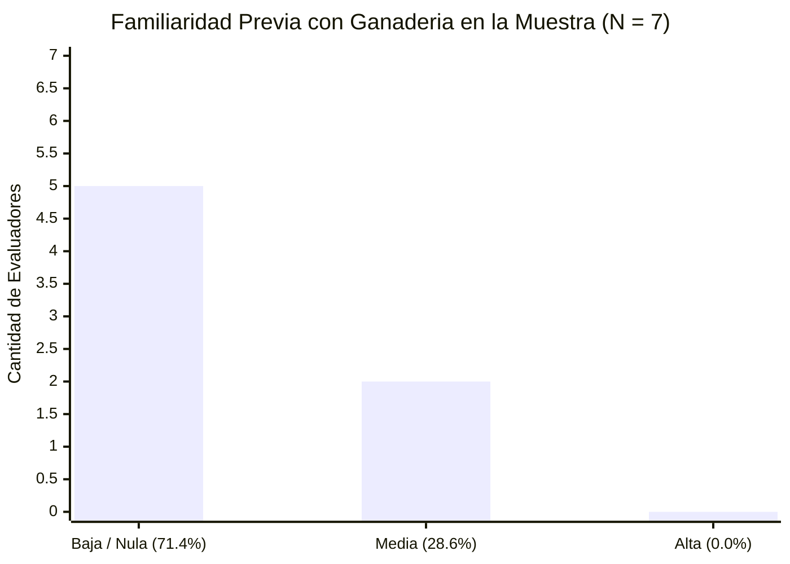
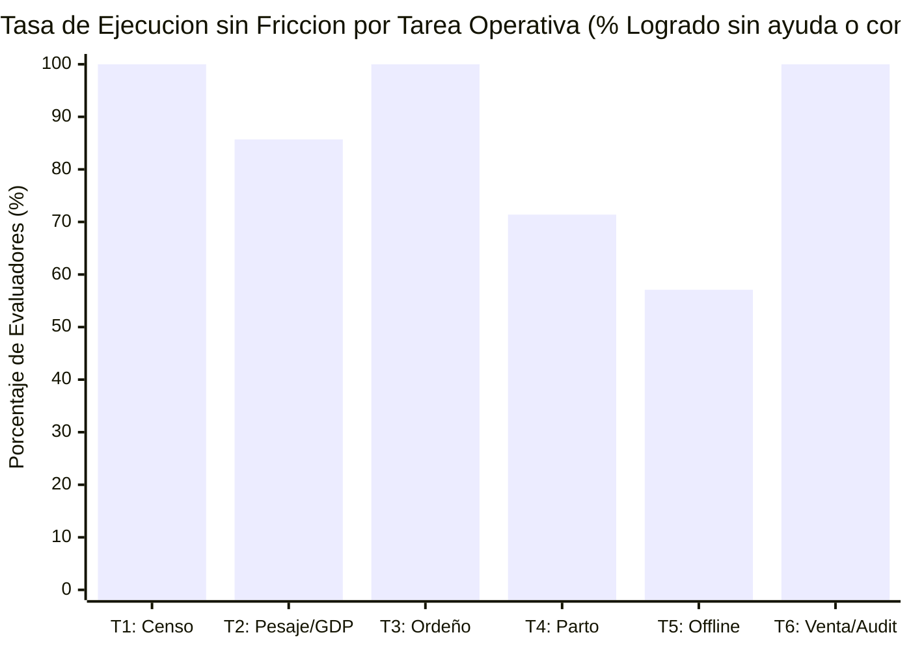
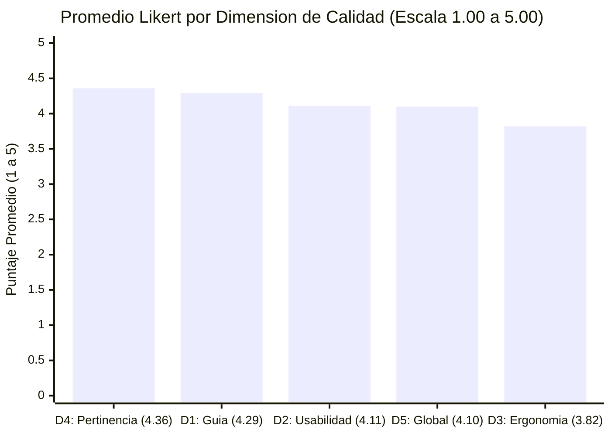

# 📊 Estudio de Validación de Usabilidad, Correspondencia Documental y Aceptación Funcional: Evaluación Cruzada del Prototipo y Guía de Usuario de FincaControl

---

## 1. Portada y Metadatos

| Atributo | Especificación |
| :--- | :--- |
| **Título del Estudio** | Estudio de Validación de Usabilidad, Correspondencia Documental y Aceptación Funcional: Evaluación Cruzada del Prototipo v3.0 y Guía de Usuario Rev 3.0 de *FincaControl* |
| **Sistema Evaluado** | **FincaControl** — Sistema de Gestión Ganadera de Doble Propósito (Leche y Carne) bajo Arquitectura *Primero Online + Extensión Offline Táctica de Campo* (Propuesta A) |
| **Población Evaluadora** | Estudiantes de la carrera **Ingeniería de Sistemas** cursantes de la asignatura **Ingeniería de Software** ($N = 7$ evaluadores) |
| **Equipo Autor del Informe** | **Johan Maldonado – José Chacón** (Grupo 3) |
| **Fecha de Publicación** | 09 de noviembre de 2026 |
| **Versión del Documento** | `v1.0 — Informe Consolidado de Resultados de Validación Externa` |
| **Fuentes Primarias Analizadas** | [resumen.pdf](file:///c:/Users/chaco/Downloads/FincaControl-main%20%281%29/FincaControl-main/formularios/resumen.pdf) y formularios individuales [1.pdf](file:///c:/Users/chaco/Downloads/FincaControl-main%20%281%29/FincaControl-main/formularios/1.pdf), [2.pdf](file:///c:/Users/chaco/Downloads/FincaControl-main%20%281%29/FincaControl-main/formularios/2.pdf), [3.pdf](file:///c:/Users/chaco/Downloads/FincaControl-main%20%281%29/FincaControl-main/formularios/3.pdf), [4.pdf](file:///c:/Users/chaco/Downloads/FincaControl-main%20%281%29/FincaControl-main/formularios/4.pdf), [5.pdf](file:///c:/Users/chaco/Downloads/FincaControl-main%20%281%29/FincaControl-main/formularios/5.pdf), [6.pdf](file:///c:/Users/chaco/Downloads/FincaControl-main%20%281%29/FincaControl-main/formularios/6.pdf) y [7.pdf](file:///c:/Users/chaco/Downloads/FincaControl-main%20%281%29/FincaControl-main/formularios/7.pdf) |

---

## 2. Resumen Ejecutivo (*Executive Summary*)

### 2.1. Objetivo Condensado
El presente estudio tuvo como propósito medir cuantitativa y cualitativamente el grado de **eficacia didáctica de la Guía de Usuario (`Rev 3.0`)**, la **usabilidad, navegabilidad y ergonomía de captura en campo del Prototipo Funcional (`v3.0`)**, y la **pertinencia de las reglas de negocio ganaderas** de **FincaControl** antes de iniciar la fase de codificación en **Flutter** y el despliegue de la **Base de Datos Relacional Central**. Para ello, se sometieron ambos artefactos a una prueba de ejecución guiada de **6 misiones operativas**, una matriz de **18 variables en escala Likert (1 a 5)** y **5 preguntas abiertas de diagnóstico** aplicadas a estudiantes de la asignatura *Ingeniería de Software*.

La validación buscó comprobar dos hipótesis críticas de diseño: **(1)** que un usuario sin experiencia previa en el sector agropecuario puede operar los procesos de configuración, inventario, pesaje (`GDP`), ordeño con bloqueo sanitario, parto y liquidación comercial apoyándose en el manual y en la interfaz adaptativa por rol (**Propuesta A**: `Administrador` vs. `Trabajador`), y **(2)** identificar fricciones de interfaz móvil que deban corregirse preventivamente al construir la aplicación nativa en Flutter.

### 2.2. Principales Hallazgos (*Top Insights*)
* **Aprobación Unánime del Entregable ($100.0\%$):** El **$100.0\%$ de los evaluadores ($7/7$)** emitió un dictamen aprobatorio sobre el conjunto Prototipo + Guía de Usuario, dividiéndose en **$42.9\%$ ($3/7$) "Aprobado sin observaciones"** y **$57.1\%$ ($4/7$) "Aprobado con sugerencias menores"**, con **$0.0\%$ de rechazos u observaciones bloqueantes**.
* **Tasa de Éxito Operativo del $100.0\%$ en las 42 Ejecuciones de Tareas:** Ningún evaluador falló en completar las 6 misiones prácticas ($0/42$ abandonos). El **$85.7\%$ de las ejecuciones ($36/42$)** se completó de forma fluida ($66.7\%$ sin ayuda y $19.0\%$ consultando la guía), a pesar de que el **$71.4\%$ de la muestra ($5/7$) declaró tener familiaridad baja o nula con la ganadería**.
* **Calificación Cuantitativa Global Sobresaliente ($\bar{X} = 4.13 / 5.00$ • $82.5\%$):** Sobre las $126$ valoraciones individuales registradas ($7 \text{ evaluadores} \times 18 \text{ ítems}$), el **$77.8\%$ ($98/126$)** correspondió a calificaciones positivas altas (`4 - De acuerdo` con $38.1\%$ y `5 - Totalmente de acuerdo` con $39.7\%$), frente a solo un **$4.0\%$ ($5/126$)** en desacuerdo.
* **Fortalezas Mejor Valoradas ($\bar{x} \ge 4.57$):** La **visibilidad del estado de red y cola offline (`D2.4`: $\bar{x} = 4.86$)**, la **fidelidad 1:1 entre Guía y Prototipo (`D1.3`: $\bar{x} = 4.57$)**, el **control sanitario de tiempos de retiro (`D4.2`: $\bar{x} = 4.57$)** y el **potencial real para sustituir cuadernos de vaquera (`D5.2`: $\bar{x} = 4.57$)** alcanzaron un **$100.0\%$ de consenso positivo**.
* **Principal Cuello de Botella Detectado (`D3.2`: $\bar{x} = 3.14$ y `Tarea 5`: $42.9\%$ con dificultad):** La fricción se concentró exclusivamente en la **adaptación responsiva del prototipo HTML en pantallas de teléfono pequeñas** (la barra superior de 10 pestañas del Administrador cortaba las últimas 3 opciones sin indicador de desplazamiento horizontal y la convivencia de formularios + tablas densas en una misma vista recargaba la pantalla) y en la necesidad de **ayudas contextuales (*tooltips*)** para siglas agropecuarias (`GDP`, `Tiempo de Retiro`).

### 2.3. Implicaciones Directas para el Desarrollo
1. **Luz verde para iniciar la codificación del Módulo 1:** El modelo de datos, las reglas de negocio y la correspondencia documental no requieren reestructuración.
2. **Principio de Interfaz Limpia en Uso Real (La App NO es un calco literal de la Guía de Usuario):** Se establece como regla de diseño que la aplicación en uso real **no tendrá bloques de texto explicativo extensos ni será un calco literal de la Guía de Usuario**. En el prototipo web se incluyeron banners descriptivos únicamente para guiar a los pares académicos durante la prueba; sin embargo, en la operación real de la finca el trabajador y el administrador necesitan pantallas limpias, directas y ágiles, reservando las explicaciones detalladas exclusivamente para el manual de usuario y dejando en la app solo micro-ayudas puntuales (*tooltips* `ℹ️`) para siglas como `GDP` o `Tiempo de Retiro`.
3. **Formalización de Inicio de Sesión (`🔐 Login`) y Gestión de Usuarios/Trabajadores por Rol (`RBAC`):** Mientras que el prototipo utilizó un botón conmutador superior para simular el cambio entre `Administrador` y `Trabajador` durante la evaluación, la especificación del sistema incorpora formalmente una **Pestaña/Pantalla de Inicio de Sesión** y un **Submódulo de Gestión de Personal y Roles (exclusivo del `Administrador Online`)** para crear cuentas de trabajadores (`OPERADOR`), asignarles credenciales/cargo en la finca, restablecer contraseñas/PIN y activar o suspender su acceso (`activo = TRUE/FALSE`) sin afectar la integridad del `Historial de Acciones`.
4. **Rediseño de la navegación móvil y separación de vistas (*Captura vs. Historial*) en Flutter:** Reemplazar la tira horizontal de 10 pestañas del prototipo web por un esquema móvil nativo (`BottomNavigationBar` + `Drawer` lateral para el Administrador y `Terminal de Carga` de 4 tarjetas para el Trabajador), desacoplando los formularios de registro respecto de los listados históricos mediante pestañas internas.

---

## 3. Metodología y Ficha Técnica

| Parámetro Metodológico | Detalle Técnico |
| :--- | :--- |
| **Universo y Población Objetivo** | Estudiantes universitarios de la carrera **Ingeniería de Sistemas** que cursan la asignatura **Ingeniería de Software**, actuando como pares evaluadores de calidad de software y usabilidad (UX). |
| **Tamaño de Muestra ($N$)** | **$N = 7$ respuestas válidas procesadas** ($100\%$ de los formularios recibidos en la carpeta `formularios/`: `1.pdf` a `7.pdf`), correspondientes a **$42$ pruebas de ejecución de tareas** ($7 \times 6$) y **$126$ mediciones en escala Likert** ($7 \times 18$). |
| **Mecanismo de Recolección** | Cuestionario estructurado autoadministrado vía web mediante **Google Forms**, acompañado de los enlaces públicos al Prototipo Interactivo en GitHub Pages (`https://josecb0508.github.io/FincaControl_Prototype/agentes/prototipo/index.html`) y a la Guía de Usuario en PDF (`https://josecb0508.github.io/FincaControl_Prototype/GUIA_DE_USUARIO.pdf`). |
| **Enlace del Instrumento** | https://docs.google.com/forms/d/e/1FAIpQLSdq3PYSbIWBEBWP2etZEp9ZvbvVCPQYJYomkneL5AMKTf4Ong/viewform?usp=header |
| **Periodo de Levantamiento** | **08 de noviembre de 2026 (11:21 a.m.)** al **09 de noviembre de 2026 (03:22 p.m.)**. |
| **Escalas de Medición** | • **Tareas Prácticas (Misiones 1–6):** Escala ordinal de logro en 4 niveles (*Logrado sin ayuda*, *Logrado consultando la guía*, *Logrado con dificultad*, *No se pudo completar*). • **Variables de Calidad (`D1`–`D5`):** Escala Likert de 5 puntos (`1 = Totalmente en desacuerdo` a `5 = Totalmente de acuerdo`). • **Retroalimentación Cualitativa y Veredicto:** 5 preguntas abiertas de respuesta libre (*verbatims*) + 1 pregunta de dictamen global en 4 niveles. |
| **Baremo de Interpretación Likert** | • **$4.21 - 5.00$ ($84.2\% - 100\%$):** Excelente / Alta Aceptación. • **$3.41 - 4.20$ ($68.2\% - 84.0\%$):** Satisfactorio / Bueno. • **$2.61 - 3.40$ ($52.2\% - 68.0\%$):** Regular / Observado (requiere ajuste focalizado). • **$1.00 - 2.60$ ($20.0\% - 52.0\%$):** Deficiente / Crítico. |

---

## 4. Perfil Demográfico y Caracterización de la Muestra

La muestra ($N = 7$) está integrada en su totalidad por **estudiantes de Ingeniería de Sistemas cursantes de Ingeniería de Software**, lo que aporta un doble valor analítico: poseen criterio técnico para auditar validaciones, flujos de estado y consistencia de interfaz, y al mismo tiempo representan a **usuarios sin dominio previo de la jerga agropecuaria**, poniendo a prueba la capacidad autoexplicativa de la Guía de Usuario y del Prototipo.

### 4.1. Nómina y Caracterización Individual de los Evaluadores

| ID | Archivo Fuente | Nombre del Evaluador | Perfil Académico | Familiaridad Previa con Ganadería | Fecha y Hora de Registro |
| :---: | :---: | :--- | :--- | :--- | :---: |
| **E1** | [1.pdf](file:///c:/Users/chaco/Downloads/FincaControl-main%20%281%29/FincaControl-main/formularios/1.pdf) | **Johan Maldonado** | Est. Ing. de Sistemas (Ing. de Software) | **Media:** Conocimiento general de términos básicos | 08/11/2026 • 11:21 a.m. |
| **E2** | [2.pdf](file:///c:/Users/chaco/Downloads/FincaControl-main%20%281%29/FincaControl-main/formularios/2.pdf) | **Reinier** | Est. Ing. de Sistemas (Ing. de Software) | **Baja / Nula:** Me guié por las explicaciones del manual | 08/11/2026 • 11:21 a.m. |
| **E3** | [3.pdf](file:///c:/Users/chaco/Downloads/FincaControl-main%20%281%29/FincaControl-main/formularios/3.pdf) | **Luis Galindez** | Est. Ing. de Sistemas (Ing. de Software) | **Baja / Nula:** Me guié por las explicaciones del manual | 08/11/2026 • 11:21 a.m. |
| **E4** | [4.pdf](file:///c:/Users/chaco/Downloads/FincaControl-main%20%281%29/FincaControl-main/formularios/4.pdf) | **Rafael Ramírez** | Est. Ing. de Sistemas (Ing. de Software) | **Baja / Nula:** Me guié por las explicaciones del manual | 08/11/2026 • 11:22 a.m. |
| **E5** | [5.pdf](file:///c:/Users/chaco/Downloads/FincaControl-main%20%281%29/FincaControl-main/formularios/5.pdf) | **Rosemary Montilla** | Est. Ing. de Sistemas (Ing. de Software) | **Baja / Nula:** Me guié por las explicaciones del manual | 08/11/2026 • 11:22 a.m. |
| **E6** | [6.pdf](file:///c:/Users/chaco/Downloads/FincaControl-main%20%281%29/FincaControl-main/formularios/6.pdf) | **Jhon Vielma** | Est. Ing. de Sistemas (Ing. de Software) | **Media:** Conocimiento general de términos básicos | 08/11/2026 • 11:23 a.m. |
| **E7** | [7.pdf](file:///c:/Users/chaco/Downloads/FincaControl-main%20%281%29/FincaControl-main/formularios/7.pdf) | **Gipsander** | Est. Ing. de Sistemas (Ing. de Software) | **Baja / Nula:** Me guié por las explicaciones del manual | 09/11/2026 • 03:22 p.m. |

### 4.2. Distribución por Nivel de Familiaridad con Procesos Ganaderos

* **Lectura de representatividad:** Cinco de los siete evaluadores (**$71.4\%$**) dependieron exclusivamente de las explicaciones de la Guía de Usuario y de las etiquetas de la interfaz para comprender conceptos como *Hierro*, *Vaca seca*, *Vaca escotera*, *Tiempo de Retiro* y *GDP*, constituyendo una **prueba de estrés ideal para evaluar la facilidad de aprendizaje (*learnability*)**.

---

## 5. Análisis de Resultados por Bloques Temáticos

### 5.1. Bloque Temático A: Desempeño Práctico en las 6 Misiones Operativas

Antes de emitir juicios subjetivos, cada evaluador ejecutó 6 tareas reales sobre el prototipo interactivo:

| Misión Operativa | Logrado sin ayuda | Logrado con la Guía | Logrado con dificultad | No se pudo completar | Éxito sin Fricción | Éxito Total |
| :--- | :---: | :---: | :---: | :---: | :---: | :---: |
| **Tarea 1:** Agregar raza personalizada y registrar animal en Censo | **5** ($71.4\%$) | **2** ($28.6\%$) | **0** ($0.0\%$) | **0** ($0.0\%$) | **$100.0\%$** | **$100.0\%$** |
| **Tarea 2:** Pesaje en báscula y cálculo automático de `GDP` | **5** ($71.4\%$) | **1** ($14.3\%$) | **1** ($14.3\%$) | **0** ($0.0\%$) | **$85.7\%$** | **$100.0\%$** |
| **Tarea 3:** Ordeño diario y filtro sanitario por Tiempo de Retiro | **6** ($85.7\%$) | **1** ($14.3\%$) | **0** ($0.0\%$) | **0** ($0.0\%$) | **$100.0\%$** | **$100.0\%$** |
| **Tarea 4:** Registro de Parto con alta automática de becerro/a | **4** ($57.1\%$) | **1** ($14.3\%$) | **2** ($28.6\%$) | **0** ($0.0\%$) | **$71.4\%$** | **$100.0\%$** |
| **Tarea 5:** Terminal del Trabajador y Cola Offline sin señal | **2** ($28.6\%$) | **2** ($28.6\%$) | **3** ($42.9\%$) | **0** ($0.0\%$) | **$57.1\%$** | **$100.0\%$** |
| **Tarea 6:** Venta comercial y auditoría en Historial de Acciones | **6** ($85.7\%$) | **1** ($14.3\%$) | **0** ($0.0\%$) | **0** ($0.0\%$) | **$100.0\%$** | **$100.0\%$** |
| **Consolidado Global ($42$ ejecuciones)** | **$28$ ($66.7\%$)** | **$8$ ($19.0\%$)** | **$6$ ($14.3\%$)** | **$0$ ($0.0\%$)** | **$85.7\%$** | **$100.0\%$** |

#### Narrativa Analítica del Bloque A:
* **¿Qué muestra el dato?** Existe una **tasa de completitud del $100.0\%$** en todas las tareas (cero abandonos). Tres flujos (**Tarea 1: Censo**, **Tarea 3: Ordeño** y **Tarea 6: Ventas + Historial**) registraron **$0.0\%$ de dificultad**, con un $85.7\%$ de ejecución intuitiva sin siquiera abrir el manual en Ordeño y Ventas. En contrapartida, la **Tarea 5 (Cambio a Rol Trabajador + Modo Sin Señal + Sincronización de Cola)** concentró el **$42.9\%$ ($3/7$) de dificultad**, seguida por la **Tarea 4 (Parto con alta de cría)** con **$28.6\%$ ($2/7$)**.
* **¿Por qué importa?** Confirma que los flujos cotidianos más frecuentes (ordeñar, pesar, registrar animales y auditar ventas) son inmediatamente comprensibles, mientras que la **simulación de estados en la barra superior del prototipo** (cambiar rol y apagar la señal de red manualmente) y los **formularios compuestos condicionales** (el sub-panel de nacimiento de cría al elegir *Parto*) requieren mayor prominencia visual en la interfaz móvil definitiva.

---

### 5.2. Bloque Temático B: Evaluación Cuantitativa por Dimensiones de Calidad (`D1` a `D5`)

A continuación se presenta el consolidado de las **5 dimensiones evaluadas** (media en escala `1.00–5.00`, índice porcentual y porcentaje de respuestas positivas `4` y `5`):

| Dimensión Evaluada | Ítems | Media ($\bar{x}$) | Índice (%) | % Positivo ($\ge 4$) | % Neutral ($=3$) | % Negativo ($\le 2$) | Nivel según Baremo |
| :--- | :---: | :---: | :---: | :---: | :---: | :---: | :---: |
| **D4.** Pertinencia Funcional, Reglas e Inocuidad | 4 | **4.36** | $87.1\%$ | **$85.7\%$** | $14.3\%$ | $0.0\%$ | 🟢 **Excelente** |
| **D1.** Eficacia Didáctica y Correspondencia de Guía | 3 | **4.29** | $85.7\%$ | **$85.7\%$** | $14.3\%$ | $0.0\%$ | 🟢 **Excelente** |
| **D2.** Usabilidad, Aprendizaje y Navegación | 4 | **4.11** | $82.1\%$ | **$71.4\%$** | $25.0\%$ | $3.6\%$ | 🔵 **Satisfactorio Alto** |
| **D5.** Valoración Integral y Aceptación Global | 3 | **4.10** | $81.9\%$ | **$85.7\%$** | $9.5\%$ | $4.8\%$ | 🔵 **Satisfactorio Alto** |
| **D3.** Ergonomía de Captura de Datos en Campo | 4 | **3.82** | $76.4\%$ | **$64.3\%$** | $25.0\%$ | $10.7\%$ | 🔵 **Satisfactorio** |
| **TOTAL GLOBAL DEL ESTUDIO ($126$ valoraciones)** | **18** | **4.13** | **$82.5\%$** | **$77.8\%$** | **$18.3\%$** | **$4.0\%$** | 🔵 **Satisfactorio Alto** |

---

### 5.3. Desglose Analítico Pregunta por Pregunta (Las 18 Variables Likert)

#### 5.3.1. Dimensión 1: Eficacia Didáctica y Correspondencia de la Guía de Usuario ($\bar{x} = 4.29 / 5.00$)

| Cód. | Enunciado Exacto Evaluado | `1` | `2` | `3` | `4` | `5` | Media ($\bar{x}$) | Desv. ($s$) | % $\ge 4$ |
| :---: | :--- | :-: | :-: | :-: | :-: | :-: | :---: | :---: | :---: |
| **D1.1** | El orden lógico de la guía (*Esquema General ➔ Configuración ➔ Inventario ➔ Carne ➔ Leche ➔ Roles y Auditoría*) facilita aprender a operar el sistema paso a paso. | 0 | 0 | 1 | 4 | 2 | **4.14** | 0.69 | **85.7%** |
| **D1.2** | La redacción explica con claridad tanto los pasos de uso como los conceptos ganaderos (*N° Identificador vs. Hierro, condiciones fisiológicas, retiro sanitario, GDP*). | 0 | 0 | 2 | 2 | 3 | **4.14** | 0.90 | **71.4%** |
| **D1.3** | Los nombres de pestañas, botones, formularios, etiquetas y alertas descritos en la Guía de Usuario coinciden fielmente con los que muestra el prototipo. | 0 | 0 | 0 | 3 | 4 | **4.57** | 0.53 | **100.0%** |

* **¿Qué muestra el dato?** Ningún evaluador calificó por debajo de `3` en toda la Dimensión 1 ($0\%$ de desaprobación). Destaca **`D1.3 Correspondencia 1:1 Guía–Prototipo` ($\bar{x} = 4.57$, $s = 0.53$)** con un **$100.0\%$ de calificaciones entre `4` y `5`**.
* **¿Por qué importa?** Ratifica de manera externa e independiente el dictamen de nuestro [informe_de_validacion.md](file:///c:/Users/chaco/Downloads/FincaControl-main%20%281%29/FincaControl-main/informe_de_validacion.md): la homologación de nombres de controles y flujos entre la Guía Rev 3.0 y el Prototipo v3.0 fue percibida sin fisuras por los usuarios.

#### 5.3.2. Dimensión 2: Usabilidad, Aprendizaje y Navegación del Prototipo ($\bar{x} = 4.11 / 5.00$)

| Cód. | Enunciado Exacto Evaluado | `1` | `2` | `3` | `4` | `5` | Media ($\bar{x}$) | Desv. ($s$) | % $\ge 4$ |
| :---: | :--- | :-: | :-: | :-: | :-: | :-: | :---: | :---: | :---: |
| **D2.1** | La interfaz del prototipo es lo suficientemente intuitiva como para comprender su mecánica rápidamente con mínima consulta reiterada del manual. | 0 | 1 | 4 | 1 | 1 | **3.29** | 0.95 | **28.6%** |
| **D2.2** | El desplazamiento entre el Esquema de Procesos, la Vista Rápida, los módulos operativos y las ventanas modales resulta lógico, ordenado y consistente. | 0 | 0 | 2 | 4 | 1 | **3.86** | 0.69 | **71.4%** |
| **D2.3** | La diferenciación de interfaz entre *Administrador (Vista Rápida y Control)* y *Trabajador (Terminal de Carga)* es clara y oculta adecuadamente funciones no autorizadas. | 0 | 0 | 1 | 2 | 4 | **4.43** | 0.79 | **85.7%** |
| **D2.4** | El prototipo comunica con claridad las confirmaciones de guardado, el estado de red (*En Línea vs. Sin Señal*) y la cantidad de envíos pendientes en cola. | 0 | 0 | 0 | 1 | 6 | **4.86** | 0.38 | **100.0%** |

* **¿Qué muestra el dato?** Existe un contraste revelador dentro de esta dimensión: mientras **`D2.4 Visibilidad del estado y cola offline` alcanza el puntaje más alto de toda la encuesta ($\bar{x} = 4.86/5.00$, con 6 de 7 evaluadores dando `5`)** y **`D2.3 Diferenciación por Rol (Propuesta A)` obtiene $\bar{x} = 4.43$**, el ítem **`D2.1 Intuitividad inicial sin consulta del manual` se sitúa en nivel neutral ($\bar{x} = 3.29$, con 4 respuestas en `3` y 1 en `2`)**.
* **¿Por qué importa?** Explica que una vez ubicado el usuario, la retroalimentación del sistema (*toasts*, badges de red, separación de roles) es excelente; pero **el primer impacto visual en la vista de Administrador tiene demasiados elementos simultáneos** (10 pestañas superiores + tarjetas explicativas + formularios + tablas), haciendo que el usuario novato sienta la pantalla inicial densa si no lee antes la guía.

#### 5.3.3. Dimensión 3: Ergonomía de Captura de Datos en Contexto de Campo ($\bar{x} = 3.82 / 5.00$)

| Cód. | Enunciado Exacto Evaluado | `1` | `2` | `3` | `4` | `5` | Media ($\bar{x}$) | Desv. ($s$) | % $\ge 4$ |
| :---: | :--- | :-: | :-: | :-: | :-: | :-: | :---: | :---: | :---: |
| **D3.1** | Los formularios de campo (ordeño, pesaje, tratamiento, parto) exigen pocos toques, precargan datos útiles (hierro oficial, precios ref.) y reducen errores de tipeo. | 0 | 0 | 2 | 3 | 2 | **4.00** | 0.82 | **71.4%** |
| **D3.2** | El tamaño de botones táctiles (*Terminal de Carga*), tipografías, contrastes y semáforos visuales es apropiado para operar desde un teléfono en condiciones de campo. | 1 | 1 | 3 | 0 | 2 | **3.14** | 1.46 | **28.6%** |
| **D3.3** | Las validaciones interactivas (bloqueo de preñez en machos/crías, unicidad de N° Identificador activo, tope de litros en tanque, campos obligatorios) evitan registros inválidos. | 0 | 0 | 2 | 3 | 2 | **4.00** | 0.82 | **71.4%** |
| **D3.4** | El buscador instantáneo de corral y la Cola Offline demuestran claramente cómo el trabajador puede capturar datos toda la jornada sin internet y sincronizarlos después. | 0 | 1 | 0 | 3 | 3 | **4.14** | 1.07 | **85.7%** |

* **¿Qué muestra el dato?** Los mecanismos lógicos de captura (**`D3.1` $\bar{x} = 4.00$**, **`D3.3` $\bar{x} = 4.00$** y **`D3.4` $\bar{x} = 4.14$**) superan la meta de satisfacción (`4.00`). Sin embargo, **`D3.2 Tamaño de controles y adaptación en teléfono` obtiene la media más baja ($\bar{x} = 3.14$) y la mayor dispersión ($s = 1.46$)** de todo el instrumento.
* **¿Por qué importa?** La alta desviación estándar ($s = 1.46$) en `D3.2` se debe a que quienes abrieron el enlace de GitHub Pages en una pantalla grande calificaron con `5`, mientras que quienes lo abrieron directamente desde el navegador de su teléfono celular (como E4: Rafael Ramírez) encontraron que las tablas anchas y la barra de 10 pestañas del prototipo web no se comportaban como una app móvil nativa. Esto valida nuestra decisión arquitectónica de construir la app real en **Flutter** con componentes móviles nativos.

#### 5.3.4. Dimensión 4: Pertinencia Funcional, Reglas de Negocio e Inocuidad Ganadera ($\bar{x} = 4.36 / 5.00$)

| Cód. | Enunciado Exacto Evaluado | `1` | `2` | `3` | `4` | `5` | Media ($\bar{x}$) | Desv. ($s$) | % $\ge 4$ |
| :---: | :--- | :-: | :-: | :-: | :-: | :-: | :---: | :---: | :---: |
| **D4.1** | Los datos gestionados cubren integralmente las necesidades clave de una finca doble propósito (censo, genealogía, leche/tanque, carne/GDP, sanidad, reproducción y caja). | 0 | 0 | 1 | 3 | 3 | **4.29** | 0.76 | **85.7%** |
| **D4.2** | El desvío automático de leche a descarte y el bloqueo de venta en canal durante el Tiempo de Retiro Sanitario aportan alto valor práctico y previenen riesgos sanitarios. | 0 | 0 | 0 | 3 | 4 | **4.57** | 0.53 | **100.0%** |
| **D4.3** | El alta automática de crías al registrar un Parto en campo y la liberación del N° Identificador al confirmar una Venta en Canal reflejan reglas de negocio bien pensadas. | 0 | 0 | 2 | 2 | 3 | **4.14** | 0.90 | **71.4%** |
| **D4.4** | El módulo *Historial de Acciones* (sin edición/borrado, con filtros y doble hora campo/servidor) ofrece trazabilidad y transparencia completas al Administrador. | 0 | 0 | 1 | 2 | 4 | **4.43** | 0.79 | **85.7%** |

* **¿Qué muestra el dato?** Es la **dimensión mejor calificada de todo el estudio ($\bar{x} = 4.36 / 5.00$, Nivel Excelente)**, con **$0.0\%$ de respuestas negativas** en sus cuatro variables. Sobresalen **`D4.2 Inocuidad por Tiempo de Retiro` ($\bar{x} = 4.57$, $100\%$ $\ge 4$)** y **`D4.4 Auditoría Inmutable en Historial de Acciones` ($\bar{x} = 4.43$)**.
* **¿Por qué importa?** Demuestra que el núcleo funcional diseñado para FincaControl (bloqueos sanitarios, gobernanza de altas por parto, liberación de identificadores tras venta en canal y bitácora inmutable *append-only*) resuelve el problema de negocio con altísima solidez técnica.

#### 5.3.5. Dimensión 5: Valoración Integral y Aceptación del Prototipo ($\bar{x} = 4.10 / 5.00$)

| Cód. | Enunciado Exacto Evaluado | `1` | `2` | `3` | `4` | `5` | Media ($\bar{x}$) | Desv. ($s$) | % $\ge 4$ |
| :---: | :--- | :-: | :-: | :-: | :-: | :-: | :---: | :---: | :---: |
| **D5.1** | La Guía de Usuario y el Prototipo conforman un entregable coherente, bien articulado y profesionalmente documentado. | 0 | 1 | 0 | 5 | 1 | **3.86** | 0.90 | **85.7%** |
| **D5.2** | La solución propuesta tiene potencial real para sustituir cuadernos de vaquera y hojas de cálculo dispersas en una unidad de producción ganadera. | 0 | 0 | 0 | 3 | 4 | **4.57** | 0.53 | **100.0%** |
| **D5.3** | En términos generales, mi valoración global sobre la calidad del prototipo y de la guía de usuario de FincaControl es altamente satisfactoria. | 0 | 0 | 2 | 4 | 1 | **3.86** | 0.69 | **71.4%** |

* **¿Qué muestra el dato?** El **$100.0\%$ de los evaluadores ($7/7$)** está de acuerdo o totalmente de acuerdo en que **FincaControl tiene potencial real para reemplazar los cuadernos físicos y hojas de cálculo en fincas ganaderas (`D5.2`: $\bar{x} = 4.57$)**. En `D5.1`, 6 de 7 evaluadores otorgaron `4` o `5`; el único `2` (E6: Jhon Vielma) se originó porque percibió que el prototipo incluía demasiado texto explicativo dentro de las pantallas, asemejándose a un calco de la guía de usuario. Este hallazgo es sumamente valioso porque confirma que **la aplicación en uso real no debe tener tanto texto explicativo ni ser una copia literal del manual**, sino mantener una interfaz netamente operativa y despejada.

---

### 5.4. Cruce de Variables (*Cross-Tabulation*)

#### Cruce 1: Nivel de Familiaridad con Ganadería $\times$ Desempeño en Tareas y Dimensiones Likert

| Indicador Cruzado | Familiaridad Baja / Nula ($n = 5$) | Familiaridad Media ($n = 2$) | Brecha ($\Delta$) e Interpretación Analítica |
| :--- | :---: | :---: | :--- |
| **Tareas logradas sin fricción (Sin ayuda + Guía)** | $24 / 30$ (**$80.0\%$**) | $12 / 12$ (**$100.0\%$**) | **$-20.0\text{ pp}$**: Los 6 casos de *"Logrado con dificultad"* ocurrieron en usuarios sin base agropecuaria previa (en Parto y Cola Offline). |
| **Promedio D1 (Guía de Usuario)** | **4.20** | **4.50** | **$-0.30$**: Ambos grupos validan la claridad de la guía; el grupo sin experiencia pidió *tooltips* en la UI para siglas como `GDP`. |
| **Promedio D2 (Usabilidad y Navegación)** | **4.05** | **4.25** | **$-0.20$**: Consistencia alta entre ambos perfiles. |
| **Promedio D3 (Ergonomía de Captura)** | **3.80** | **3.88** | **$-0.08$**: La percepción sobre densidad en móvil es transversal e independiente del conocimiento ganadero. |
| **Promedio D4 (Pertinencia e Inocuidad)** | **4.20** | **4.75** | **$-0.55$**: Quienes conocen términos básicos de ganadería valoran aún más alto ($\bar{x}=4.75$) las reglas de retiro y genealogía. |
| **Promedio D5 (Valoración Global)** | **4.27** | **3.67** | **$+0.60$**: Los usuarios sin experiencia previa quedaron altamente impresionados por el valor integral del sistema. |
| **Promedio Global Likert ($18$ ítems)** | **4.11 / 5.00** | **4.19 / 5.00** | **$-0.08$**: **Sin sesgo por desconocimiento del dominio**; la guía niveló exitosamente a ambos segmentos. |

#### Cruce 2: Experiencia de Navegación Móvil / Densidad Visual $\times$ Dictamen Final

| Segmento según Experiencia de Interfaz | Evaluadores | Media `D3.2` (Ergonomía Móvil) | Media `D2.1` (Intuitividad) | Dictamen Global Emitido |
| :--- | :--- | :---: | :---: | :--- |
| **Sin fricción de pantalla / scroll** ($n = 3$) | E1 (Johan), E4* (Rafael en desktop/tareas), E5 (Rosemary) | **3.67** | **4.00** | **$100\%$ Aprobado sin observaciones** ($3/3$) |
| **Reportaron corte de pestañas o densidad en pantalla pequeña** ($n = 4$) | E2 (Reinier), E3 (Luis), E6 (Jhon V.), E7 (Gipsander) | **2.75** | **2.75** | **$100\%$ Aprobado con sugerencias menores** ($4/4$) |

* **Hallazgo del cruce:** El $100\%$ de quienes marcaron *"Aprobado con sugerencias menores"* lo hicieron específicamente por **ergonomía de pantalla pequeña y densidad visual** (`D3.2` y `D2.1`), manteniendo calificaciones sobresalientes en correspondencia documental (`D1.3` $= 4.50$) e inocuidad/reglas de negocio (`D4.2` $= 4.50$).

---

### 5.5. Análisis Cualitativo de Preguntas Abiertas (*Verbatims* y Categorización por Tópicos)

#### Categorización Temática de Hallazgos Cualitativos ($35$ respuestas abiertas analizadas: $7 \text{ evaluadores} \times 5 \text{ preguntas}$)

| Tópico / Categoría Emergente                                                |      Frecuencia      |       Sentimiento       | Citas Textuales Representativas (*Verbatims*)                                                                                                                                                                                                                                                                                                                                                                                                                                                                                                                                                                                                        |
| :-------------------------------------------------------------------------- | :------------------: | :---------------------: | :--------------------------------------------------------------------------------------------------------------------------------------------------------------------------------------------------------------------------------------------------------------------------------------------------------------------------------------------------------------------------------------------------------------------------------------------------------------------------------------------------------------------------------------------------------------------------------------------------------------------------------------------------- |
| **1. Fidelidad 1:1 entre Guía y Prototipo**                                 | **$7/7$ ($100\%$)**  |       🟢 Positivo       | • *"El prototipo se comporta tal como lo indica la guía de usuario"* (E5: Rosemary) • *"La denominación de los estadios fisiológicos y su consistencia en el bloqueo de casillas de preñez entre machos y crías en el censo inicial"* (E2: Reinier) • *"No hubo diferencia"* / *"Ninguna importante"* (E1, E3, E6, E7)                                                                                                                                                                                                                                                                                                                         |
| **2. Completitud de Datos del Dominio Ganadero**                            | **$7/7$ ($100\%$)**  |       🟢 Positivo       | • *"Ninguno"* / *"No noté nada"* / *"Me parece que está bien así"* / *"No."* (Los 7 evaluadores confirmaron que **no falta ningún dato obligatorio ni validación clave** en los formularios).                                                                                                                                                                                                                                                                                                                                                                                                                                                        |
| **3. Claridad de Alertas Sanitarias, Leche, Vista Rápida e Identificación** | **$5/7$ ($71.4\%$)** |       🟢 Positivo       | • *"La clara diferenciación entre el N° Identificador individual y el Hierro de propiedad, junto con los indicadores en tiempo real de retiro sanitario"* (E2: Reinier) • *"Las etiquetas de resumen y la vista rápida del admin le dan una información importante al administrador de la finca"* (E5: Rosemary) • *"Aunque no sé de ganadería pude hacer todas las tareas siguiendo los pasos. Los avisos de confirmación son claros y el modo sin señal se entiende fácil"* (E7: Gipsander)                                                                                                                                                  |
| **4. Navegación Superior (10 pestañas) y Densidad de Pantalla en Móvil**    | **$4/7$ ($57.1\%$)** | 🟠 Fricción UX (Mejora) | • *"Cuando pedían ir a producción, no sabía dónde estaba el botón a la ventana porque no hay barra de scroll, en mi pantalla solo veo 7 de los 10 botones"* (E3: Luis Galindez) • *"En el menú principal, al ser varias opciones en el rol administrador no hay una barra de desplazamiento, debe tabularse"* (E5: Rosemary) • *"Para una versión móvil, podría separarse el registro de la información de las tablas que se muestran al final de cada pantalla, tratando de que no quede tan densa la interfaz"* (E5: Rosemary) • *"Yo usé la página desde el teléfono y no se veía bien (no me aparece responsive yo creo)"* (E4: Rafael) |
| **5. Ayudas Contextuales (*Tooltips* / Micro-guías en App)**                | **$3/7$ ($42.9\%$)** |    🟠 Sugerencia UX     | • *"Palabras como GDP o retiro no las conocía. Pondría una ayuda corta al lado de esos términos"* (E7: Gipsander) • *"Añadir flujos esquemáticos o diagramas de secuencia visuales paso a paso para guiar al operador directamente desde el teléfono en modo sin señal"* (E2: Reinier) • *"Tipo una pestaña de ayuda en la ventana por si le dicen al trabajador que registre la cría de vaca y él de verdad ya ni se acuerda de cómo era todo eso (no nacen vacas todos los días)"* (E4: Rafael)                                                                                                                                              |
| **6. Escalabilidad de Búsqueda Offline con Cientos de Animales**            | **$2/7$ ($28.6\%$)** |   🔵 Consulta Técnica   | • *"Si hay 400 vacas y el trabajador no se acuerda [del número], va a perder mucho tiempo ahí y de paso no sé cómo van a hacer para mostrarle todas las vacas offline"* (E4: Rafael) • *"La consulta instantánea en corral... la información presentada en este apartado podría ser más clara"* (E6: Jhon Vielma)                                                                                                                                                                                                                                                                                                                                 |

---

## 6. Conclusiones y Diagnóstico

1. **Validación Exitosa del Diseño Funcional y Documental ($100\%$ Aprobado):**
   * El estudio demuestra que la **Fase de Análisis de FincaControl alcanzó su objetivo con éxito**: el **$100.0\%$ de los evaluadores aprobó el sistema** ($42.9\%$ sin observaciones y $57.1\%$ con sugerencias menores de interfaz), completando el **$100.0\%$ de las 42 misiones operativas** y otorgando una media global de **$\bar{X} = 4.13 / 5.00$ ($82.5\%$)**.
2. **Fortalezas Consolidadas (No requieren modificación funcional):**
   * **Cero omisiones de datos de negocio:** El $100\%$ de la muestra ratificó que no faltan campos ni validaciones en los procesos de configuración, inventario, pesaje, ordeño, sanidad, reproducción, ventas ni finanzas.
   * **Correspondencia exacta Guía–Prototipo ($\bar{x} = 4.57$):** La alineación 1:1 entre el manual y el prototipo permitió que usuarios sin experiencia ganadera previa ($71.4\%$ de la muestra) completaran todas las tareas.
   * **Reglas de Inocuidad, Propuesta A y Auditoría ($\bar{x} = 4.43\text{–}4.86$):** El bloqueo por retiro sanitario, la separación de vistas `Administrador` vs. `Trabajador`, los indicadores de conectividad/cola offline y el `Historial de Acciones` inmutable fueron los puntos más aplaudidos.
3. **Cuellos de Botella Detectados y Discrepancias entre lo Esperado y lo Medido:**
   * **Sorpresa 1 — Corte de las 10 pestañas del Administrador en pantallas estrechas:** En el prototipo HTML, la barra de navegación horizontal con 10 pestañas ocultaba las últimas 3 pestañas en pantallas pequeñas o de laptop con zoom, obligando a usar la tecla `Tab` o desplazarse sin una barra de scroll visible.
   * **Sorpresa 2 — Exceso de texto explicativo en el prototipo (Aclaratoria: la App real NO será un calco literal de la Guía de Usuario):** Para facilitar la validación académica por estudiantes sin experiencia ganadera, el prototipo web incluyó banners explicativos de procesos y mostró el formulario de captura arriba y la tabla histórica completa abajo en la misma pantalla. Varios evaluadores percibieron esto como *"cargado"* o *"un calco literal de la guía de usuario dentro de la pantalla"*. Queda establecido que **en el uso real un trabajador o administrador no necesita tanto texto explicativo en pantalla**: la aplicación real en Flutter eliminará esos bloques descriptivos (que pertenecen exclusivamente al documento de la Guía de Usuario) para ofrecer formularios limpios y directos.
   * **Sorpresa 3 — Búsqueda en corral cuando el trabajador olvida el N° Identificador exacto:** Si en una finca de 400 reses el operador solo recuerda el nombre/alias (*"Canela"*) o parte del número, el buscador local sobre `cache_padron_activo` debe permitir búsqueda autocompletada tanto por **N° Identificador** como por **Nombre/Alias** y filtrar por etapa.
   * **Sorpresa 4 — Necesidad de Especificar el Inicio de Sesión Real y la Administración de Usuarios/Trabajadores por Rol (`RBAC`):** En el prototipo se empleó un botón superior para conmutar libremente entre `Administrador` y `Trabajador` con fines de prueba rápida. Para el proyecto real, es indispensable especificar en toda la documentación la **Pestaña/Pantalla de Inicio de Sesión (`🔐 Iniciar Sesión`)** y el **Módulo de Gestión de Usuarios y Roles (exclusivo del `Administrador` Online)**, permitiendo al Administrador crear cuentas de trabajadores (`OPERADOR`), asignarles cargo en la finca y credenciales/PIN, restablecer contraseñas y suspender/desactivar trabajadores (`activo = FALSE`) sin borrar su historial de acciones auditadas.

---

## 7. Recomendaciones y Plan de Acción

Para traducir estos hallazgos en mejoras concretas antes y durante la construcción de la aplicación móvil en **Flutter**, se establece el siguiente **Plan de Acción Priorizado**:

### 7.1. Matriz de Iniciativas: *Quick Wins* (Inmediatas) vs. Estructurales (Construcción en Flutter)

|     ID     |                 Prioridad / Tipo                 | Hallazgo que Atiende                                                                                                                    | Acción Concreta a Implementar                                                                                                                                                                                                                                                                                                                                                                                   |          Responsable          | Métrica / KPI de Verificación                                                                                               |
| :--------: | :----------------------------------------------: | :-------------------------------------------------------------------------------------------------------------------------------------- | :-------------------------------------------------------------------------------------------------------------------------------------------------------------------------------------------------------------------------------------------------------------------------------------------------------------------------------------------------------------------------------------------------------------- | :---------------------------: | :-------------------------------------------------------------------------------------------------------------------------- |
| **ACC-01** |        ⚡ **Quick Win** *(Prototipo Web)*         | Corte de las 10 pestañas del Admin sin barra de scroll visible (`D3.2`, E3, E5) y tablas anchas en celular (E4).                        | Habilitar barra de scroll horizontal visible y ajuste responsivo (`flex-wrap` / indicador táctil) en `.nav-tabs` del prototipo `index.html`.                                                                                                                                                                                                                                                                    |          José Chacón          | **$100\%$ de las 10 pestañas accesibles** con 1 toque en pantallas de `360px` a `1366px`.                                   |
| **ACC-02** |       ⚡ **Quick Win** *(Interfaz / Guía)*        | Percepción de exceso de texto explicativo en pantalla (`D5.1`, E6) y desconocimiento puntual de siglas `GDP` y `Retiro` (`D1.2`, E7).   | Establecer que **la app en uso real no tendrá tanto texto explicativo ni será un calco literal de la Guía de Usuario** (eliminando párrafos instructivos de las vistas operativas, pues un trabajador real no los necesita) y usar únicamente micro-tooltips discretos (`ℹ️`) al pulsar sobre siglas técnicas (`GDP`, `Tiempo de Retiro`).                                                                   |        Johan Maldonado        | **0 bloques de texto teórico** en pantallas de captura real y **$\ge 90\%$ de comprensión** de siglas con *tooltip*.        |
| **ACC-03** |       ⚡ **Quick Win** *(Buscador Corral)*        | Duda sobre cómo buscar entre 400 vacas offline si el trabajador olvida el número exacto (`Tarea 5`, E4, E6).                            | Ampliar el buscador rápido de corral (`cache_padron_activo`) para buscar por **N° Identificador O Nombre/Alias** con lista desplegable de coincidencias instantáneas y tarjeta de resultado simplificada.                                                                                                                                                                                                       |          José Chacón          | Búsqueda offline en **$< 2\text{ segundos}$** tanto por número (`104`) como por alias (`Canela`).                           |
| **ACC-04** | 🏗️ **Estructural** *(App Flutter — Mód. 1 y 7)* | Densidad visual al juntar formularios de registro, textos largos y tablas históricas en una sola pantalla (`D2.1`, `D3.2`, E3, E5, E6). | En la app **Flutter**: 1. Reemplazar las 10 pestañas superiores por un **`BottomNavigationBar` de 4 secciones + `Drawer` lateral** para el Admin. 2. Separar cada módulo en dos pestañas limpias: **`[+ Registrar]`** (solo formulario limpio) y **`[📋 Historial / Listado]`** (solo tabla paginada). 3. Suprimir cualquier bloque de texto explicativo extenso en las pantallas.                  | Johan Maldonado & José Chacón | Subir el puntaje de **`D2.1` (Intuitividad)** y **`D3.2` (Ergonomía móvil)** de $3.14\text{–}3.29$ a **$\ge 4.30 / 5.00$**. |
| **ACC-05** |   🏗️ **Estructural** *(App Flutter — Mód. 5)*   | Fricción en flujos poco frecuentes como el registro de `Parto` con alta de cría (`Tarea 4`: $28.6\%$ con dificultad, E2, E4).           | Convertir el registro de **Parto** en un **asistente paso a paso de 2 pantallas (*Stepper*)** con micro-ayuda visual offline (*Paso 1: Datos de la Madre ➔ Paso 2: Ficha del Recién Nacido*).                                                                                                                                                                                                                   |        Johan Maldonado        | Reducir la tasa de dificultad en **Tarea 4 (Parto)** de $28.6\%$ a **$< 10\%$**.                                            |
| **ACC-06** | 🏗️ **Estructural** *(Documentación y App — Mód. 1)* | Ausencia de flujo formal de Inicio de Sesión y de administración de cuentas de trabajadores por el Administrador (`RBAC`).              | Especificar en toda la documentación e implementar en Flutter: 1. **Pantalla de Inicio de Sesión (`🔐 Iniciar Sesión`)** con enrutamiento automático según rol (`ADMINISTRADOR` vs. `OPERADOR`) y sesión persistente en campo. 2. **Pestaña/Sección `👥 Gestión de Usuarios y Roles` (Exclusivo Admin Online)** para crear trabajadores, asignar rol/cargo, restablecer claves y suspender cuentas (`activo = FALSE`) conservando su historial auditado. | Johan Maldonado & José Chacón | **$100\%$ de trazabilidad nominal por usuario** autenticado y control de altas/bajas de personal en la BD Central.          |

---

## 8. Anexos / Apéndices

### Anexo A. Enlaces Oficiales y Artefactos del Estudio
* **Formulario de Evaluación Aplicado (Google Forms):** https://docs.google.com/forms/d/e/1FAIpQLSdq3PYSbIWBEBWP2etZEp9ZvbvVCPQYJYomkneL5AMKTf4Ong/viewform?usp=header
* **Prototipo Evaluado en GitHub Pages:** https://josecb0508.github.io/FincaControl_Prototype/agentes/prototipo/index.html
* **Guía de Usuario Evaluada en GitHub Pages:** https://josecb0508.github.io/FincaControl_Prototype/GUIA_DE_USUARIO.pdf
* **Archivos Fuente en el Repositorio (`formularios/`):** [resumen.pdf](file:///c:/Users/chaco/Downloads/FincaControl-main%20%281%29/FincaControl-main/formularios/resumen.pdf), [1.pdf](file:///c:/Users/chaco/Downloads/FincaControl-main%20%281%29/FincaControl-main/formularios/1.pdf), [2.pdf](file:///c:/Users/chaco/Downloads/FincaControl-main%20%281%29/FincaControl-main/formularios/2.pdf), [3.pdf](file:///c:/Users/chaco/Downloads/FincaControl-main%20%281%29/FincaControl-main/formularios/3.pdf), [4.pdf](file:///c:/Users/chaco/Downloads/FincaControl-main%20%281%29/FincaControl-main/formularios/4.pdf), [5.pdf](file:///c:/Users/chaco/Downloads/FincaControl-main%20%281%29/FincaControl-main/formularios/5.pdf), [6.pdf](file:///c:/Users/chaco/Downloads/FincaControl-main%20%281%29/FincaControl-main/formularios/6.pdf), [7.pdf](file:///c:/Users/chaco/Downloads/FincaControl-main%20%281%29/FincaControl-main/formularios/7.pdf).

---

### Anexo B. Matriz Completa de Datos Individuales ($N = 7$ Evaluadores $\times$ $25$ Variables Cerradas)

| Variable / Pregunta | E1: Johan M. (`1.pdf`) | E2: Reinier (`2.pdf`) | E3: Luis G. (`3.pdf`) | E4: Rafael R. (`4.pdf`) | E5: Rosemary M. (`5.pdf`) | E6: Jhon V. (`6.pdf`) | E7: Gipsander (`7.pdf`) | Consolidado / Media |
| :--- | :---: | :---: | :---: | :---: | :---: | :---: | :---: | :---: |
| **P1.2 Familiaridad Ganadera** | Media | Baja/Nula | Baja/Nula | Baja/Nula | Baja/Nula | Media | Baja/Nula | $71.4\%$ Baja / $28.6\%$ Media |
| **Tarea 1 (Raza + Animal)** | Con Guía | Con Guía | Sin ayuda | Sin ayuda | Sin ayuda | Sin ayuda | Sin ayuda | **$100\%$ Éxito** ($71.4\%$ SA) |
| **Tarea 2 (Pesaje + GDP)** | Con Guía | Con dificultad | Sin ayuda | Sin ayuda | Sin ayuda | Sin ayuda | Sin ayuda | **$100\%$ Éxito** ($71.4\%$ SA) |
| **Tarea 3 (Ordeño + Retiro)** | Con Guía | Sin ayuda | Sin ayuda | Sin ayuda | Sin ayuda | Sin ayuda | Sin ayuda | **$100\%$ Éxito** ($85.7\%$ SA) |
| **Tarea 4 (Parto + Cría)** | Con Guía | Con dificultad | Con dificultad | Sin ayuda | Sin ayuda | Sin ayuda | Sin ayuda | **$100\%$ Éxito** ($57.1\%$ SA) |
| **Tarea 5 (Terminal + Offline)** | Con Guía | Con dificultad | Con dificultad | Con dificultad | Sin ayuda | Sin ayuda | Con Guía | **$100\%$ Éxito** ($57.1\%$ s/f) |
| **Tarea 6 (Venta + Historial)** | Con Guía | Sin ayuda | Sin ayuda | Sin ayuda | Sin ayuda | Sin ayuda | Sin ayuda | **$100\%$ Éxito** ($85.7\%$ SA) |
| **D1.1 Orden lógico de la guía** | 5 | 4 | 4 | 3 | 5 | 4 | 4 | **4.14** |
| **D1.2 Claridad conceptual** | 5 | 3 | 5 | 4 | 5 | 3 | 4 | **4.14** |
| **D1.3 Correspondencia 1:1** | 5 | 5 | 4 | 4 | 5 | 5 | 4 | **4.57** |
| **D2.1 Intuitividad inicial** | 5 | 2 | 3 | 3 | 4 | 3 | 3 | **3.29** |
| **D2.2 Fluidez de navegación** | 5 | 4 | 3 | 4 | 4 | 3 | 4 | **3.86** |
| **D2.3 Diferenciación por Rol** | 5 | 5 | 4 | 3 | 5 | 4 | 5 | **4.43** |
| **D2.4 Visibilidad estado/cola** | 5 | 5 | 5 | 5 | 5 | 4 | 5 | **4.86** |
| **D3.1 Agilidad formularios** | 5 | 4 | 3 | 4 | 5 | 3 | 4 | **4.00** |
| **D3.2 Ergonomía móvil/botones** | 5 | 3 | 3 | 1 | 5 | 2 | 3 | **3.14** |
| **D3.3 Prevención de errores** | 5 | 3 | 3 | 4 | 5 | 4 | 4 | **4.00** |
| **D3.4 Buscador y Cola Offline** | 5 | 4 | 5 | 4 | 5 | 2 | 4 | **4.14** |
| **D4.1 Cobertura doble propósito** | 5 | 4 | 3 | 4 | 5 | 5 | 4 | **4.29** |
| **D4.2 Inocuidad y retiros** | 5 | 5 | 4 | 4 | 5 | 5 | 4 | **4.57** |
| **D4.3 Regla Parto y Venta Canal** | 5 | 3 | 3 | 4 | 5 | 5 | 4 | **4.14** |
| **D4.4 Historial de Acciones** | 5 | 5 | 4 | 5 | 5 | 3 | 4 | **4.43** |
| **D5.1 Coherencia entregable** | 4 | 4 | 4 | 4 | 5 | 2 | 4 | **3.86** |
| **D5.2 Potencial sustituir papel** | 4 | 5 | 5 | 5 | 5 | 4 | 4 | **4.57** |
| **D5.3 Satisfacción global** | 4 | 4 | 4 | 3 | 5 | 3 | 4 | **3.86** |
| **Promedio Individual Likert** | **4.83** | **3.94** | **3.83** | **3.78** | **4.89** | **3.56** | **4.00** | **4.13 / 5.00** |
| **Veredicto Global** | Aprobado s/obs | Aprobado c/sug | Aprobado c/sug | Aprobado s/obs | Aprobado s/obs | Aprobado c/sug | Aprobado c/sug | **$100\%$ Aprobado** |

---

### Anexo C. Transcripción Íntegra de Respuestas Abiertas (*Verbatims* Completos por Evaluador)

| Evaluador | 4.1. Aspectos mejor logrados | 4.2. Puntos de desorientación o fricción | 4.3. ¿Falta algún dato obligatorio? | 4.4. Diferencias Guía vs. Prototipo | 4.5. Sugerencias puntuales de mejora |
| :--- | :--- | :--- | :--- | :--- | :--- |
| **E1: Johan Maldonado** (`1.pdf`) | *"El área de lácteos es muy intuitivo"* | *"Sanidad"* | *"Ninguno"* | *"No hubo diferencia"* | *"Muy buen trabajo"* |
| **E2: Reinier** (`2.pdf`) | *"La clara diferenciación entre el N° Identificador individual y el Hierro de propiedad, junto con los indicadores en tiempo real de retiro sanitario."* | *"Bastante cómoda diría yo"* | *"-------"* | *"La denominación de los estadios fisiológicos y su consistencia en el bloqueo de casillas de preñez entre machos y crías en el censo inicial."* | *"Añadir flujos esquemáticos o diagramas de secuencia visuales paso a paso para guiar al operador directamente desde el teléfono en modo sin señal."* |
| **E3: Luis Galindez** (`3.pdf`) | *"la guia de usurario me parece que esta bien, pero el prototipo pienso que esta bastante cargado y tiende a enredar un poco"* | *"cuando pedian ir a produccion, no sabia donde estaba el boton a la ventana porque no hay barra de scroll, en mi pantalla solo veo 7 de los 10 botones"* | *"me parece que esta bien asi"* | *"nada"* | *"entiendo que sea un tema extenso pero pienso que hay bastante informacion en 1 sola ventana"* |
| **E4: Rafael Ramírez** (`4.pdf`) | *"La parte donde el trabajador puede buscar sobre un animal la hoja de vida, se me hace muy fácil y que ellos van a entender, total si se les olvidó el número tiene la opción abajo de ver todos los que están, aunque ahora que lo menciono, si hay 400 vacas y el trabajador no se acuerda, va a perder mucho tiempo ahí y de paso nose como van hacer para mostrarle todas las vacas offline, sería tenerla siempre cargadas o nose(pero es más duda que una queja del programa)"* | *"Yo use la página desde el teléfono y no se veía bien( no me aparece responsive yo creo) no se si es por los pixeles de la pantalla de mi celular o si ese es el estilo para Teléfono"* | *"Ya ahí debería saber más del día a día del trabajador creo"* | *"Nou, es más use más que todo la página y no tanto la guía(no creo que los campesinos se pongan a leer un Manuel y entenderlo)"* | *"Pudieran insertar un video por sección donde hacen lo que debería hacer el trabajador, tipo una pestaña de ayuda en la ventana por si le dicen al trabajador que registre la cría de vaca y el de verdad ya ni se acuerda de como era todo eso(no nacen vacas todos los días)"* |
| **E5: Rosemary Montilla** (`5.pdf`) | *"Las etiquetas de resumen y la vista rapida del admin, le dan una informacion importante al administrador de la finca"* | *"En el menu principal, al ser varias opciones en el rol administrador no hay una barra de desplazamiento, debe tabularse"* | *"No tengo informacion de base que aportar en este punto"* | *"El prototipo se comporta tal como lo indica la guia de usuario"* | *"Para una version movil, podria separarse el registro de la informacion de las tablas que se muestran al final de cada pantalla, tratando de que no quede tan densa la interfaz."* |
| **E6: Jhon Vielma** (`6.pdf`) | *"El prototipo en sí parece ser la guía de usuario, lleno de descripciones y datos de ejemplo."* | *"La consulta instantánea en corral me resulta poco útil, aunque imagino que su funcionalidad principal es ofrecer información del animal consultado. La información presentada en este apartado podría ser más clara."* | *"No."* | *"No."* | *"Implementar una barra de navegación sencilla."* |
| **E7: Gipsander** (`7.pdf`) | *"Aunque no sé de ganadería pude hacer todas las tareas siguiendo los pasos. Los avisos de confirmación son claros y el modo sin señal se entiende fácil"* | *"Palabras como GDP o retiro no las conocía. Pondría una ayuda corta al lado de esos términos"* | *"No noté nada"* | *"Ninguna importante"* | *"Botones más grandes en celular y ayuda para entender los términos"* |

---

### Anexo D. Copia Íntegra del Cuestionario Original Aplicado en Google Forms

* **Enlace Público del Formulario:** https://docs.google.com/forms/d/e/1FAIpQLSdq3PYSbIWBEBWP2etZEp9ZvbvVCPQYJYomkneL5AMKTf4Ong/viewform?usp=header
* **Estructura Exacta Aplicada:**
  1. **Sección 1 — Identificación:**
     * *Nombre \** (Respuesta corta)
     * *Familiaridad previa con ganadería \** (Varias opciones: `Alta: Experiencia directa en finca o sector agropecuario` | `Media: Conocimiento general de términos básicos` | `Baja / Nula: Me guié por las explicaciones del manual`)
  2. **Sección 2 — Validación de Tareas Prácticas:**
     * *Tarea 1 a Tarea 6 \** (Varias opciones por tarea: `Logrado sin ayuda` | `Logrado consultando la guía` | `Logrado con dificultad` | `No se pudo completar` | `Otros`)
  3. **Sección 3 — Evaluación de Usabilidad (Escala Likert `1` a `5`):**
     * *Cuadrícula 1:* Eficacia Didáctica y Correspondencia de la Guía de Usuario (`D1.1` a `D1.3`).
     * *Cuadrícula 2:* Usabilidad, Aprendizaje y Navegación del Prototipo (`D2.1` a `D2.4`).
     * *Cuadrícula 3:* Ergonomía de Captura de Datos (`D3.1` a `D3.4`).
     * *Cuadrícula 4:* Pertinencia Funcional, Reglas de Negocio e Inocuidad Ganadera (`D4.1` a `D4.4`).
     * *Cuadrícula 5:* Valoración Integral y Aceptación del Prototipo (`D5.1` a `D5.3`).
  4. **Sección 4 — Preguntas Abiertas de Retroalimentación y Veredicto:**
     * *4.1 a 4.5 \** (5 preguntas abiertas de respuesta breve)
     * *Opinión sobre el Prototipo y Guía de Usuario \** (`Aprobado sin observaciones` | `Aprobado con sugerencias menores` | `Observado (Requiere ajustes moderados)` | `No aprobado (Requiere nueva iteración)`).
