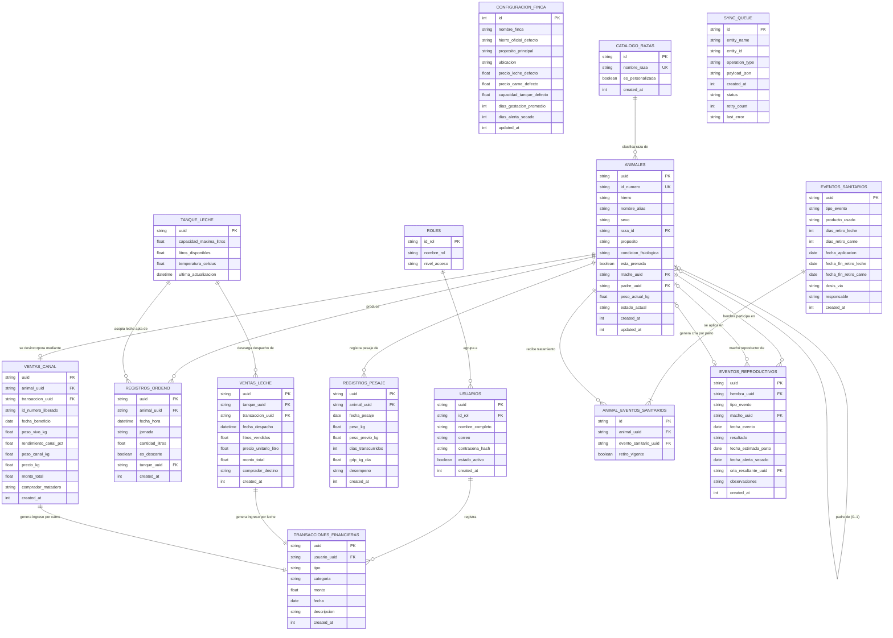

# 🗄️ Modelo Entidad-Relación (MER / DER): FincaControl
> **Sistema Integral de Gestión Ganadera para Fincas de Doble Propósito (Leche y Carne)**  
> **Equipo de Desarrollo:** Johan Maldonado – José Chacón  
> **Motor de Base de Datos:** SQLite Embebido Local (*Offline-First en Flutter*) + SQLite Cloud (*Base de Datos Online Centralizada*)

---

## 1. 📊 Diagrama Entidad-Relación (ER Diagram)

El siguiente diagrama modela la totalidad de las tablas maestras, transaccionales, operativas y de sincronización, reflejando fielmente la separación entre **Número Identificador** (`id_numero`) e **Hierro** (`hierro`), el catálogo de razas extensible, la genealogía por ID, el semáforo sanitario de tiempos de retiro y la trazabilidad financiera:

---

## 2. 📖 Diccionario de Datos y Especificación de Entidades

A continuación se detalla cada entidad con sus tipos de datos nativos SQLite (compatibles al 100% de manera idéntica tanto en el almacenamiento local embebido de Flutter como en SQLite Cloud), claves primarias (`PK`), claves foráneas (`FK`), restricciones de integridad y descripción funcional:

### 2.1. Entidad `CONFIGURACION_FINCA`
Almacena los parámetros globales de la unidad de producción. Diseñada como tabla de registro único (`id = 1`).

| Campo | Tipo | Restricción | Descripción |
| :--- | :--- | :--- | :--- |
| `id` | `INTEGER` | `PK`, `CHECK (id = 1)` | Identificador fijo del registro de configuración. |
| `nombre_finca` | `TEXT` | `NOT NULL` | Nombre comercial del hato (Ej. *"Hda. La Esperanza"*). |
| `hierro_oficial_defecto` | `TEXT` | `NOT NULL` | Descripción de la marca de hierro oficial del propietario (Ej. *"Iniciales HE"*). |
| `proposito_principal` | `TEXT` | `NOT NULL` | *"Doble Propósito"*, *"Leche"*, *"Carne"*. |
| `ubicacion` | `TEXT` | `NULLABLE` | Estado, municipio o sector geográfico de la finca. |
| `precio_leche_defecto` | `REAL` | `NOT NULL DEFAULT 0.45` | Precio base referencial por litro de leche ($\text{\$/L}$). |
| `precio_carne_defecto` | `REAL` | `NOT NULL DEFAULT 1.85` | Precio base referencial por kilo en pie/canal ($\text{\$/Kg}$). |
| `capacidad_tanque_defecto`| `REAL` | `NOT NULL DEFAULT 2000` | Capacidad máxima en litros del tanque de enfriamiento. |
| `dias_gestacion_promedio` | `INTEGER` | `NOT NULL DEFAULT 283` | Duración zootécnica promedio de gestación bovina (días). |
| `dias_alerta_secado` | `INTEGER` | `NOT NULL DEFAULT 60` | Antelación al parto para alertar el cese del ordeño (días). |
| `updated_at` | `INTEGER` | `NOT NULL` | Timestamp UNIX en milisegundos de la última modificación. |

---

### 2.2. Entidades de Seguridad: `ROLES` y `USUARIOS`
Implementan el control de acceso basado en roles (**RBAC**).

#### Tabla `ROLES`
* `id_rol` (`TEXT`, `PK`): Identificador del rol (`'ADMIN'`, `'OPERADOR'`).
* `nombre_rol` (`TEXT`, `NOT NULL`): Nombre legible (*"Administrador de Finca"*, *"Operador de Vaquera"*).
* `nivel_acceso` (`TEXT`, `NOT NULL`): Nivel granular de privilegios (*"FULL_ACCESS"*, *"FIELD_OPERATIONS"*).

#### Tabla `USUARIOS`
* `uuid` (`TEXT`, `PK`): Identificador único universal (UUID v4).
* `id_rol` (`TEXT`, `FK -> ROLES.id_rol`): Rol asignado al usuario.
* `nombre_completo` (`TEXT`, `NOT NULL`): Nombre del encargado o vaquero.
* `correo` (`TEXT`, `NOT NULL UNIQUE`): Correo de autenticación.
* `contrasena_hash` (`TEXT`, `NOT NULL`): Hash seguro (BCrypt/Argon2).
* `estado_activo` (`INTEGER`, `NOT NULL DEFAULT 1`): `1` = Activo, `0` = Inactivo.
* `created_at` (`INTEGER`, `NOT NULL`): Timestamp UNIX de creación.

---

### 2.3. Entidad `CATALOGO_RAZAS`
Catálogo extensible que persiste tanto razas sembradas por defecto como cruces personalizados creados en campo por el usuario.

| Campo | Tipo | Restricción | Descripción |
| :--- | :--- | :--- | :--- |
| `id` | `TEXT` | `PK` | Identificador único (slug o UUID). |
| `nombre_raza` | `TEXT` | `NOT NULL UNIQUE` | Nombre oficial (Ej: *"Gyr Mestizo"*, *"Carora F1"*, *"Girolando F1"*). |
| `es_personalizada` | `INTEGER` | `NOT NULL DEFAULT 0` | `0` = Raza predeterminada de fábrica, `1` = Creada por el usuario. |
| `created_at` | `INTEGER` | `NOT NULL` | Timestamp UNIX de registro. |

---

### 2.4. Entidad Central: `ANIMALES` (Censo de Rebaño)
Núcleo del sistema. Aplica la regla zootécnica de separar el **Número Identificador único** (`id_numero`) de la **Descripción del Hierro** (`hierro`), soporta condiciones fisiológicas venezolanas y relaciones reflexivas para genealogía:

| Campo | Tipo | Restricción | Descripción |
| :--- | :--- | :--- | :--- |
| `uuid` | `TEXT` | `PK` | UUID v4 interno para sincronización universal sin colisiones. |
| `id_numero` | `TEXT` | `NOT NULL` | **Número identificador individual visible** (arete, chapa o tatuaje). Es único entre animales en estado `'Activo'`. |
| `hierro` | `TEXT` | `NOT NULL` | Descripción de la marca de hierro de procedencia/propietario (Ej: *"Hda. La Esperanza - Iniciales HE"*). |
| `nombre_alias` | `TEXT` | `NOT NULL` | Nombre o alias del animal (Ej: *"Mariposa"*, *"Canela"*, *"Campeón"*). |
| `sexo` | `TEXT` | `CHECK (sexo IN ('Hembra', 'Macho'))` | Sexo zootécnico del animal. |
| `raza_id` | `TEXT` | `FK -> CATALOGO_RAZAS.nombre_raza` | Raza del animal vinculada al catálogo. |
| `proposito` | `TEXT` | `NOT NULL` | *"Doble Propósito"*, *"Leche"*, *"Carne / Ceba"*. |
| `condicion_fisiologica` | `TEXT` | `NOT NULL` | Condición zootécnica venezolana: *Becerro, Becerra, Maute, Mauta, Novillo, Novilla, Toro Reproductor, Vaca parida, Vaca escotera, Vaca seca*. |
| `esta_prenada` | `INTEGER` | `DEFAULT 0` | `1` = Sí, `0` = No. Restringido exclusivamente a hembras reproductoras (*Vacas y Novillas*). |
| `madre_uuid` | `TEXT` | `FK -> ANIMALES.uuid NULLABLE` | Referencia reflexiva a la madre biológica. |
| `padre_uuid` | `TEXT` | `FK -> ANIMALES.uuid NULLABLE` | Referencia reflexiva al toro padre o código de pajuela. |
| `peso_actual_kg` | `REAL` | `NOT NULL` | Último peso vivo registrado en báscula (Kg). |
| `estado_actual` | `TEXT` | `DEFAULT 'Activo'` | `'Activo'`, `'Desincorporado / Canal'`, `'Muerto'`, `'Vendido Vivo'`. |
| `created_at` | `INTEGER` | `NOT NULL` | Timestamp UNIX de alta. |
| `updated_at` | `INTEGER` | `NOT NULL` | Timestamp UNIX de última modificación. |

---

### 2.5. Línea de Producción de Leche: `REGISTROS_ORDENO`, `TANQUE_LECHE` y `VENTAS_LECHE`

#### Tabla `REGISTROS_ORDENO`
Registra cada ordeño individual.
* `uuid` (`TEXT`, `PK`): UUID v4.
* `animal_uuid` (`TEXT`, `FK -> ANIMALES.uuid`): Vaca ordeñada.
* `fecha_hora` (`TEXT/DATETIME`, `NOT NULL`): Fecha y hora del pesaje de leche.
* `jornada` (`TEXT`, `CHECK (jornada IN ('Mañana', 'Tarde'))`): Turno del ordeño.
* `cantidad_litros` (`REAL`, `NOT NULL`): Volumen obtenido en litros.
* `es_descarte` (`INTEGER`, `NOT NULL DEFAULT 0`): `1` = Leche no comercial por tiempo de retiro activo (desvío forzoso a descarte/terneros); `0` = Leche apta.
* `tanque_uuid` (`TEXT`, `FK -> TANQUE_LECHE.uuid NULLABLE`): Tanque de acopio al que se sumó (solo si `es_descarte = 0`).

#### Tabla `TANQUE_LECHE`
Monitorea el inventario disponible de leche fría apta para venta comercial.
* `uuid` (`TEXT`, `PK`): Identificador del tanque de la vaquera.
* `capacidad_maxima_litros` (`REAL`, `NOT NULL`): Límite físico del tanque.
* `litros_disponibles` (`REAL`, `NOT NULL DEFAULT 0.0`): **Stock disponible acumulado**. Se incrementa con ordeños aptos y disminuye con cada despacho.
* `temperatura_celsius` (`REAL`, `DEFAULT 4.0`): Temperatura de conservación.
* `ultima_actualizacion` (`INTEGER`, `NOT NULL`): Timestamp UNIX.

#### Tabla `VENTAS_LECHE`
Registra el despacho comercial y la facturación de la leche.
* `uuid` (`TEXT`, `PK`): Remisión de venta.
* `tanque_uuid` (`TEXT`, `FK -> TANQUE_LECHE.uuid`): Tanque de origen del que se restaron los litros.
* `transaccion_uuid` (`TEXT`, `FK -> TRANSACCIONES_FINANCIERAS.uuid`): Asiento contable de ingreso automático generado.
* `fecha_despacho` (`TEXT/DATE`, `NOT NULL`): Fecha de entrega del camión cisterna o receptor.
* `litros_vendidos` (`REAL`, `NOT NULL`): Litros descargados del tanque.
* `precio_unitario_litro` (`REAL`, `NOT NULL`): Precio pactado ($\text{\$/L}$).
* `monto_total` (`REAL`, `NOT NULL`): Monto liquidado ($\text{Litros} \times \text{Precio}$).
* `comprador_destino` (`TEXT`, `NOT NULL`): Planta procesadora o quesera compradora.

---

### 2.6. Línea de Producción de Carne: `REGISTROS_PESAJE` y `VENTAS_CANAL`

#### Tabla `REGISTROS_PESAJE`
Control de evolución ponderal individual o por lote.
* `uuid` (`TEXT`, `PK`): UUID v4.
* `animal_uuid` (`TEXT`, `FK -> ANIMALES.uuid`): Bovino pesado.
* `fecha_pesaje` (`TEXT/DATE`, `NOT NULL`): Fecha de báscula.
* `peso_kg` (`REAL`, `NOT NULL`): Peso vivo medido.
* `peso_previo_kg` (`REAL`, `NOT NULL`): Peso de la sesión anterior.
* `dias_transcurridos` (`INTEGER`, `NOT NULL`): Intervalo entre fechas.
* `gdp_kg_dia` (`REAL`, `NOT NULL`): Ganancia Diaria de Peso calculada:  
  $$\text{GDP} = \frac{\text{peso\_kg} - \text{peso\_previo\_kg}}{\text{dias\_transcurridos}}$$
* `desempeno` (`TEXT`, `NOT NULL`): *'Excelente'* ($\ge 0.60$), *'Normal'* ($0.30 - 0.59$), *'Estancado'* ($< 0.30$).

#### Tabla `VENTAS_CANAL`
Liquidación en matadero que desincorpora al animal del censo activo y **libera formalmente su número identificador**:
* `uuid` (`TEXT`, `PK`): Registro de beneficio en canal.
* `animal_uuid` (`TEXT`, `FK -> ANIMALES.uuid`): Res vendida (cuyo `estado_actual` pasa a `'Desincorporado / Canal'`).
* `transaccion_uuid` (`TEXT`, `FK -> TRANSACCIONES_FINANCIERAS.uuid`): Asiento de ingreso automático generado.
* `id_numero_liberado` (`TEXT`, `NOT NULL`): **Número identificador que queda libre** en el censo para ser reutilizado por una nueva cría.
* `fecha_beneficio` (`TEXT/DATE`, `NOT NULL`): Fecha de salida/beneficio.
* `peso_vivo_kg` (`REAL`, `NOT NULL`): Peso vivo en báscula.
* `rendimiento_canal_pct` (`REAL`, `NOT NULL`): Rendimiento cárnico estimado (Ej: $53.5\%$).
* `peso_canal_kg` (`REAL`, `NOT NULL`): Kilos calculados en canal ($\text{peso\_vivo} \times \text{rendimiento}$).
* `precio_kg` (`REAL`, `NOT NULL`): Precio por kilo pactado.
* `monto_total` (`REAL`, `NOT NULL`): Total liquidado a favor de la finca.
* `comprador_matadero` (`TEXT`, `NOT NULL`): Frigorífico o comprador.

---

### 2.7. Sanidad y Bioseguridad: `EVENTOS_SANITARIOS` y `ANIMAL_EVENTOS_SANITARIOS`

#### Tabla `EVENTOS_SANITARIOS`
Define el tratamiento médico o campaña sanitaria (individual o masiva).
* `uuid` (`TEXT`, `PK`): UUID v4.
* `tipo_evento` (`TEXT`, `NOT NULL`): *'Tratamiento Antibiótico', 'Vacunación Oficial', 'Desparasitación', 'Vitaminización'*.
* `producto_usado` (`TEXT`, `NOT NULL`): Nombre comercial y principio activo.
* `dias_retiro_leche` (`INTEGER`, `NOT NULL DEFAULT 0`): Días de carencia obligatoria en leche.
* `dias_retiro_carne` (`INTEGER`, `NOT NULL DEFAULT 0`): Días de carencia obligatoria en carne.
* `fecha_aplicacion` (`TEXT/DATE`, `NOT NULL`): Fecha de administración.
* `fecha_fin_retiro_leche` (`TEXT/DATE`, `NOT NULL`): $\text{fecha\_aplicacion} + \text{dias\_retiro\_leche}$.
* `fecha_fin_retiro_carne` (`TEXT/DATE`, `NOT NULL`): $\text{fecha\_aplicacion} + \text{dias\_retiro\_carne}$.
* `dosis_via` (`TEXT`): Dosis y vía de aplicación (Intramuscular, Subcutánea, Oral).
* `responsable` (`TEXT`): Médico veterinario o encargado aplicador.

#### Tabla Intermedia `ANIMAL_EVENTOS_SANITARIOS`
Permite relacionar tratamientos masivos (un lote o todo el rebaño) o individuales a múltiples animales:
* `id` (`TEXT`, `PK`): UUID v4.
* `animal_uuid` (`TEXT`, `FK -> ANIMALES.uuid`): Animal tratado.
* `evento_sanitario_uuid` (`TEXT`, `FK -> EVENTOS_SANITARIOS.uuid`): Evento sanitario.
* `retiro_vigente` (`INTEGER`, `NOT NULL DEFAULT 1`): Flag calculado que activa el semáforo rojo en ordeño y bloquea la venta en canal.

---

### 2.8. Ciclo Reproductivo: `EVENTOS_REPRODUCTIVOS`
Gobierna los servicios, gestaciones, secados y partos con alta de cría:

| Campo | Tipo | Restricción | Descripción |
| :--- | :--- | :--- | :--- |
| `uuid` | `TEXT` | `PK` | UUID v4 del evento. |
| `hembra_uuid` | `TEXT` | `FK -> ANIMALES.uuid` | Vaca o novilla sobre la que ocurre el evento. |
| `tipo_evento` | `TEXT` | `NOT NULL` | *'Celo', 'Inseminación / Monta', 'Diagnóstico Preñez', 'Secado', 'Parto', 'Aborto'*. |
| `macho_uuid` | `TEXT` | `FK -> ANIMALES.uuid NULLABLE` | Toro reproductor o código de pajuela. |
| `fecha_evento` | `TEXT/DATE` | `NOT NULL` | Fecha del suceso zootécnico. |
| `resultado` | `TEXT` | `NOT NULL` | *'Exitoso', 'Preñada Confirmada', 'Vacía', 'Secado Efectuado', 'Nacimiento Vivo'*. |
| `fecha_estimada_parto` | `TEXT/DATE` | `NULLABLE` | $\text{fecha\_evento} + 283 \text{ días}$ (en servicios y preñez confirmada). |
| `fecha_alerta_secado` | `TEXT/DATE` | `NULLABLE` | $\text{fecha\_estimada\_parto} - 60 \text{ días}$. |
| `cria_resultante_uuid` | `TEXT` | `FK -> ANIMALES.uuid NULLABLE` | Vínculo foráneo directo a la nueva cría dada de alta en `ANIMALES` tras un Parto. |
| `observaciones` | `TEXT` | `NULLABLE` | Detalles clínicos o de condición de parto. |

---

### 2.9. Control Financiero Operativo: `TRANSACCIONES_FINANCIERAS`
Gestiona el flujo de caja diario de la explotación pecuaria:

| Campo | Tipo | Restricción | Descripción |
| :--- | :--- | :--- | :--- |
| `uuid` | `TEXT` | `PK` | UUID v4 de la transacción. |
| `usuario_uuid` | `TEXT` | `FK -> USUARIOS.uuid` | Usuario que autorizó o registró el movimiento. |
| `tipo` | `TEXT` | `CHECK (tipo IN ('Ingreso', 'Egreso'))` | Naturaleza del movimiento. |
| `categoria` | `TEXT` | `NOT NULL` | *'Venta de Leche', 'Venta de Ganado / Canal', 'Subproductos (Queso)', 'Alimentación / Sal', 'Sanidad / Medicinas', 'Mano de Obra / Jornales', 'Mantenimiento / Combustible'*. |
| `monto` | `REAL` | `NOT NULL CHECK (monto > 0)` | Importe monetario en dólares ($\text{\$ USD}$). |
| `fecha` | `TEXT/DATE` | `NOT NULL` | Fecha del movimiento financiero. |
| `descripcion` | `TEXT` | `NOT NULL` | Detalle explicativo de la transacción. |

---

### 2.10. Infraestructura Offline-First: `SYNC_QUEUE`
Tabla técnica de auditoría local en SQLite donde se encolan todas las mutaciones realizadas en campo sin internet:

| Campo | Tipo | Restricción | Descripción |
| :--- | :--- | :--- | :--- |
| `id` | `TEXT` | `PK` | UUID v4 de la operación en cola. |
| `entity_name` | `TEXT` | `NOT NULL` | Nombre de la tabla afectada (*'ANIMALES', 'REGISTROS_ORDENO', etc.*). |
| `entity_id` | `TEXT` | `NOT NULL` | UUID del registro mutado. |
| `operation_type` | `TEXT` | `CHECK (operation_type IN ('INSERT', 'UPDATE', 'DELETE'))` | Tipo de operación DML. |
| `payload_json` | `TEXT` | `NOT NULL` | Carga útil completa serializada en JSON. |
| `created_at` | `INTEGER` | `NOT NULL` | Timestamp UNIX en milisegundos para orden cronológico estricto (`ASC`). |
| `status` | `TEXT` | `DEFAULT 'PENDING'` | `'PENDING'`, `'SYNCING'`, `'SYNCED'`, `'CONFLICT'`, `'FAILED'`. |
| `retry_count` | `INTEGER` | `DEFAULT 0` | Número de reintentos de sincronización con el backend. |
| `last_error` | `TEXT` | `NULLABLE` | Traza del último error de red o de validación HTTP. |

---

## 3. 🎯 Reglas de Integridad y Trazabilidad del Negocio

1. **Unicidad Condicional del Número Identificador:**
   * En SQLite se aplica un índice único parcial:  
     `CREATE UNIQUE INDEX uq_id_numero_activo ON ANIMALES(id_numero) WHERE estado_actual = 'Activo';`
   * Esto permite que, cuando un animal pasa a canal (`estado_actual = 'Desincorporado / Canal'`), su `id_numero` se **libere automáticamente**, pudiendo ser asignado a un nuevo becerro sin generar colisión en la base de datos.
2. **Inocuidad Estricta en Ordeño:**
   * Antes de insertar en `REGISTROS_ORDENO`, una consulta verifica si el animal tiene registros activos en `ANIMAL_EVENTOS_SANITARIOS` con fecha actual $\le \text{fecha\_fin\_retiro\_leche}$. De ser así, se fuerza `es_descarte = 1` y `tanque_uuid = NULL`, impidiendo que la leche contamine el tanque comercial.
3. **Bloqueo Físico en Venta a Canal:**
   * La inserción en `VENTAS_CANAL` está protegida por un trigger/validación que aborta la transacción si el animal tiene retiro vigente de carne ($\text{fecha actual} \le \text{fecha\_fin\_retiro\_carne}$).
4. **Transaccionalidad en Partos:**
   * El registro de un evento de tipo `'Parto'` en `EVENTOS_REPRODUCTIVOS` ejecuta un bloque transaccional atómico:
     1. Inserta la cría en `ANIMALES` con su `id_numero`, `hierro`, `nombre_alias`, `sexo`, `raza_id`, `peso_actual_kg` y `madre_uuid`.
     2. Actualiza la madre en `ANIMALES` a `condicion_fisiologica = 'Vaca parida'` y `esta_prenada = 0`.
     3. Inserta la fila en `EVENTOS_REPRODUCTIVOS` referenciando el `cria_resultante_uuid`.
5. **Acreditación Automática de Ingresos:**
   * Toda confirmación en `VENTAS_LECHE` o `VENTAS_CANAL` genera automáticamente una tupla vinculada en `TRANSACCIONES_FINANCIERAS` con `tipo = 'Ingreso'`, garantizando la reconciliación exacta entre la producción física y la caja financiera.

---

## 4. ☁️ Ventajas de la Arquitectura Unificada con SQLite Cloud

La decisión de adoptar **SQLite Cloud** como base de datos en la nube (sustituyendo a PostgreSQL) simplifica radicalmente el ciclo de vida del software en **FincaControl**:

1. **Paridad Dialectal 100% (Single Source of Truth en DDL):**
   * Un único script `schema.sql` es válido y ejecutable sin ninguna alteración tanto en los dispositivos móviles (*Flutter con `sqflite` o `sqlite3`*) como en el servidor centralizado (*SQLite Cloud*).
   * Se elimina la necesidad de mantener dos esquemas separados o capas complejas de mapeo objeto-relacional (ORM) para traducir sintaxis, tipos o funciones entre SQLite y PostgreSQL.
2. **Cero Fricción en Tipos de Datos:**
   * Idéntico comportamiento en tipos primitivos: `INTEGER`, `REAL`, `TEXT`, `BLOB`.
   * El manejo de marcas temporales (UNIX Epoch en milisegundos o strings ISO-8601) y valores booleanos (`0` y `1`) es exactamente el mismo en el cliente y en la nube.
3. **Mismo Comportamiento en Índices Parciales y Restricciones:**
   * El índice condicional `CREATE UNIQUE INDEX uq_id_numero_activo ON ANIMALES(id_numero) WHERE estado_actual = 'Activo';` opera de manera idéntica en ambos lados, garantizando que la regla de reciclaje de números de arete/identificador funcione con la misma semántica tanto localmente como en la nube.
4. **Sincronización Directa y Liviana:**
   * Las mutaciones registradas en `SYNC_QUEUE` (INSERT, UPDATE, DELETE con parámetros) pueden replicarse directamente contra SQLite Cloud a través de su API REST/WebSocket nativa o mediante un micro-servicio intermediario, ejecutando exactamente la misma sentencia SQL preparada sin necesidad de traducción o transformación de dialéctica.
5. **Menor Consumo de Recursos y Alta Eficiencia:**
   * SQLite Cloud ofrece latencias ultrabajas, soporte de replicación distribuida bajo consenso Raft y un consumo de memoria mínimo en comparación con instancias pesadas de bases de datos relacionales convencionales.

