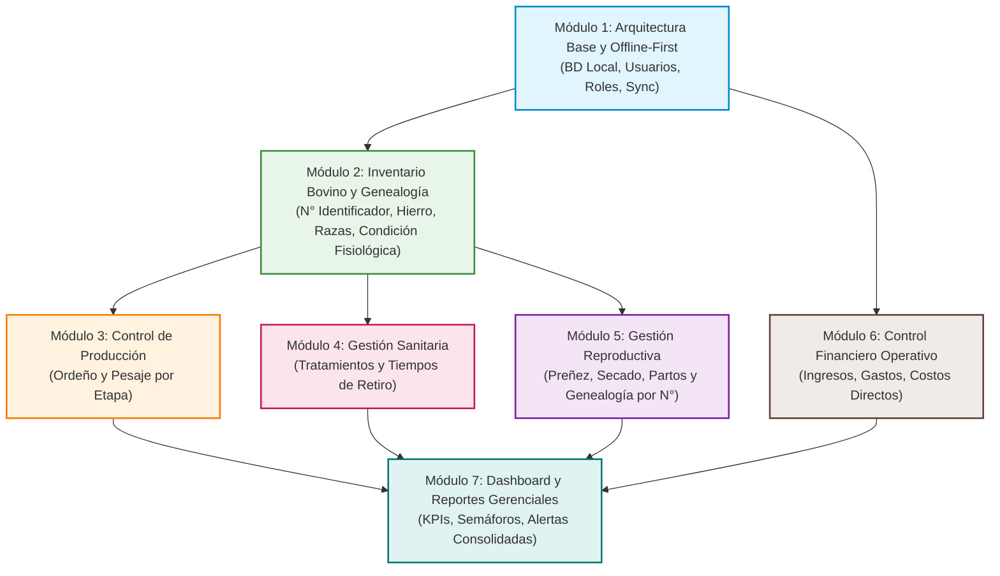

# 📋 Guía Paso a Paso de Planificación de Módulos: FincaControl
> **Sistema de Gestión Ganadera para Fincas de Doble Propósito (Leche y Carne)**  
> **Equipo de Trabajo:** Johan Maldonado – José Chacón  
> **Fase:** Planificación y Diseño Arquitectónico

---

## 📑 Índice de Módulos y Fases de Desarrollo

Haga clic en cualquiera de los módulos para consultar su desglose detallado de planificación:

1. [Fase 1: Módulo 1 - Arquitectura Base, Seguridad y Motor Offline-First](#modulo-1-arquitectura-base)
2. [Fase 2: Módulo 2 - Gestión de Inventario Bovino, Condiciones Fisiológicas y Trazabilidad Genealógica](#modulo-2-inventario-genealogia)
3. [Fase 3: Módulo 3 - Control de Producción de Doble Propósito (Leche y Carne)](#modulo-3-control-produccion)
4. [Fase 4: Módulo 4 - Gestión Sanitaria, Tratamientos y Tiempos de Retiro](#modulo-4-gestion-sanitaria)
5. [Fase 5: Módulo 5 - Gestión Reproductiva y Trazabilidad Materno-Filial](#modulo-5-gestion-reproductiva)
6. [Fase 6: Módulo 6 - Control Financiero Operativo y Costos Directos](#modulo-6-financiero-operativo)
7. [Fase 7: Módulo 7 - Tablero de Control (Dashboard), Métricas y Reportes](#modulo-7-dashboard-reportes)
8. [Matriz de Dependencias y Ruta Crítica de Desarrollo](#matriz-dependencias)

---

## 1. Módulo 1: Arquitectura Base, Seguridad y Motor Offline-First

### 🎯 Propósito del Módulo
Establecer la infraestructura de software, la base de datos local embebida y los mecanismos de autenticación y sincronización en segundo plano. En una finca de doble propósito, el acceso a internet suele ser nulo o inestable en los potreros y vaqueras; este módulo garantiza que la aplicación sea 100% operativa sin conexión (*Offline-First*).

### 🧩 Entidades del Modelo de Dominio
* **`Rol`**: `ID_Rol`, `Nombre_Rol`, `Nivel_Acceso`.
* **`Usuario`**: `ID_Usuario`, `Nombre`, `Correo`, `Contrasena_Hash`, `Estado_Activo`.

### 📝 Desglose de Funcionalidades Paso a Paso
1. **Definición del Almacenamiento Local (SQLite / Room / Hive):**
   * Configuración de esquema relacional local con soporte a identificadores universales (UUID) para evitar colisiones de ID durante la creación de registros sin conexión.
   * Persistencia local de catálogos dinámicos configurables por el productor (como el catálogo personalizado de razas bovinas).
   * Mecanismo de migraciones de base de datos local.
2. **Control de Acceso Basado en Roles (RBAC):**
   * **Administrador (Propietario / Administrador de Finca):** Acceso total a finanzas, configuración, usuarios y altas/bajas.
   * **Operador (Mayordomo / Ordeñador / Vaquero):** Entrada rápida a registros de pesaje, ordeño diario y aplicaciones sanitarias, sin acceso a módulos financieros restringidos.
3. **Mecanismo de Autenticación Híbrida:**
   * Validación local mediante tokens con expiración extendida para permitir inicio de sesión en campo sin cobertura celular.
4. **Cola de Sincronización (Sync Engine):**
   * Registro de auditoría local (`pending_sync`, `timestamp`, `operation_type`: INSERT/UPDATE/DELETE).
   * Detección de conectividad (WiFi / Datos) y sincronización delta en segundo plano.
   * Estrategia de resolución de conflictos (*Last-Write-Wins* o validación transaccional por marca de tiempo).

### ⚠️ Consideraciones de Campo (Offline)
* Todas las transacciones deben persistirse primero en el almacenamiento local con respuesta inmediata (<100ms) para no demorar la faena del operario.
* Cifrado local de datos sensibles (contraseñas y balances financieros).

### 📌 Checklist de Planificación
- [ ] Especificación de endpoints y contratos de sincronización.
- [ ] Definición formal de permisos para la matriz Rol vs. Pantalla.
- [ ] Diagrama de estados del motor de sincronización.

[⬆ Volver al Índice](#indice)

---

## 2. Módulo 2: Gestión de Inventario Bovino, Condiciones Fisiológicas y Trazabilidad Genealógica

### 🎯 Propósito del Módulo
Digitalizar el censo del rebaño bovino, constituyendo el núcleo del sistema. Permite identificar de manera individual cada res mediante su **Número Identificador**, registrar la descripción de su **Hierro** (propietario y procedencia conforme a la tradición ganadera venezolana), clasificar a los animales según su **condición fisiológica / etapa de desarrollo** y estado de **preñez**, gestionar un catálogo extensible de **razas** y consultar su genealogía para evitar consanguinidad (endogamia) en futuros empadres.

### 🧩 Entidades del Modelo de Dominio
* **`Animal`**:
  * `ID_Numero`: Número identificador único del animal dentro del rebaño activo (ej. `042`, `104`, `201`).
  * `Hierro`: Descripción de la marca de hierro quemado/frío que en Venezuela indica **propietario y procedencia** del animal (puede consistir en iniciales, monogramas o figuras como *"Iniciales JM"*, *"Hda. La Esperanza (HE)"*, *"Herradura con estrella"*).
  * `Nombre_Alias`: Nombre o apodo del ejemplar.
  * `Fecha_Nacimiento` / `Edad_Estimada`.
  * `Sexo`: *Hembra* o *Macho*.
  * `Raza`: Referencia al catálogo de razas (permite razas por defecto y razas personalizadas registradas por el usuario).
  * `Proposito`: *Leche*, *Carne / Ceba*, *Doble Propósito*.
  * `Condicion_Fisiologica`: Etapa productiva/fisiológica del bovino (*Becerro / Becerra*, *Maute / Mauta*, *Novillo / Novilla*, *Toro / Toro Reproductor*, *Vaca parida*, *Vaca escotera*, *Vaca seca*).
  * `Esta_Prenada`: Booleano (`Sí` / `No`), aplicable **únicamente a hembras en etapa reproductiva** (*Vacas* y *Novillas*); no aplica en machos (*Toro*, *Novillo*, *Maute*, *Becerro*) ni en crías (*Becerra*).
  * `Tipo_Parto_Vaca`: Opcional para vacas paridas (*Primípara* si es su primer parto, o *Multípara* si acumula varios).
  * `Estado_Actual`: *Activo*, *Vendido / Canal*, *Muerto*, *Descarte*.
* **`CatalogoRaza`**: `ID_Raza`, `Nombre_Raza`, `Es_Personalizada`. Permite que el productor agregue nuevas razas y queden guardadas permanentemente para registrar futuros animales.
* **Relaciones Genealógicas:** Relación reflexiva con `Madre (0..1)` y `Padre (0..1)` vinculada a través del **Número Identificador del Animal (`ID_Numero`)**, garantizando trazabilidad unívoca incluso cuando todos los animales nacidos en la finca comparten el mismo hierro de propiedad.

### 🐄 Etapas y Clasificación Fisiológica del Ganado Bovino (Estándar Venezolano)
1. **Becerro / Becerra:** Desde el nacimiento hasta el destete (aproximadamente entre los 4 y 10 meses de edad), con un peso que oscila entre los 150 kg y 200 kg al destete. Dependen inicialmente de la leche materna y el calostro, transitando gradualmente hacia el consumo de pastos y concentrados.
2. **Maute / Mauta:** Animales jóvenes que van desde los 10 hasta los 18 meses de edad, alcanzando un peso aproximado de 350 kg (rango desde el destete 150–250 kg hasta los 350 kg PV). Corresponde a la fase de levante o crecimiento intermedio tras el destete e inicio de actividad sexual.
3. **Novillo / Novilla (y Torete):** Desde los 18 meses hasta alcanzar el peso mínimo requerido para la venta, el engorde final o la reproducción (aproximadamente 400 kg o más). En las hembras, las destinadas a reproducción suelen llamarse *novillas de vientre* (entre el inicio de actividad sexual y el primer parto). En los machos jóvenes se distingue entre *torete* (entero pospubertad) y *novillo* (castrado para ceba).
4. **Toro / Toro Reproductor:** Macho adulto destinado a la monta o reproducción, generalmente incorporado a partir de los 30 meses de vida con pesos superiores a los 425 kg.
5. **Vaca:** Hembra en etapa adulta (considerada así a partir de su primer parto). Según su estado productivo y reproductivo en el hato venezolano, se clasifica en:
   * **Vaca parida:** Aquella que ha tenido su cría y se encuentra en lactancia (*primípara* si es su primer parto, o *multípara* si acumula varios).
   * **Vaca escotera:** Vaca que se encuentra preñada pero no está produciendo leche en ese momento (no lactante).
   * **Vaca seca:** Aquella que ha finalizado su periodo de lactancia y se encuentra en el último tercio de gestación (~60 días previos) antes del siguiente parto.

### 📝 Desglose de Funcionalidades Paso a Paso
1. **Registro de Animales con Distinción entre Número Identificador y Hierro:**
   * **Número Identificador (`ID_Numero`):** Campo obligatorio y único en el rebaño activo que identifica individualmente a la res.
   * **Descripción del Hierro (`Hierro`):** Campo descriptivo para registrar las iniciales, letras o figura del hierro que acredita propietario y procedencia del animal.
   * Captura por nacimiento en finca (asignación automática del `ID_Numero` de la madre conocida y prellenado del hierro de la finca) o por compra externa (registrando el hierro del vendedor/procedencia).
2. **Registro Personalizado y Persistente de Razas:**
   * Selector con razas predeterminadas (*Gyr Mestizo*, *Carora F1*, *Brahman*, *Guzerá*, *Pardo Suizo*, *Senepol*, *Romosinuano*) e interfaz integrada para **registrar nuevas razas personalizadas**, las cuales quedan almacenadas en el catálogo local para ser reutilizadas en el registro de otros animales.
3. **Clasificación por Condición Fisiológica y Validación de Preñez:**
   * Selección dinámica de la condición fisiológica coherente con el sexo del animal (si es `Macho`: *Becerro*, *Maute*, *Novillo / Torete*, *Toro Reproductor*; si es `Hembra`: *Becerra*, *Mauta*, *Novilla de vientre*, *Vaca parida*, *Vaca escotera*, *Vaca seca*).
   * Control explícito **¿Está Preñada? (`Sí / No`)**: Se habilita exclusivamente para hembras aptas (*Novilla* y *Vaca*). Si se selecciona un macho o una becerra/mauta, el sistema bloquea o marca automáticamente como *"No aplica"*. Asimismo, en *Vaca escotera* y *Vaca seca* se preselecciona `Preñada = Sí` según su definición zootécnica.
4. **Hoja de Vida Digital y Árbol Genealógico (Por Número Identificador):**
   * Vista consolidada con `ID_Numero`, descripción del `Hierro`, condición fisiológica, estado de preñez, raza y último peso.
   * Vista jerárquica de ascendencia donde la **Madre** y el **Padre** se guardan y muestran por su **Número Identificador (`#ID_Numero`)**.
5. **Módulo de Bajas, Venta en Canal y Liberación del Número Identificador:**
   * Al desincorporar un animal por venta en canal, se conserva su registro histórico (con su número y hierro) y se libera su **Número Identificador (`ID_Numero`)** para que pueda asignarse a nuevas crías.
6. **Motor de Búsqueda y Filtros de Rebaño:**
   * Filtrado dinámico por condición fisiológica, estado de preñez (preñadas vs. vacías), raza, sexo, hierro de procedencia y propósito.

### ⚠️ Consideraciones de Campo (Offline)
* Búsqueda indexada en SQLite por **Número Identificador (`ID_Numero`)** y por **Hierro** para respuesta instantánea en la manga de manejo o corral.
* El catálogo personalizado de razas se guarda localmente en SQLite/`localStorage` para estar disponible sin conexión.

### 📌 Checklist de Planificación
- [x] Separación de atributos entre `ID_Numero` (identificador individual y clave de genealogía materna/paterna) y `Hierro` (descripción de iniciales/figura de propietario y procedencia).
- [x] Catálogo extensible de razas bovinas con opción de crear y guardar nuevas razas desde los formularios de alta y parto.
- [x] Clasificación por condiciones fisiológicas venezolanas (*Becerro/a*, *Maute/a*, *Novillo/Novilla*, *Toro Reproductor*, *Vaca parida*, *Vaca escotera*, *Vaca seca*) e indicador de preñez exclusivo para hembras.

[⬆ Volver al Índice](#indice)

---

## 3. Módulo 3: Control de Producción de Doble Propósito (Leche y Carne)

### 🎯 Propósito del Módulo
Registrar y analizar las dos fuentes primarias de rendimiento económico en fincas de doble propósito: la producción lechera diaria y la ganancia de peso para carne. Permite identificar las vacas de alta producción y los lotes de levante y ceba más eficientes según su etapa fisiológica.

### 🧩 Entidades del Modelo de Dominio
* **`RegistroOrdeno`**: `ID_ordeno`, `Fecha_Hora`, `Cantidad_Litros`, `Jornada` (*Mañana*, *Tarde*), `Animal_Numero (1)`.
* **`RegistroPesaje`**: `ID_pesaje`, `Fecha`, `Peso_Kg`, `Condicion_Fisiologica_Actual`, `Animal_Numero (1)`.

### 📝 Desglose de Funcionalidades Paso a Paso
1. **Submódulo de Ordeño Diario:**
   * **Entrada Individual Rápida:** Búsqueda por **Número Identificador (`ID_Numero`)** de la vaca (filtrando hembras en condición `Vaca parida` / lactancia) y registro de litros por jornada (mañana/tarde).
   * **Modo Carga Masiva / Lista de Vaquera:** Formulario en tabla para ingresar rápidamente los litros de todo el lote de ordeño sin cambiar de pantalla.
   * Acumulados diarios de producción global de la finca (litros totales del día).
2. **Submódulo de Pesaje y Control de Carne por Etapa Fisiológica:**
   * Registro de pesajes periódicos en báscula física o cinta bovinométrica identificando al animal por su `ID_Numero`.
   * **Cálculo Automático de Ganancia Diaria de Peso (GDP):**  
     $$\text{GDP} = \frac{\text{Peso Actual} - \text{Peso Anterior}}{\text{Días transcurridos}}$$
   * Evaluación del peso respecto a los umbrales de transición de etapa fisiológica en Venezuela (*Destete de Becerro a Maute*: ~150–200 kg; *Levante de Maute a Novillo/Novilla*: ~350 kg; *Acabado/Reproducción*: ≥400–425 kg).
3. **Analítica de Productividad:**
   * Curvas de lactancia (días en lactancia vs. litros/día).
   * Promedios de producción por animal, por lote y comparativa entre temporadas (verano/invierno).

### ⚠️ Consideraciones de Campo (Offline)
* Teclado numérico predeterminado en formularios para acelerar la digitación durante la faena.
* Validación de rangos lógicos (ejemplo: alertar si se digitan >40 litros en una jornada o pesos incoherentes para evitar errores de dedo).

### 📌 Checklist de Planificación
- [ ] Definición de fórmulas de cálculo de promedios de lactancia normalizada (305 días).
- [ ] Sugerencia automática de cambio de condición fisiológica cuando un animal alcanza el peso/edad de transición (ej. de *Becerro* a *Maute* o de *Maute* a *Novillo*).
- [ ] Diseño de gráficos ligeros renderizables en local sin bibliotecas pesadas.

[⬆ Volver al Índice](#indice)

---

## 4. Módulo 4: Gestión Sanitaria, Tratamientos y Tiempos de Retiro

### 🎯 Propósito del Módulo
Garantizar la salud del rebaño y salvaguardar la inocuidad alimentaria. El control estricto de los **Tiempos de Retiro** (período de carencia de medicamentos en leche y carne) evita la contaminación de la leche entregada al centro de acopio y la venta de reses con trazas de fármacos.

### 🧩 Entidades del Modelo de Dominio
* **`EventoSanitario`**: `ID_Sanidad`, `Tipo_Evento` (*Vacunación*, *Desparasitación*, *Tratamiento Antibiótico*, *Vitaminización*), `Fecha_Aplicacion`, `Producto_Usado`, `Dias_Retiro_Leche`, `Dias_Retiro_Carne`, `Animales_Numero (1..*)`.

### 📝 Desglose de Funcionalidades Paso a Paso
1. **Registro de Eventos y Campañas Sanitarias:**
   * Registro individual por `ID_Numero` (para animales enfermos en enfermería/corral).
   * Registro colectivo/en lote (ej. vacunación oficial de ley según INSAI contra Fiebre Aftosa, Rabia, Brucelosis en hembras o pruebas serológicas de Brucelosis y Tuberculosis).
2. **Semáforo y Alertas de Tiempos de Retiro (Punto Crítico):**
   * Cálculo automático de fecha de liberación:  
     $$\text{Fecha de Fin de Retiro} = \text{Fecha de Aplicación} + \text{Días de Retiro}$$
   * **Alerta visual roja en el módulo de ordeño:** Bloqueo o advertencia si el ordeñador intenta registrar leche comercializable de una vaca bajo tratamiento.
   * **Alerta visual en bajas/ventas:** Bloqueo preventivo de venta para matadero de animales dentro del tiempo de retiro de carne.
3. **Calendario y Programación Sanitaria:**
   * Programación de revacunaciones y refuerzos periódicos.
   * Historial clínico acumulado por animal en su hoja de vida.

### ⚠️ Consideraciones de Campo (Offline)
* El cálculo del vencimiento de la cuarentena del fármaco debe realizarse localmente en el dispositivo utilizando el reloj interno.
* Alertas visuales destacadas incluso sin conectividad a internet.

### 📌 Checklist de Planificación
- [ ] Vademécum básico precargado con fármacos comunes y sus días de retiro sugeridos.
- [ ] Reglas de negocio para el bloqueo preventivo en pantallas de ordeño y ventas.
- [ ] Registro de firma o responsable de la aplicación sanitaria.

[⬆ Volver al Índice](#indice)

---

## 5. Módulo 5: Gestión Reproductiva y Trazabilidad Materno-Filial

### 🎯 Propósito del Módulo
Monitorear y optimizar los ciclos reproductivos de las hembras bovinas (*Novillas de vientre* y *Vacas*). Un óptimo manejo reproductivo actualiza dinámicamente la condición fisiológica y el estado de preñez de la hembra, reduce los días abiertos, acorta el Intervalo Entre Partos (IEP) y automatiza el registro genealógico de las crías usando el **Número Identificador** de los progenitores.

### 🧩 Entidades del Modelo de Dominio
* **`EventoReproductivo`**: `ID_Reproduccion`, `Tipo_Evento` (*Celo*, *Servicio/Monta*, *Inseminación*, *Palpación/Diagnóstico*, *Secado*, *Parto*, *Aborto*), `Fecha_Evento`, `Resultado`, `Observaciones`, `Hembra_Numero (1)`, `Macho_Numero_O_Semen (0..1)`.

### 📝 Desglose de Funcionalidades Paso a Paso
1. **Registro de Ciclo y Servicios:**
   * Selección exclusiva de hembras en etapa reproductiva (*Novilla*, *Vaca parida*, *Vaca escotera*, *Vaca seca*) identificadas por su `ID_Numero`.
   * Registro de celos detectados y servicios (monta natural indicando el `ID_Numero` del *Toro Reproductor* o inseminación artificial con código de pajuela).
2. **Diagnóstico de Gestación (Palpación / Ecografía) y Estado de Preñez:**
   * Registro de resultado (*Preñada Confirmada* / *Vacía* / *Dudosa*).
   * Si el resultado es *Preñada Confirmada*, el sistema actualiza automáticamente el atributo `Esta_Prenada = Sí` en la ficha de la hembra (y si no está produciendo leche, puede clasificarla como *Vaca escotera*). Si el resultado es *Vacía* o *Aborto*, actualiza `Esta_Prenada = No`.
   * Proyección automática de fecha estimada de parto (período de gestación promedio de 283 días).
3. **Control y Alertas del Ciclo de la Vaca:**
   * **Alerta de Secado:** Notificación ~60 días antes del parto estimado para suspender el ordeño; al registrar el evento de *Secado*, la condición fisiológica de la hembra cambia automáticamente a **`Vaca seca`** (manteniendo `Esta_Prenada = Sí`).
   * **Alerta de Próximo Parto:** Notificación ~15 días antes para traslado a potrero de maternidad.
4. **Atención y Registro de Partos (Alta Automática de Cría con Número e Hierro):**
   * Registro de fecha de parto, sexo de la cría y peso al nacer.
   * **Enlace automático con el Módulo 2 (Censo):**
     * Da de alta a la cría solicitando su **`ID_Numero` (N° Identificador único)**, **`Hierro` (Descripción del hierro de propiedad/procedencia)**, `Nombre_Alias`, `Sexo`, `Raza` (permitiendo elegir una existente o registrar una nueva raza en el acto) y `Peso_Kg`.
     * Asigna automáticamente la condición fisiológica inicial **`Becerro`** (si es macho) o **`Becerra`** (si es hembra), con `Esta_Prenada = No aplica`.
     * Registra la genealogía vinculando **`Madre` = `ID_Numero` de la vaca parida** y **`Padre` = `ID_Numero` del toro reproductor / semen**.
     * Actualiza a la madre a condición fisiológica **`Vaca parida`** (en lactancia) y estado `Esta_Prenada = No` (iniciando su período de espera voluntaria).

### ⚠️ Consideraciones de Campo (Offline)
* El motor local debe recalcular automáticamente la condición fisiológica (*Vaca parida*, *Vaca escotera*, *Vaca seca*) y el indicador booleano de preñez (`Esta_Prenada`) tras cada evento registrado.

### 📌 Checklist de Planificación
- [x] Matriz de transición de condiciones fisiológicas y estado de preñez de la hembra.
- [x] Algoritmo de cálculo de fechas de secado y fecha estimada de parto.
- [x] Flujo integrado: "Registrar Parto -> Dar de Alta al Becerro/a con N° Identificador, Hierro descriptivo y Madre por N° Identificador".

[⬆ Volver al Índice](#indice)

---

## 6. Módulo 6: Control Financiero Operativo y Costos Directos

### 🎯 Propósito del Módulo
Brindar claridad financiera sobre los ingresos y egresos cotidianos de la explotación ganadera. Permite al productor conocer la rentabilidad real de la finca sin requerir la complejidad de un software contable fiscal o tributario.

### 🧩 Entidades del Modelo de Dominio
* **`TransaccionFinanciera`**: `ID_Transaccion`, `Tipo` (*Ingreso*, *Egreso*), `Categoria`, `Monto`, `Fecha`, `Descripcion`, `Usuario (1)`.

### 📝 Desglose de Funcionalidades Paso a Paso
1. **Libro de Caja y Flujo de Operación:**
   * **Ingresos:** Venta de leche (litros x precio), venta de animales por categoría fisiológica (becerros destetados, mautes, novillos gordos en pie/canal, vacas o toros de descarte), venta de subproductos (queso, cuajada, estiércol).
   * **Egresos:** Compra de concentrado/alimento, medicamentos veterinarios, sal mineralizada, pago de jornales/nómina, mantenimiento de cercas y potreros, combustible.
2. **Cálculo de Costos Directos de Producción:**
   * Cálculo del costo estimado por litro de leche producido:  
     $$\text{Costo/Litro} = \frac{\sum \text{Egresos Operativos de Lechería}}{\text{Total Litros Producidos}}$$
   * Estimación de margen bruto por venta de animales de ceba.
3. **Cierres Financieros Periódicos:**
   * Balance operativo semanal, quincenal y mensual (Total Ingresos - Total Egresos = Utilidad Operativa).
   * Visualización del flujo de caja acumulado.

### ⚠️ Consideraciones de Campo (Offline)
* Registro de transacciones con soporte a múltiples monedas o tasas de cambio de referencia si la región lo amerita.
* Protección de acceso: solo visible para usuarios con rol de Administrador.

### 📌 Checklist de Planificación
- [ ] Catálogo estándar de categorías de ingresos y gastos agropecuarios.
- [ ] Algoritmo de prorrateo para costos directos de leche vs. carne.
- [ ] Plantillas de resumen de flujo de caja en formato descargable/imprimible.

[⬆ Volver al Índice](#indice)

---

## 7. Módulo 7: Tablero de Control (Dashboard), Métricas y Reportes

### 🎯 Propósito del Módulo
Consolidar la información de todos los módulos en una vista gerencial simple, visual e intuitiva para apoyar la toma de decisiones rápidas por parte del propietario o encargado.

### 🧩 Integración de Entidades
Cruza datos de `Animal`, `CatalogoRaza`, `RegistroOrdeno`, `RegistroPesaje`, `EventoSanitario`, `EventoReproductivo` y `TransaccionFinanciera`.

### 📝 Desglose de Funcionalidades Paso a Paso
1. **Resumen de Estado y Clasificación Fisiológica del Rebaño:**
   * Tarjetas informativas: Total animales activos, desglose por condición fisiológica (*Vacas paridas en ordeño*, *Vacas escoteras*, *Vacas secas*, *Novillos/Novillas*, *Mautes/Mautas*, *Becerros/Becerras*, *Toros reproductores*) y total de hembras preñadas.
2. **Semáforo Operativo Diario:**
   * Animales en período de retiro sanitario activo (leche/carne no apta).
   * Vacas preñadas próximas a secado (próximos 7-15 días).
   * Vacas próximas al parto (próximos 7 días).
   * Lotes con pesaje vencido o pendiente.
3. **Indicadores Clave de Desempeño (KPIs Ganaderos):**
   * Promedio de leche diario (litros/vaca/día y total tanque).
   * Ganancia Media Diaria (GMD) en lotes de levante (mautes) y ceba (novillos).
   * Días Abiertos promedio del rebaño e Intervalo Entre Partos (IEP).
   * Margen operativo del mes (Ingresos vs. Gastos).
4. **Generación de Reportes Locales:**
   * Generación de reportes resumidos en formato PDF estructurado para compartir por WhatsApp o imprimir cuando se disponga de conexión.

### ⚠️ Consideraciones de Campo (Offline)
* Los indicadores del dashboard se calculan a partir de la base de datos local SQLite mediante consultas agregadas optimizadas con índices.

### 📌 Checklist de Planificación
- [ ] Definición del layout de widgets para pantallas móviles.
- [ ] Diseño de las plantillas PDF para los reportes de cierre semanal y mensual.

[⬆ Volver al Índice](#indice)

---

## 8. Matriz de Dependencias y Ruta Crítica de Desarrollo

Para planificar el desarrollo ágil de **FincaControl**, se recomienda seguir esta secuencia lógica basada en la jerarquía de dependencias del modelo de datos:

### 🗓️ Fases Sugeridas de Implementación (Roadmap)

| Fase | Módulo | Entregable Clave | Dependencia Previa |
| :--- | :--- | :--- | :--- |
| **Fase 1 (Sprint 1)** | Módulo 1 (Arquitectura Base) | Almacenamiento local SQLite, esquema de roles y autenticación. | Ninguna |
| **Fase 2 (Sprint 2)** | Módulo 2 (Inventario Bovino) | CRUD de animales con N° Identificador, Hierro descriptivo, catálogo extensible de razas, condiciones fisiológicas, estado de preñez y árbol genealógico. | Módulo 1 |
| **Fase 3 (Sprint 3)** | Módulo 3 (Producción) | Entrada rápida de ordeño individual/lote y registro de pesajes con GDP por etapa fisiológica. | Módulo 2 |
| **Fase 4 (Sprint 4)** | Módulo 4 (Sanidad) | Registro de tratamientos y semáforo restrictivo de tiempos de retiro. | Módulo 2 |
| **Fase 5 (Sprint 5)** | Módulo 5 (Reproducción) | Ciclo reproductivo, actualización de preñez/condición fisiológica y alta automática de crías vinculadas al N° Identificador materno. | Módulo 2 y Módulo 4 |
| **Fase 6 (Sprint 6)** | Módulo 6 (Financiero) | Libro de ingresos/egresos y cálculo de costo por litro/kilo. | Módulo 1 (opcional cruce con M3 y M2) |
| **Fase 7 (Sprint 7)** | Módulo 7 (Dashboard & Sync) | Tablero consolidado de KPIs, reportes PDF y sincronización con servidor. | Módulos 1 al 6 |

---

[⬆ Volver al Índice](#indice)
