# 📋 Guía Paso a Paso de Planificación de Módulos: FincaControl
> **Sistema de Gestión Ganadera para Fincas de Doble Propósito (Leche y Carne)**  
> **Equipo de Trabajo:** Johan Maldonado – José Chacón  
> **Fase:** Planificación y Diseño Arquitectónico

---

## 📑 Índice de Módulos y Fases de Desarrollo

Haga clic en cualquiera de los módulos para consultar su desglose detallado de planificación:

1. [Fase 1: Módulo 1 - Arquitectura Base, Seguridad y Motor Offline-First](#modulo-1-arquitectura-base)
2. [Fase 2: Módulo 2 - Gestión de Inventario Bovino y Trazabilidad Genealógica](#modulo-2-inventario-genealogia)
3. [Fase 3: Módulo 3 - Control de Producción de Doble Propósito (Leche y Carne)](#modulo-3-control-produccion)
4. [Fase 4: Módulo 4 - Gestión Sanitaria, Tratamientos y Tiempos de Retiro](#modulo-4-gestion-sanitaria)
5. [Fase 5: Módulo 5 - Gestión Reproductiva y Trazabilidad Materno-Filial](#modulo-5-gestion-reproductiva)
6. [Fase 6: Módulo 6 - Control Financiero Operativo y Costos Directos](#modulo-6-financiero-operativo)
7. [Fase 7: Módulo 7 - Tablero de Control (Dashboard), Métricas y Reportes](#modulo-7-dashboard-reportes)
8. [Matriz de Dependencias y Ruta Crítica de Desarrollo](#matriz-dependencias)

---

## 1. Módulo 1: Arquitectura Base, Seguridad y Motor Offline-First

### 🎯 Propósito del Módulo
Establecer la infraestructura de software, la base de datos local embebida y los mecanismos de autenticación y sincronización en segundo plano. En una finca de doble propósito, el acceso a internet suele ser nulo o inestable en los potreros y vaqueras; este módulo garantiza que la aplicación sea 100% operativa sin conexión (*Offline-First*).

### 🧩 Entidades del Modelo de Dominio
* **`Rol`**: `ID_Rol`, `Nombre_Rol`, `Nivel_Acceso`.
* **`Usuario`**: `ID_Usuario`, `Nombre`, `Correo`, `Contrasena_Hash`, `Estado_Activo`.

### 📝 Desglose de Funcionalidades Paso a Paso
1. **Definición del Almacenamiento Local (SQLite / Room / Hive):**
   * Configuración de esquema relacional local con soporte a identificadores universales (UUID) para evitar colisiones de ID durante la creación de registros sin conexión.
   * Mecanismo de migraciones de base de datos local.
2. **Control de Acceso Basado en Roles (RBAC):**
   * **Administrador (Propietario / Administrador de Finca):** Acceso total a finanzas, configuración, usuarios y altas/bajas.
   * **Operador (Mayordomo / Ordeñador / Vaquero):** Entrada rápida a registros de pesaje, ordeño diario y aplicaciones sanitarias, sin acceso a módulos financieros restringidos.
3. **Mecanismo de Autenticación Híbrida:**
   * Validación local mediante tokens con expiración extendida para permitir inicio de sesión en campo sin cobertura celular.
4. **Cola de Sincronización (Sync Engine):**
   * Registro de auditoría local (`pending_sync`, `timestamp`, `operation_type`: INSERT/UPDATE/DELETE).
   * Detección de conectividad (WiFi / Datos) y sincronización delta en segundo plano.
   * Estrategia de resolución de conflictos (*Last-Write-Wins* o validación transaccional por marca de tiempo).

### ⚠️ Consideraciones de Campo (Offline)
* Todas las transacciones deben persistirse primero en el almacenamiento local con respuesta inmediata (<100ms) para no demorar la faena del operario.
* Cifrado local de datos sensibles (contraseñas y balances financieros).

### 📌 Checklist de Planificación
- [ ] Especificación de endpoints y contratos de sincronización.
- [ ] Definición formal de permisos para la matriz Rol vs. Pantalla.
- [ ] Diagrama de estados del motor de sincronización.

[⬆ Volver al Índice](#indice)

---

## 2. Módulo 2: Gestión de Inventario Bovino y Trazabilidad Genealógica

### 🎯 Propósito del Módulo
Digitalizar el censo del rebaño bovino, constituyendo el núcleo del sistema. Permite identificar de manera individual cada res, gestionar su estado productivo y consultar su genealogía para evitar consanguinidad (endogamia) en futuros empadres.

### 🧩 Entidades del Modelo de Dominio
* **`Animal`**: `ID_Hierro`, `Nombre_Alias`, `Fecha_Nacimiento`, `Sexo`, `Raza`, `Proposito` (*Leche*, *Carne*, *Doble Propósito*), `Estado_Actual` (*Activo*, *Vendido*, *Muerto*, *Descarte*).
* **Relaciones Genealógicas:** Relación reflexiva con `Madre (0..1)` y `Padre (0..1)`.

### 📝 Desglose de Funcionalidades Paso a Paso
1. **Registro Rápido de Animales (Alta):**
   * Captura por nacimiento en finca (asignación automática de madre conocida).
   * Registro por compra o ingreso externo (con datos de procedencia).
   * Identificación obligatoria por `ID_Hierro` / número de caravana / arete y alias opcional.
2. **Hoja de Vida Digital (Perfil del Animal):**
   * Vista consolidada con edad en meses/años, etapa de desarrollo (ternera/o, mauta/novillo, vaca, toro).
   * Línea de tiempo interactiva: pesajes históricos, curva de ordeño, historial de vacunación y partos.
3. **Árbol Genealógico y Trazabilidad de Linaje:**
   * Vista jerárquica de ascendencia (padre, madre, abuelos maternos y paternos).
   * Validación preventiva al planificar montas para advertir sobre parentesco cercano.
4. **Módulo de Bajas y Salidas del Rebaño:**
   * Registro de causas de baja: venta (enlace opcional a ingreso financiero), muerte (causa clínica) o descarte productivo.
5. **Motor de Búsqueda y Filtros de Rebaño:**
   * Filtrado dinámico por lote/potrero, sexo, propósito, raza y estado reproductivo actual.

### ⚠️ Consideraciones de Campo (Offline)
* Búsqueda indexada en SQLite por número de hierro para respuesta instantánea en la manga de manejo o corral.
* Interfaz con tipografías de alto contraste y botones táctiles amplios para su uso bajo luz solar directa.

### 📌 Checklist de Planificación
- [ ] Catálogo estándar de razas bovinas comunes en doble propósito (Brahman, Gyr, Guzerá, Pardo Suizo, Carora, mestizajes F1).
- [ ] Reglas de validación de formato para el número de hierro/arete.
- [ ] Mockups de la "Hoja de Vida" y del árbol genealógico.

[⬆ Volver al Índice](#indice)

---

## 3. Módulo 3: Control de Producción de Doble Propósito (Leche y Carne)

### 🎯 Propósito del Módulo
Registrar y analizar las dos fuentes primarias de rendimiento económico en fincas de doble propósito: la producción lechera diaria y la ganancia de peso para carne. Permite identificar las vacas de alta producción y los lotes de engorde más eficientes.

### 🧩 Entidades del Modelo de Dominio
* **`RegistroOrdeno`**: `ID_ordeno`, `Fecha_Hora`, `Cantidad_Litros`, `Jornada` (*Mañana*, *Tarde*), `Animal (1)`.
* **`RegistroPesaje`**: `ID_pesaje`, `Fecha`, `Peso_Kg`, `Animal (1)`.

### 📝 Desglose de Funcionalidades Paso a Paso
1. **Submódulo de Ordeño Diario:**
   * **Entrada Individual Rápida:** Registro de litros por vaca y jornada (mañana/tarde).
   * **Modo Carga Masiva / Lista de Vaquera:** Formulario en tabla para ingresar rápidamente los litros de todo el lote de ordeño sin cambiar de pantalla.
   * Acumulados diarios de producción global de la finca (litros totales del día).
2. **Submódulo de Pesaje y Control de Carne:**
   * Registro de pesajes periódicos en báscula física o cinta bovinométrica.
   * **Cálculo Automático de Ganancia Diaria de Peso (GDP):**  
     $$\text{GDP} = \frac{\text{Peso Actual} - \text{Peso Anterior}}{\text{Días transcurridos}}$$
   * Clasificación de animales de engorde y alertas de animales estancados o con pérdida de peso.
3. **Analítica de Productividad:**
   * Curvas de lactancia (días en lactancia vs. litros/día).
   * Promedios de producción por animal, por lote y comparativa entre temporadas (verano/invierno).

### ⚠️ Consideraciones de Campo (Offline)
* Teclado numérico predeterminado en formularios para acelerar la digitación durante la faena.
* Validación de rangos lógicos (ejemplo: alertar si se digitan >50 litros en una vaca o pesos incoherentes para evitar errores de dedo).

### 📌 Checklist de Planificación
- [ ] Definición de fórmulas de cálculo de promedios de lactancia normalizada (305 días).
- [ ] Flujo de entrada de datos en menos de 3 toques de pantalla por animal.
- [ ] Diseño de gráficos ligeros renderizables en local sin bibliotecas pesadas.

[⬆ Volver al Índice](#indice)

---

## 4. Módulo 4: Gestión Sanitaria, Tratamientos y Tiempos de Retiro

### 🎯 Propósito del Módulo
Garantizar la salud del rebaño y salvaguardar la inocuidad alimentaria. El control estricto de los **Tiempos de Retiro** (período de carencia de medicamentos en leche y carne) evita la contaminación de la leche entregada al centro de acopio y la venta de reses con trazas de fármacos.

### 🧩 Entidades del Modelo de Dominio
* **`EventoSanitario`**: `ID_Sanidad`, `Tipo_Evento` (*Vacunación*, *Desparasitación*, *Tratamiento Antibiótico*, *Vitaminización*), `Fecha_Aplicacion`, `Producto_Usado`, `Dias_Retiro_Leche`, `Dias_Retiro_Carne`, `Animales (1..*)`.

### 📝 Desglose de Funcionalidades Paso a Paso
1. **Registro de Eventos y Campañas Sanitarias:**
   * Registro individual (para animales enfermos en enfermería/corral).
   * Registro colectivo/en lote (ej. vacunación oficial contra Fiebre Aftosa, Rabia, Brucelosis o baños garrapaticidas para todo el rebaño).
2. **Semáforo y Alertas de Tiempos de Retiro (Punto Crítico):**
   * Cálculo automático de fecha de liberación:  
     $$\text{Fecha de Fin de Retiro} = \text{Fecha de Aplicación} + \text{Días de Retiro}$$
   * **Alerta visual roja en el módulo de ordeño:** Bloqueo o advertencia si el ordeñador intenta registrar leche comercializable de una vaca bajo tratamiento.
   * **Alerta visual en bajas/ventas:** Bloqueo preventivo de venta para matadero de animales dentro del tiempo de retiro de carne.
3. **Calendario y Programación Sanitaria:**
   * Programación de revacunaciones y refuerzos periódicos.
   * Historial clínico acumulado por animal en su hoja de vida.

### ⚠️ Consideraciones de Campo (Offline)
* El cálculo del vencimiento de la cuarentena del fármaco debe realizarse localmente en el dispositivo utilizando el reloj interno.
* Alertas visuales destacadas incluso sin conectividad a internet.

### 📌 Checklist de Planificación
- [ ] Vademécum básico precargado con fármacos comunes y sus días de retiro sugeridos.
- [ ] Reglas de negocio para el bloqueo preventivo en pantallas de ordeño y ventas.
- [ ] Registro de firma o responsable de la aplicación sanitaria.

[⬆ Volver al Índice](#indice)

---

## 5. Módulo 5: Gestión Reproductiva y Trazabilidad Materno-Filial

### 🎯 Propósito del Módulo
Monitorear y optimizar los ciclos reproductivos de las hembras bovinas. Un óptimo manejo reproductivo reduce los días abiertos, acorta el Intervalo Entre Partos (IEP) y sincroniza los partos para mantener picos sostenidos de producción lechera y reemplazos de ganado.

### 🧩 Entidades del Modelo de Dominio
* **`EventoReproductivo`**: `ID_Reproduccion`, `Tipo_Evento` (*Celo*, *Servicio/Monta*, *Inseminación*, *Palpación/Diagnóstico*, *Secado*, *Parto*, *Aborto*), `Fecha_Evento`, `Resultado`, `Observaciones`, `Hembra (1)`, `Macho (0..1)`.

### 📝 Desglose de Funcionalidades Paso a Paso
1. **Registro de Ciclo y Servicios:**
   * Registro de celos detectados y servicios (monta natural con toro o inseminación artificial con pajuela/raza del toro).
2. **Diagnóstico de Gestación (Palpación / Ecografía):**
   * Registro de resultado (Preñada / Vacía / Dudosa).
   * Proyección automática de fecha estimada de parto (período de gestación promedio de 280-285 días).
3. **Control y Alertas del Ciclo de la Vaca:**
   * **Alerta de Secado:** Notificación ~60 días antes del parto estimado para suspender el ordeño y permitir la recuperación de la ubre y el desarrollo fetal.
   * **Alerta de Próximo Parto:** Notificación ~15 días antes para traslado a potrero de maternidad.
4. **Atención y Registro de Partos:**
   * Registro de fecha de parto, tipo (normal/distócico), sexo de la cría y viabilidad (vivo/nacimuerto).
   * **Enlace automático:** Alta directa de la cría en el Módulo 2 con asignación automática de madre y padre, e inicio del nuevo ciclo de lactancia de la vaca en el Módulo 3.

### ⚠️ Consideraciones de Campo (Offline)
* El motor local debe recalcular automáticamente el estado reproductivo de la hembra (*Vacía*, *Servida*, *Preñada*, *Seca*, *En Lactancia*) tras cada evento registrado.

### 📌 Checklist de Planificación
- [ ] Matriz de transición de estados reproductivos de la hembra.
- [ ] Algoritmo de cálculo de fechas de secado y fecha estimada de parto.
- [ ] Flujo integrado: "Registrar Parto -> Dar de Alta al Becerro/a".

[⬆ Volver al Índice](#indice)

---

## 6. Módulo 6: Control Financiero Operativo y Costos Directos

### 🎯 Propósito del Módulo
Brindar claridad financiera sobre los ingresos y egresos cotidianos de la explotación ganadera. Permite al productor conocer la rentabilidad real de la finca sin requerir la complejidad de un software contable fiscal o tributario.

### 🧩 Entidades del Modelo de Dominio
* **`TransaccionFinanciera`**: `ID_Transaccion`, `Tipo` (*Ingreso*, *Egreso*), `Categoria`, `Monto`, `Fecha`, `Descripcion`, `Usuario (1)`.

### 📝 Desglose de Funcionalidades Paso a Paso
1. **Libro de Caja y Flujo de Operación:**
   * **Ingresos:** Venta de leche (litros x precio), venta de animales (kilos o pie x precio), venta de subproductos (queso, cuajada, estiércol).
   * **Egresos:** Compra de concentrado/alimento, medicamentos veterinarios, sal mineralizada, pago de jornales/nómina, mantenimiento de cercas y potreros, combustible.
2. **Cálculo de Costos Directos de Producción:**
   * Cálculo del costo estimado por litro de leche producido:  
     $$\text{Costo/Litro} = \frac{\sum \text{Egresos Operativos de Lechería}}{\text{Total Litros Producidos}}$$
   * Estimación de margen bruto por venta de animales de ceba.
3. **Cierres Financieros Periódicos:**
   * Balance operativo semanal, quincenal y mensual (Total Ingresos - Total Egresos = Utilidad Operativa).
   * Visualización del flujo de caja acumulado.

### ⚠️ Consideraciones de Campo (Offline)
* Registro de transacciones con soporte a múltiples monedas o tasas de cambio de referencia si la región lo amerita.
* Protección de acceso: solo visible para usuarios con rol de Administrador.

### 📌 Checklist de Planificación
- [ ] Catálogo estándar de categorías de ingresos y gastos agropecuarios.
- [ ] Algoritmo de prorrateo para costos directos de leche vs. carne.
- [ ] Plantillas de resumen de flujo de caja en formato descargable/imprimible.

[⬆ Volver al Índice](#indice)

---

## 7. Módulo 7: Tablero de Control (Dashboard), Métricas y Reportes

### 🎯 Propósito del Módulo
Consolidar la información de todos los módulos en una vista gerencial simple, visual e intuitiva para apoyar la toma de decisiones rápidas por parte del propietario o encargado.

### 🧩 Integración de Entidades
Cruza datos de `Animal`, `RegistroOrdeno`, `RegistroPesaje`, `EventoSanitario`, `EventoReproductivo` y `TransaccionFinanciera`.

### 📝 Desglose de Funcionalidades Paso a Paso
1. **Resumen de Estado del Rebaño:**
   * Tarjetas informativas: Total animales activos, vacas en ordeño, vacas secas, terneros/as, mautas/novillos, toros reproductores.
2. **Semáforo Operativo Diario:**
   * Animales en período de retiro sanitario activo (leche/carne no apta).
   * Vacas próximas a secado (próximos 7-15 días).
   * Vacas próximas al parto (próximos 7 días).
   * Lotes con pesaje vencido o pendiente.
3. **Indicadores Clave de Desempeño (KPIs Ganaderos):**
   * Promedio de leche diario (litros/vaca/día y total tanque).
   * Ganancia Media Diaria (GMD) en lotes de ceba.
   * Días Abiertos promedio del rebaño e Intervalo Entre Partos (IEP).
   * Margen operativo del mes (Ingresos vs. Gastos).
4. **Generación de Reportes Locales:**
   * Generación de reportes resumidos en formato PDF estructurado para compartir por WhatsApp o imprimir cuando se disponga de conexión.

### ⚠️ Consideraciones de Campo (Offline)
* Los indicadores del dashboard se calculan a partir de la base de datos local SQLite mediante consultas agregadas optimizadas con índices.

### 📌 Checklist de Planificación
- [ ] Definición del layout de widgets para pantallas móviles.
- [ ] Diseño de las plantillas PDF para los reportes de cierre semanal y mensual.

[⬆ Volver al Índice](#indice)

---

## 8. Matriz de Dependencias y Ruta Crítica de Desarrollo

Para planificar el desarrollo ágil de **FincaControl**, se recomienda seguir esta secuencia lógica basada en la jerarquía de dependencias del modelo de datos:

```mermaid
flowchart TD
    M1["Módulo 1: Arquitectura Base y Offline-First\n(BD Local, Usuarios, Roles, Sync)"] --> M2["Módulo 2: Inventario Bovino y Genealogía\n(Registro de Animales, Hoja de Vida)"]
    
    M2 --> M3["Módulo 3: Control de Producción\n(Ordeño y Pesaje de Carne)"]
    M2 --> M4["Módulo 4: Gestión Sanitaria\n(Tratamientos y Tiempos de Retiro)"]
    M2 --> M5["Módulo 5: Gestión Reproductiva\n(Servicios, Gestación, Partos)"]
    
    M1 --> M6["Módulo 6: Control Financiero Operativo\n(Ingresos, Gastos, Costos Directos)"]
    
    M3 --> M7["Módulo 7: Dashboard y Reportes Gerenciales\n(KPIs, Semáforos, Alertas Consolidadas)"]
    M4 --> M7
    M5 --> M7
    M6 --> M7

    style M1 fill:#e1f5fe,stroke:#0288d1,stroke-width:2px
    style M2 fill:#e8f5e9,stroke:#388e3c,stroke-width:2px
    style M3 fill:#fff3e0,stroke:#f57c00,stroke-width:2px
    style M4 fill:#fce4ec,stroke:#c2185b,stroke-width:2px
    style M5 fill:#f3e5f5,stroke:#7b1fa2,stroke-width:2px
    style M6 fill:#efebe9,stroke:#5d4037,stroke-width:2px
    style M7 fill:#e0f2f1,stroke:#00796b,stroke-width:2px
```

### 🗓️ Fases Sugeridas de Implementación (Roadmap)

| Fase | Módulo | Entregable Clave | Dependencia Previa |
| :--- | :--- | :--- | :--- |
| **Fase 1 (Sprint 1)** | Módulo 1 (Arquitectura Base) | Almacenamiento local SQLite, esquema de roles y autenticación. | Ninguna |
| **Fase 2 (Sprint 2)** | Módulo 2 (Inventario Bovino) | CRUD de animales, hoja de vida y árbol genealógico. | Módulo 1 |
| **Fase 3 (Sprint 3)** | Módulo 3 (Producción) | Entrada rápida de ordeño individual/lote y registro de pesajes con GDP. | Módulo 2 |
| **Fase 4 (Sprint 4)** | Módulo 4 (Sanidad) | Registro de tratamientos y semáforo restrictivo de tiempos de retiro. | Módulo 2 |
| **Fase 5 (Sprint 5)** | Módulo 5 (Reproducción) | Ciclo reproductivo, alertas de secado/parto y alta automática de crías. | Módulo 2 y Módulo 4 |
| **Fase 6 (Sprint 6)** | Módulo 6 (Financiero) | Libro de ingresos/egresos y cálculo de costo por litro/kilo. | Módulo 1 (opcional cruce con M3 y M2) |
| **Fase 7 (Sprint 7)** | Módulo 7 (Dashboard & Sync) | Tablero consolidado de KPIs, reportes PDF y sincronización con servidor. | Módulos 1 al 6 |

---

[⬆ Volver al Índice](#indice)
