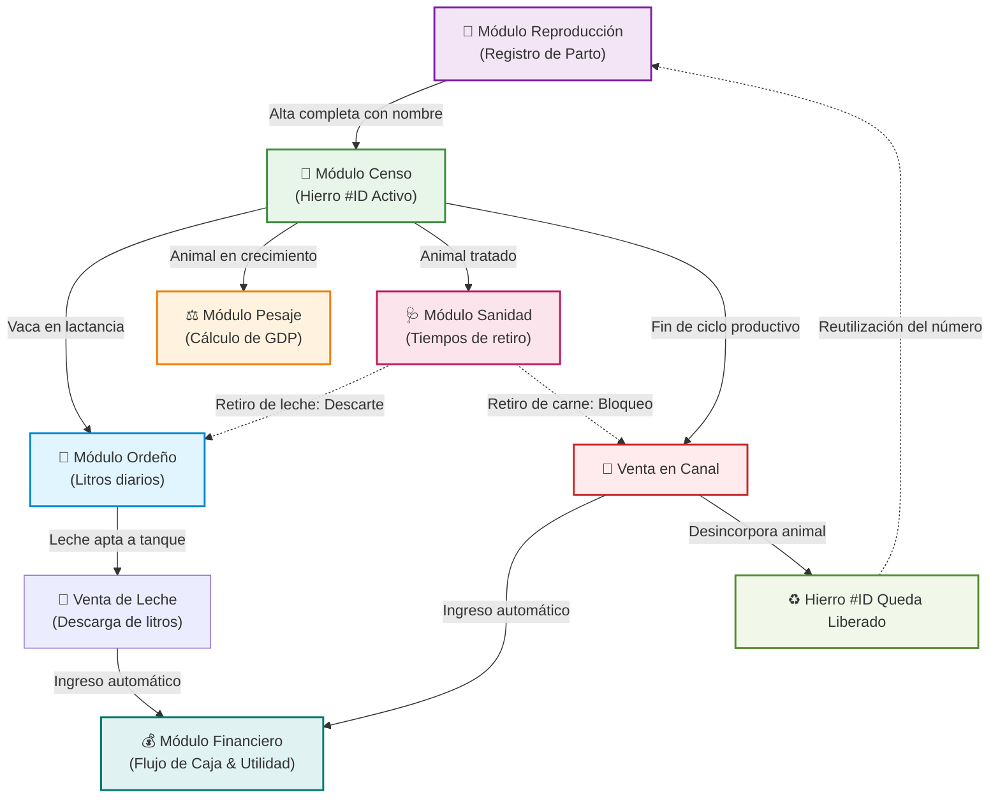

# 📖 Manual de Funcionamiento y Especificación de Módulos: FincaControl
> **Sistema Integral de Gestión Ganadera para Fincas de Doble Propósito (Leche y Carne)**  
> **Equipo de Desarrollo:** Johan Maldonado – José Chacón  
> **Ubicación del Prototipo:** [`C:\Users\Usuario\Documents\GitHub\FincaControl\agentes\prototipo\index.html`](./index.html)

---

## 📑 Índice de Módulos Documentados

Haga clic en cualquiera de los módulos para consultar su funcionamiento operativo y técnico:

1. [Módulo 1: Tablero General (Dashboard) y Arquitectura Base](#modulo-1-dashboard)
2. [Módulo 2: Censo e Inventario Bovino (`Animal`) y Beneficio en Canal](#modulo-2-censo-canal)
3. [Módulo 3: Control de Ordeño y Gestión del Tanque de Leche (`RegistroOrdeno`)](#modulo-3-ordeno-tanque)
4. [Módulo 4: Pesajes, Carne y Ganancia Diaria de Peso (`RegistroPesaje`)](#modulo-4-pesaje-carne)
5. [Módulo 5: Sanidad Animal y Tiempos de Retiro (`EventoSanitario`)](#modulo-5-sanidad-retiros)
6. [Módulo 6: Gestión Reproductiva y Alta Completa de Crías (`EventoReproductivo`)](#modulo-6-reproduccion)
7. [Módulo 7: Financiero Operativo y Costos Directos (`TransaccionFinanciera`)](#modulo-7-finanzas)
8. [Ciclo de Vida del Número de Hierro y Matriz de Interconexión](#matriz-interconexion)

---

## 1. Módulo 1: Tablero General (Dashboard) y Arquitectura Base

### 🎯 Propósito
Consolidar el estado productivo, sanitario y financiero de la finca en una sola pantalla de alta visibilidad, permitiendo la captura rápida de datos durante las faenas de campo sin cambiar de vista.

### ⚙️ Funcionamiento Operativo
1. **Tarjetas de Métricas en Tiempo Real (KPIs):**
   * **Disponible en Tanque:** Muestra el volumen acumulado de leche apta para venta comercial (descontando ventas y descartes).
   * **Rebaño Activo:** Censo de animales vivos en producción, con desglose de reses desincorporadas por venta en canal.
   * **Retiro Sanitario:** Alerta roja con la cantidad de vacas bajo tratamiento médico cuya leche o carne no puede comercializarse.
   * **Utilidad en Caja:** Saldo neto en efectivo (Ingresos totales - Egresos operativos).
2. **Widget de Entrada Rápida en Vaquera:**
   * Diseñado con campos destacados de alto contraste (`2px solid #94A3B8`, foco expansivo y altura táctil de 48px).
   * Permite ingresar el número de hierro, jornada (Mañana/Tarde) y litros producidos.
   * **Validación instantánea:** Si se introduce el ID de una vaca en tratamiento, el formulario muestra una alerta roja advirtiendo que su producción irá a descarte y no sumará al tanque comercial.
3. **Semáforo de Alertas Prioritarias:**
   * Muestra notificaciones críticas agrupadas por urgencia:
     * 🔴 *Alerta Roja:* Animales con tiempo de retiro activo (con fecha exacta de fin de carencia).
     * 🟡 *Alerta Ámbar:* Vacas preñadas que cumplen ~220 días de gestación para programar secado inmediato.
4. **Persistencia Local (Offline-First):**
   * El indicador superior *"Offline-First (Local)"* certifica que todas las transacciones se almacenan de inmediato en la base de datos local SQLite del dispositivo, garantizando latencia cero en zonas sin cobertura celular.
5. **Selector de Rol (RBAC):**
   * Alterna entre `Administrador` y `Operador`. Los operadores tienen restringido el acceso a balances financieros y precios de venta.

[⬆ Volver al Índice](#indice)

---

## 2. Módulo 2: Censo e Inventario Bovino (`Animal`) y Beneficio en Canal

### 🎯 Propósito
Gestionar el padrón oficial de animales de la finca, su genealogía, hoja de vida y el proceso de desincorporación por venta en matadero/canal liberando el número de hierro para nuevas generaciones.

### ⚙️ Funcionamiento Operativo
1. **Padrón de Animales Activos:**
   * Registro individual de cada res con sus atributos: `ID_Hierro`, `Nombre/Alias`, `Sexo`, `Raza`, `Propósito` (*Doble Propósito*, *Leche*, *Carne*), `Estado Actual` (*En Lactancia*, *Seca*, *Levante/Ceba*, *Reproductor*, *Cría/Lactante*).
2. **Hoja de Vida Individual (Modal Interactivo):**
   * Al presionar **"Hoja de Vida"**, se despliega el expediente completo de la res:
     * Datos generales y último peso registrado.
     * **Árbol de Genealogía Directa:** Madre (`#ID`) y Padre (`#ID`) con validación de consanguinidad.
     * **Historial Consolidado:** Último ordeño, último pesaje con GDP y estado sanitario actual.
3. **Beneficio en Canal y Desincorporación por Carne:**
   * Cada fila cuenta con el botón **"🥩 Vender en Canal"**:
     * **Control de Inocuidad Obligatorio:** Si la res tiene un tratamiento médico con *Retiro de Carne Activo*, el sistema **bloquea el botón de confirmación** y emite una alerta roja prohibiendo el beneficio hasta que venza el plazo residual.
     * **Captura de Liquidación:** Solicita Peso Vivo en báscula, Rendimiento en Canal (% estimado entre 52% y 56%), Precio por Kg en pie/canal, Fecha y Comprador/Frigorífico.
     * **Efectos al Confirmar:**
       1. **Desincorpora el animal del rebaño activo:** Ya no figura en listas de ordeño, pesaje o preñez.
       2. **Libera el Número de Hierro:** El ID queda formalmente desocupado en el inventario activo, permitiendo que sea asignado a un nuevo becerro recién nacido.
       3. **Archivo en el Historial de Canal:** Pasa a la sub-pestaña *"🥩 Historial Canal & Ventas"* para conservar la trazabilidad histórica de la venta.
       4. **Ingreso Automático en Finanzas:** Registra el cobro en el libro de caja dentro de la categoría *"Venta de Ganado / Canal"*.

[⬆ Volver al Índice](#indice)

---

## 3. Módulo 3: Control de Ordeño y Gestión del Tanque de Leche (`RegistroOrdeno`)

### 🎯 Propósito
Registrar la producción lechera diaria, resguardar la inocuidad alimentaria controlando descartes médicos y gestionar el inventario del tanque de enfriamiento para su despacho comercial.

### ⚙️ Funcionamiento Operativo
1. **Control de Tanque de Leche:**
   * **Leche Disponible en Tanque:** Saldo neto de litros aptos almacenados.
   * **Ordeñado Hoy (Apto):** Volumen ordeñado durante la jornada que cumplió con las normas sanitarias.
   * **Descarte por Retiro:** Litros producidos por vacas medicadas. Se contabilizan para evaluar la ubre, pero **no ingresan al tanque comercial**.
2. **Formulario de Registro de Ordeño:**
   * Selección de vaca, jornada (Mañana/Tarde) y litros medidos.
   * Detección automática en vivo de períodos de carencia.
3. **Flujo de Venta y Despacho de Leche:**
   * Mediante el botón **"🥛 Vender / Despachar Leche"**:
     * El sistema muestra el saldo actual disponible en el tanque.
     * El operario ingresa los litros a vender (el sistema valida que no exceda el stock existente), el precio unitario pactado (`$/L`), el comprador (*Ej: Quesera Don Pedro*) y la fecha.
     * **Efectos al Confirmar:**
       1. **Resta los litros vendidos del tanque disponible**.
       2. **Genera un asiento de Ingreso en Finanzas:** Monto = $\text{Litros} \times \text{Precio/Litro}$.
       3. Almacena la remisión en la tabla de *Historial de Despachos y Ventas de Leche*.

[⬆ Volver al Índice](#indice)

---

## 4. Módulo 4: Pesajes, Carne y Ganancia Diaria de Peso (`RegistroPesaje`)

### 🎯 Propósito
Monitorear el crecimiento ponderal de los lotes de levante y ceba en pastoreo, evaluando la conversión alimenticia y detectando animales estancados.

### ⚙️ Funcionamiento Operativo
1. **Captura de Pesaje en Báscula:**
   * Selección del animal, fecha y entrada del peso vivo actual en kilogramos.
   * El sistema precarga automáticamente el último peso conocido para referencia del usuario.
2. **Cálculo Automático de la Ganancia Diaria de Peso (GDP / GMD):**
   * Aplica la fórmula zootécnica:
     $$\text{GDP (kg/día)} = \frac{\text{Peso Actual (kg)} - \text{Peso Anterior (kg)}}{\text{Días Transcurridos Entre Pesajes}}$$
3. **Calificación de Desempeño:**
   * **Excelente / Óptimo (`> 0.60 kg/día`):** Animal con excelente respuesta al pastoreo y suplementación mineral.
   * **Normal / Aceptable (`0.30 - 0.60 kg/día`):** Rango estándar para trópico bajo.
   * **Estancado / Alerta (`< 0.30 kg/día` o pérdida de peso):** Requiere revisión veterinaria (parasitosis, podología o nutrición).
4. Actualiza inmediatamente el peso vivo en la ficha del animal.

[⬆ Volver al Índice](#indice)

---

## 5. Módulo 5: Sanidad Animal y Tiempos de Retiro (`EventoSanitario`)

### 🎯 Propósito
Gestionar planes de vacunación, desparasitación y tratamientos con antibióticos, garantizando la inocuidad mediante el bloqueo estricto por **Tiempos de Retiro**.

### ⚙️ Funcionamiento Operativo
1. **Registro de Tratamiento Médico:**
   * Selección de la res, tipo de evento (*Tratamiento Antibiótico*, *Vacunación*, *Desparasitación*, *Vitaminas*), producto aplicado y fecha.
   * **Entrada Obligatoria:** `Días de Retiro en Leche` y `Días de Retiro en Carne`.
2. **Activación de Cuarentena y Reglas de Bloqueo:**
   * Si los días de retiro son mayores a cero:
     * El animal pasa a estado **Cuarentena Sanitaria Activa**.
     * **En Ordeño:** Genera alerta roja obligando a enviar la leche a descarte (no comercializable).
     * **En Censo / Canal:** **Inhabilita el botón de venta a matadero** hasta que transcurran los días de carencia reglamentarios.
3. Tabla histórica con auditoría completa de medicamentos y fechas de liberación.

[⬆ Volver al Índice](#indice)

---

## 6. Módulo 6: Gestión Reproductiva y Alta Completa de Crías (`EventoReproductivo`)

### 🎯 Propósito
Controlar el ciclo reproductivo de las vacas y novillas, programar fechas de secado oportunas y dar de alta de forma integral a los nuevos terneros nacidos en la finca.

### ⚙️ Funcionamiento Operativo
1. **Eventos de Ciclo:**
   * Registro de celos detectados, inseminaciones artificiales o montas con toro, palpaciones de diagnóstico de preñez y secados.
   * **Alerta de Secado Programado:** Calcula la fecha estimada de parto ($\text{Servicio} + 283 \text{ días}$) y avisa ~60 días antes para suspender el ordeño y permitir el descanso de la ubre.
2. **Registro de Parto y Alta Completa de la Cría (Ficha de Censo):**
   * Al seleccionar el evento **"Parto (Nacimiento de Cría)"**, se activa el sub-panel especial de captura con todos los campos oficiales del Censo:
     * **N° Hierro de la Cría:** Permite asignar un número nuevo o **reutilizar un hierro liberado** tras una venta previa en canal.
     * **Nombre / Alias:** Nombre oficial del ternero (*Ej: Relámpago, Diamante, Canelita*).
     * **Sexo:** Hembra o Macho.
     * **Raza:** Cruce zootécnico (*Gyr Mestizo, Carora F1, Brahman, Guzerá, Pardo Suizo*).
     * **Propósito:** Doble Propósito, Leche o Carne.
     * **Peso al Nacer (Kg):** Registro de báscula inicial (típicamente 30 - 40 kg).
   * **Impacto Automatizado al Guardar:**
     1. Registra el evento en la bitácora reproductiva de la madre.
     2. **Da de alta inmediatamente al nuevo animal en el Censo Rebaño** con su ficha completa, peso y genealogía (`Madre` = vaca parida, `Padre` = toro del servicio).
     3. Cambia el estado de la vaca madre a `En Lactancia` y la habilita para el registro de ordeño.

[⬆ Volver al Índice](#indice)

---

## 7. Módulo 7: Financiero Operativo y Costos Directos (`TransaccionFinanciera`)

### 🎯 Propósito
Proporcionar una radiografía clara del flujo de caja de la finca ganadera, integrando los ingresos automáticos por venta de leche y animales con los egresos operativos.

### ⚙️ Funcionamiento Operativo
1. **Flujo de Ingresos Automatizados:**
   * Cada vez que se despacha leche del tanque se genera un ingreso en la categoría *"Venta de Leche"*.
   * Cada vez que se beneficia un animal en canal se genera un ingreso en la categoría *"Venta de Ganado / Canal"*.
2. **Registro de Egresos Operativos:**
   * Permite registrar compras de sal mineralizada, concentrados, medicamentos veterinarios, combustible y pago de jornales de vaquería.
3. **Cálculo de Indicadores Clave en Tiempo Real:**
   * **Utilidad Operativa:** $\text{Ingresos Totales} - \text{Egresos Totales}$.
   * **Margen Bruto (%):** Relación porcentual entre utilidad e ingresos.
   * **Costo Directo por Litro de Leche Producido:**
     $$\text{Costo/Litro} = \frac{\sum \text{Egresos Operativos de Lechería}}{\text{Total Litros de Leche Producidos}}$$
4. Permite al productor conocer si el precio pagado por litro de leche cubre los costos directos de la finca.

[⬆ Volver al Índice](#indice)

---

## 8. Ciclo de Vida del Número de Hierro y Matriz de Interconexión

El siguiente flujo resume cómo interactúan los módulos en la operación real de la finca:

### 📋 Resumen de Integridad de Datos
| Acción del Usuario | Módulo Origen | Módulos Impactados | Resultado |
| :--- | :--- | :--- | :--- |
| **Ordeñar Vaca Sana** | Ordeño | Dashboard, Tanque de Leche | Suma litros al stock disponible para venta. |
| **Ordeñar Vaca en Retiro** | Ordeño | Dashboard | Marca la leche como descarte (no comercializable). |
| **Vender Leche** | Ordeño / Dashboard | Tanque, Finanzas | Disminuye el stock del tanque y acredita el dinero en caja. |
| **Tratamiento Médico** | Sanidad | Ordeño, Censo, Dashboard | Activa semáforo rojo y bloquea venta en canal. |
| **Vender en Canal** | Censo | Censo, Finanzas, Hierros | Desincorpora res, libera su número de hierro y acredita ingreso. |
| **Registrar Parto** | Reproducción | Censo, Ordeño | Da de alta la cría con nombre y pasa a la madre a lactancia. |

---

[⬆ Volver al Índice](#indice)
