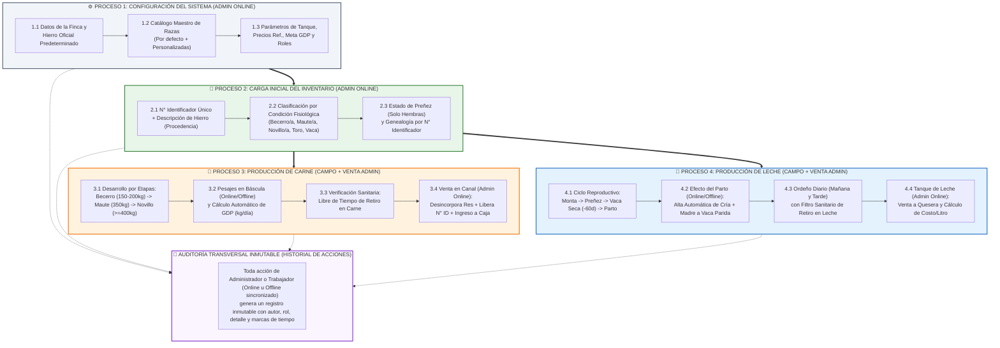
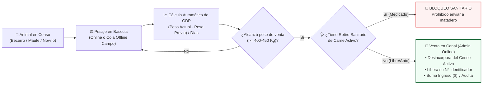
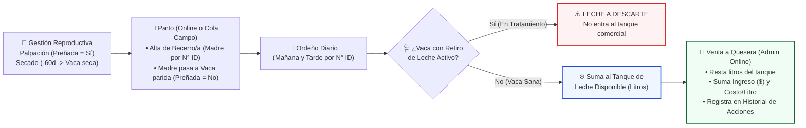

# 📘 Guía de Usuario Orientada a Procesos: FincaControl
> **Manual Paso a Paso desde la Puesta en Marcha hasta la Operación Diaria y Auditoría**  
> **Sistema Integral de Gestión Ganadera para Fincas de Doble Propósito (Leche y Carne)**  
> **Arquitectura:** Primero Online (Base de Datos Central) + Extensión Offline Táctica de Campo • **Diseño:** Propuesta A (Experiencia Dual por Rol)  
> **Equipo de Desarrollo:** Johan Maldonado – José Chacón  
> **Prototipo Interactivo Verificable:** [`agentes/prototipo/index.html`](./agentes/prototipo/index.html)

---

## 📑 Índice General (Orden Lógico de Operación)

1. [🗺️ 0. Esquema General de los Procesos y Modelo Operativo](#esquema-procesos)
   * [0.1. Mapa Integral de Procesos de FincaControl](#mapa-procesos)
   * [0.2. Secuencia Lógica de Puesta en Producción](#secuencia-logica)
   * [0.3. Experiencia Dual por Rol (Propuesta A) y Alcance Online vs. Offline](#modelo-roles-conectividad)
2. [⚙️ Proceso 1: Configuración del Sistema (Puesta a Punto — Exclusivo Admin Online)](#proceso-1-configuracion)
   * [1.1. Identidad de la Finca y Hierro Oficial Predeterminado](#config-finca-hierro)
   * [1.2. Gestión del Catálogo Maestro de Razas Bovinas](#config-catalogo-razas)
   * [1.3. Parámetros Productivos, Comerciales, Simulador de Red y Roles](#config-parametros-rbac)
3. [🐄 Proceso 2: Carga Inicial del Inventario de Animales (Censo del Rebaño)](#proceso-2-inventario)
   * [2.1. Reglas de Identificación y Altas: N° Identificador vs. Hierro y Permisos de Creación](#regla-id-vs-hierro)
   * [2.2. Clasificación por Condiciones Fisiológicas y Estado de Preñez](#regla-condiciones-fisiologicas)
   * [2.3. Paso a Paso para Registrar el Rebaño Inicial y su Genealogía (Admin Online)](#paso-a-paso-censo)
4. [🥩 Proceso 3: Registro de Datos del Proceso de Producción de Carne](#proceso-3-produccion-carne)
   * [3.1. Esquema Operativo del Proceso Cárnico](#esquema-carne)
   * [3.2. Paso a Paso: Pesajes Periódicos y Cálculo de Ganancia Diaria (GDP)](#paso-pesajes-gdp)
   * [3.3. Paso a Paso: Control de Tiempos de Retiro en Carne](#paso-retiro-carne)
   * [3.4. Paso a Paso: Beneficio en Canal, Liberación del N° Identificador y Venta (Admin Online)](#paso-beneficio-canal)
5. [🥛 Proceso 4: Registro de Datos del Proceso de Producción de Leche](#proceso-4-produccion-leche)
   * [4.1. Esquema Operativo del Proceso Lechero](#esquema-leche)
   * [4.2. Paso a Paso: Ciclo Reproductivo, Secado y Parto (Alta Automática de Cría en Campo)](#paso-parto-lactancia)
   * [4.3. Paso a Paso: Registro de Ordeño Diario (Mañana y Tarde) e Inocuidad](#paso-ordeno-diario)
   * [4.4. Paso a Paso: Gestión del Tanque de Enfriamiento, Despacho y Costo por Litro (Admin Online)](#paso-tanque-venta-leche)
6. [📱📜 Sección 5: Operación Diaria por Rol — Terminal de Carga, Vista Rápida y Auditoría](#operacion-roles-auditoria)
   * [5.1. Perfil Trabajador: Uso de la `📱 Terminal de Carga` y Cola Offline de Campo](#terminal-carga-trabajador)
   * [5.2. Perfil Administrador: `📊 Vista Rápida (Admin)` e `📜 Historial de Acciones` (Bitácora Inmutable)](#vista-rapida-historial-admin)

---

## 🗺️ 0. Esquema General de los Procesos y Modelo Operativo

Antes de interactuar con cualquier pantalla o funcionalidad de **FincaControl**, es fundamental comprender tanto el **esquema de procesos de negocio** de una finca ganadera venezolana de doble propósito (leche y carne) como la separación inteligente de responsabilidades entre el **Servidor Central (Online)**, el **Teléfono del Trabajador en Campo** y la **Vista Rápida del Administrador**.

### 0.1. Mapa Integral de Procesos de FincaControl

### 0.2. Secuencia Lógica de Puesta en Producción

Para que el sistema opere sin inconsistencias desde el primer día, se debe seguir este orden de cuatro etapas:

| Orden | Macroproceso | ¿Quién y cómo lo ejecuta? | Entregable en el Sistema |
| :---: | :--- | :--- | :--- |
| **1°** | **Configuración del Sistema** | **Administrador (Online):** Define nombre del hato, hierro oficial, catálogo maestro de razas, capacidad del tanque y precios referenciales. | Finca parametrizada en la Base de Datos Central y disponible para descarga de caché en móviles de campo. |
| **2°** | **Carga Inicial del Inventario** | **Administrador (Online):** Registra el censo fundacional y animales comprados con su **N° Identificador**, **Hierro** y **Condición Fisiológica**. | Padrón activo clasificado por etapa, estado de preñez y genealogía por N° Identificador. |
| **3°** | **Proceso de Producción de Carne** | **Trabajador/Admin (Online u Offline en campo):** Pesajes periódicos (**GDP**) y tratamientos sanitarios. **Admin (Online):** Venta en canal. | Historial de pesajes con **GDP**, bloqueo sanitario activo, ventas en canal liquidadas y N° Identificadores liberados. |
| **4°** | **Proceso de Producción de Leche** | **Trabajador/Admin (Online u Offline en campo):** Preñez, secado, partos (alta de cría) y ordeño diario. **Admin (Online):** Despacho del tanque. | Leche apta en tanque, descartes sanitarios aislados, despachos cobrados y costo directo por litro calculado. |

### 0.3. Experiencia Dual por Rol (Propuesta A) y Alcance Online vs. Offline

**FincaControl** se distribuye como **una sola aplicación móvil en Flutter** que adapta automáticamente su interfaz según el rol autenticado (**Propuesta A**) y opera bajo una arquitectura **Primero Online con Extensión Offline Táctica de Campo**:

| Dimensión | 👤 Perfil Administrador (`Vista Rápida y Control`) | 👷 Perfil Trabajador / Operador (`Terminal de Carga`) |
| :--- | :--- | :--- |
| **Propósito del Teléfono** | Lectura ejecutiva inmediata de indicadores, gobierno administrativo/comercial y auditoría total de la finca. | Herramienta ergonómica de captura rápida de datos en vaquera, manga de pesaje y potrero. |
| **Vistas Habilitadas** | `🗺️ Esquema de Procesos`, `📊 Vista Rápida (Admin)`, `⚙️ 1. Configuración`, `🐄 2. Inventario`, `⚖️ 3. Carne`, `🥛 4. Leche`, `🩺 Sanidad`, `🧬 Reproducción`, `💰 Financiero` e **`📜 Historial de Acciones`**. | **`📱 Terminal de Carga`** (4 botones gigantes + buscador rápido de corral + buzón offline) y formularios operativos de `Ordeño`, `Pesaje`, `Sanidad`, `Reproducción/Parto` y consulta de `Padrón Activo`. |
| **Operaciones Exclusivas 100% Online** | Configuración de finca, creación de nuevas razas, alta manual de animales (inventario inicial y compras), venta de leche del tanque, venta en canal y libro financiero. | *Ocultas y restringidas por seguridad.* El trabajador solo incorpora animales nuevos cuando nace un becerro/a al registrar un **Parto**. |
| **Comportamiento Sin Señal (Offline)** | Modo lectura del último resumen descargado; las operaciones administrativas/comerciales solicitan conexión activa para evitar descuadres. | **100% Operativo en Campo:** Consulta la caché ligera del padrón activo (con semáforo de retiro sanitario) y guarda ordeños, pesajes, tratamientos y partos en una **Cola Local FIFO** que se sincroniza al recuperar señal. |

[⬆ Volver al Índice](#indice)

---

## ⚙️ Proceso 1: Configuración del Sistema (Puesta a Punto — Exclusivo Admin Online)

> **Dónde realizarlo en la aplicación:** Pestaña **`⚙️ 1. Configuración`** (requiere **`👤 Rol: Administrador`** y conexión **`En Línea`** con el Servidor Central).

### 1.1. Identidad de la Finca y Hierro Oficial Predeterminado
En Venezuela, el **hierro** es la marca (iniciales, letras entrelazadas o figura) que certifica quién es el propietario del ganado y cuál es su finca de procedencia.
1. Diríjase al panel **Parámetros Generales de la Finca**.
2. Ingrese el **Nombre de la Finca / Hato \*** (*Ej: `Hda. La Esperanza`*).
3. Ingrese el **Hierro Oficial Predeterminado \*** (*Ej: `Hda. La Esperanza (Iniciales HE)`* o *`Figura Herradura con Estrella`*).
   * *Impacto automático:* Este hierro se precargará por defecto cada vez que se registre un animal en el censo o nazca un becerro/a en un parto, ahorrando digitación en campo.

### 1.2. Gestión del Catálogo Maestro de Razas Bovinas
El sistema incluye por defecto las razas más habituales en sistemas de doble propósito venezolanos (*Gyr Mestizo, Carora F1, Brahman, Brahman Rojo, Guzerá, Pardo Suizo, Senepol, Romosinuano*) y permite al **Administrador (Online)** registrar nuevas razas o cruces:
1. En el panel **🧬 1.2 Catálogo Maestro de Razas Bovinas** (o mediante el botón **`+ Registrar Nueva Raza`** en el Censo), pulse **`+ Agregar Nueva Raza`**.
2. Escriba el nombre de la raza (*Ej: `Girolando F1`*, *`Nelore`*, *`Carora Puro`*) y presione **"Guardar Raza en Catálogo"**.
3. *Impacto automático:* La raza se guarda en la Base de Datos Central, queda auditada en el **`📜 Historial de Acciones`** y se descarga en la caché de referencia de los teléfonos de los trabajadores para usarla en partos en campo.

### 1.3. Parámetros Productivos, Comerciales, Simulador de Red y Roles
1. En **Parámetros Generales de la Finca**, defina los valores comerciales y zootécnicos editables:
   * **Capacidad Tanque Leche (L) \*:** *Ej: `2000 L`*.
   * **Precio Ref. Leche (`$ / L`) \*:** *Ej: `$0.45`*.
   * **Precio Ref. Carne Pie (`$ / Kg`) \*:** *Ej: `$1.85`*.
   * **Meta GDP Ceba (`kg/día`) \*:** *Ej: `0.70 kg/día`*.
   * *Nota zootécnica:* Los umbrales biológicos de **Gestación (283 días)** y **Alerta de Secado (60 días antes del parto)** vienen preconfigurados como estándares zootécnicos del sistema y se visualizan directamente en el módulo de Reproducción.
2. Presione **"Guardar Configuración del Sistema"**.
3. **Controles Superiores de Simulación (Propuesta A y Conectividad):** En la barra superior del prototipo puede probar en cualquier momento:
   * **Píldora de Red (`En Línea (Servidor Central)` / `Sin Señal (Modo Campo)`):** Simula la pérdida y recuperación de internet.
   * **Botón `🔄 Cola: X pend.`:** Envía en orden cronológico los registros capturados sin señal hacia el Servidor Central.
   * **Selector de Rol (`👤 Rol: Administrador (Vista Rápida)` / `👷 Rol: Trabajador (Terminal de Carga)`):** Alterna en vivo entre las dos interfaces de la Propuesta A.

[⬆ Volver al Índice](#indice)

---

## 🐄 Proceso 2: Carga Inicial del Inventario de Animales (Censo del Rebaño)

> **Dónde realizarlo en la aplicación:** Pestaña **`🐄 2. Inventario (Censo)`**.

Una vez configurada la finca, el segundo paso obligatorio es cargar los animales que conforman el rebaño actual.

### 2.1. Reglas de Identificación y Altas: N° Identificador vs. Hierro y Permisos de Creación
1. **Diferenciación entre N° Identificador e Hierro:**
   * **N° Identificador del Animal (`numero_identificador`):** Número único que individualiza a cada res dentro del rebaño activo (*Ej: `042`, `104`, `201`, `009`*). **No puede repetirse** entre dos animales activos, **se usa para vincular Madre y Padre** en la genealogía, y **queda liberado** para futuras crías cuando el animal se vende en canal (mientras la base de datos conserva su `id_animal` interno inmutable para no alterar historiales).
   * **Hierro (`Descripción del Hierro`):** Describe las iniciales o figura que certifican **propietario y procedencia** (*Ej: "Hda. La Esperanza (Iniciales HE)"* o *"Finca San José (Iniciales SJ)"*). Varios animales comparten el mismo hierro.
2. **Regla de Negocio sobre Quién Incorpora Animales Nuevos:**
   * **Inventario Inicial y Compras Externas (`+ Nuevo Animal Manual`):** Exclusivo del **`Administrador` en modo `Online`**, garantizando unicidad inmediata contra la Base de Datos Central.
   * **Nacimientos en Finca:** El **`Trabajador`** en campo incorpora nuevos animales únicamente como consecuencia natural de registrar un **Parto** en el módulo de Reproducción (Sección 4.2).

### 2.2. Clasificación por Condiciones Fisiológicas y Estado de Preñez
Al registrar cada animal, clasifíquelo según su **etapa fisiológica** en el hato venezolano (consultable en la app mediante el botón **`📖 Clasificación Fisiológica (VZLA)`**):

| Etapa / Condición Fisiológica | Sexo | Edad y Peso de Referencia | Características y Regla de Preñez en el Sistema |
| :--- | :---: | :--- | :--- |
| **Becerro / Becerra** | Macho / Hembra | Nacimiento a destete (~4 a 10 meses) • **150 a 200 kg** | Dependen inicialmente de leche materna y calostro, transitando a pastos y concentrados. **¿Preñada?:** *No aplica*. |
| **Maute / Mauta** | Macho / Hembra | 10 a 18 meses • **~350 kg** | Fase de levante o crecimiento intermedio tras el destete. **¿Preñada?:** *No aplica*. |
| **Novillo / Torete** | Macho | Desde 18 meses • **≥ 400 kg** | Fase de engorde final para venta/ceba o levante de macho joven. **¿Preñada?:** *No aplica (Bloqueado por ser macho)*. |
| **Novilla de vientre** | Hembra | Desde 18 meses • **≥ 400 kg** | Hembra joven destinada a reproducción hasta su primer parto. **¿Preñada?:** *Habilitado (`Sí` / `No`)*. |
| **Toro / Toro Reproductor** | Macho | ≥ 30 meses • **> 425 kg** | Macho adulto destinado a la monta o reproducción. **¿Preñada?:** *No aplica (Bloqueado por ser macho)*. |
| **Vaca parida** | Hembra | Adulta (1 o más partos) | Ha tenido su cría y produce leche (*Primípara* en su 1er parto, *Multípara* si acumula varios). **¿Preñada?:** *Habilitado (`Sí` / `No`)*. |
| **Vaca escotera** | Hembra | Adulta | Vaca que se encuentra **preñada** pero no está produciendo leche en ese momento. **¿Preñada?:** *Sí (Preñada)*. |
| **Vaca seca** | Hembra | Adulta (Último tercio gestación) | Finalizó su lactancia y está en descanso de ubre (~60 días previos al parto). **¿Preñada?:** *Sí (Preñada)*. |

### 2.3. Paso a Paso para Registrar el Rebaño Inicial y su Genealogía (Admin Online)
1. Con rol **`Administrador`** y conexión **`En Línea`**, abra **`🐄 2. Inventario (Censo)`** y pulse **`+ Nuevo Animal Manual`**.
2. Complete los campos resaltados del formulario:
   * **N° Identificador \*:** Número único del animal (*Ej: `112`*).
   * **Hierro (Descripción) \*:** Verifique el hierro oficial prellenado o describa el hierro de procedencia si es un animal comprado (*Ej: `Iniciales JM (Media Luna)`*).
   * **Nombre / Alias \*:** Nombre del ejemplar (*Ej: `Consentida`*).
   * **Sexo \* y Condición Fisiológica \*:** Al elegir `Macho` o `Hembra`, el sistema filtra automáticamente las etapas válidas y bloquea **¿Está Preñada?** cuando no aplica.
   * **¿Está Preñada? \*:** En Vacas o Novillas de vientre, seleccione `No (Vacía)` o `🤰 Sí (Preñada)`.
   * **Raza \*, Propósito y Peso Actual (Kg) \*:** Elija la raza (o cree una con `+ Nueva Raza`), propósito y peso vivo inicial.
   * **Madre (N° Identificador) y Padre (N° Identificador):** Ingrese el **N° Identificador** de los progenitores (*Ej: Madre `042`, Padre `009`*).
3. Presione **"Guardar en Inventario"**. El alta se guarda en el Servidor Central y registra su asiento en **`📜 Historial de Acciones`**.
4. Use los filtros por **Etapa Fisiológica** o **Preñez** y el botón **"Hoja de Vida"** para inspeccionar el expediente y árbol genealógico de cualquier ejemplar.

[⬆ Volver al Índice](#indice)

---

## 🥩 Proceso 3: Registro de Datos del Proceso de Producción de Carne

> **Dónde realizarlo en la aplicación:** Captura de campo en **`⚖️ 3. Producción Carne`** y **`🩺 Sanidad & Retiro`** (o desde **`📱 Terminal de Carga`** del Trabajador, Online u Offline). Liquidación comercial en **`🐄 2. Inventario (Censo -> Vender en Canal)`** (exclusivo **Administrador Online**).

### 3.1. Esquema Operativo del Proceso Cárnico

### 3.2. Paso a Paso: Pesajes Periódicos y Cálculo de Ganancia Diaria (GDP)
1. Diríjase a **`⚖️ 3. Producción Carne`** (o toque **`+ Registrar Pesaje en Manga`** desde la **`📱 Terminal de Carga`**).
2. En el panel **Nuevo Pesaje Periódico**:
   * **Animal (N° Identificador) \*:** Seleccione el ejemplar (*Ej: `#201 Campeón • Maute`*). El sistema muestra su último peso registrado (`Previo: 340 Kg`).
   * **Fecha de Pesaje \* y Peso Actual (Kg) \*:** Ingrese la fecha y el nuevo peso vivo (*Ej: `362 Kg`*).
3. Presione **"Calcular GDP y Guardar"**.
4. **Resultado Automático:**
   * Calcula la **Ganancia Diaria de Peso (GDP)** en `kg/día`:
     > **Fórmula:** `GDP = (Peso Actual - Peso Previo) / Días transcurridos`
   * Clasifica el desempeño con semáforo visual: 🟢 **Excelente / Óptimo (`≥ 0.60 kg/día`)**, ⚪ **Aceptable / Normal (`0.30 a 0.59 kg/día`)** o 🔴 **Estancado / Alerta (`< 0.30 kg/día`)**.
   * Si está **En Línea**, impacta de inmediato el Servidor Central; si está **Sin Señal**, actualiza la caché local y guarda el pesaje en la **Cola Offline de Campo** conservando la hora exacta de captura en la manga.

### 3.3. Paso a Paso: Control de Tiempos de Retiro en Carne
1. Abra **`🩺 Sanidad & Retiro`** (o desde **`📱 Terminal de Carga`** -> **`+ Evento Sanitario / Retiro`**).
2. Seleccione el **Animal Tratado (N° ID)**, el **Producto Aplicado** e ingrese los **Días de Retiro en Carne** (*Ej: `28 días`*) y/o en Leche.
3. Presione **"Guardar Tratamiento y Activar Cuarentena"**.
4. *Efecto de Inocuidad:* Activa de inmediato el bloqueo sanitario en la caché local y en el Servidor Central, impidiendo vender ese animal a matadero mientras dure la cuarentena.

### 3.4. Paso a Paso: Beneficio en Canal, Liberación del N° Identificador y Venta (Admin Online)
1. Con rol **`Administrador`** y conexión **`En Línea`**, vaya a **`🐄 2. Inventario (Censo)`** (o a la tabla de **`⚖️ 3. Producción Carne`**) y pulse el botón rojo **`🥩 Vender en Canal`** sobre el animal apto.
2. En la ventana de liquidación:
   * Verifique que esté libre de alertas rojas de bloqueo sanitario.
   * Confirme el **Peso Vivo en Báscula (Kg)**, el **Precio por Kg (`$`)** y el **Destino / Matadero / Frigorífico** (`Total Liquidación = Peso Vivo × Precio por Kg`).
3. Presione **"🥩 Confirmar Venta, Desincorporar y Liberar N° Identificador"**.
4. **Impacto Cuádruple Automatizado en el Servidor Central:**
   * **Inventario:** Pasa del rebaño activo a **`🥩 Historial Canal & Ventas`** conservando su Hierro y peso de salida.
   * **Identificadores:** Su **N° Identificador queda formalmente liberado** para asignarse a futuros becerros.
   * **Finanzas:** Acredita automáticamente el **Ingreso (`$`)** en el libro de caja (*"Venta de Ganado / Canal"*).
   * **Auditoría:** Registra el asiento inmutable en **`📜 Historial de Acciones`**.

[⬆ Volver al Índice](#indice)

---

## 🥛 Proceso 4: Registro de Datos del Proceso de Producción de Leche

> **Dónde realizarlo en la aplicación:** Captura reproductiva y de ordeño en **`🧬 Reproducción`** y **`🥛 4. Producción Leche`** (o desde **`📱 Terminal de Carga`**, Online u Offline). Venta/despacho del tanque en **`🥛 4. Producción Leche`** o **`📊 Vista Rápida (Admin)`** (exclusivo **Administrador Online**).

### 4.1. Esquema Operativo del Proceso Lechero

### 4.2. Paso a Paso: Ciclo Reproductivo, Secado y Parto (Alta Automática de Cría en Campo)
1. Diríjase a **`🧬 Reproducción`** (o desde **`📱 Terminal de Carga`** -> **`+ Reproducción y Parto (Alta Cría)`**).
2. **Seguimiento de Preñez y Secado:**
   * Al registrar **`Diagnóstico Preñez`** con resultado `Preñada Confirmada`, la hembra actualiza su estado a **`Preñada: Sí`** (o pasa a **`Vaca escotera`** si no está lactando).
   * Al cumplir ~60 días previos al parto, registre **`Secado de Vaca`**: la hembra pasa automáticamente a **`Vaca seca`**.
3. **Registro de Parto y Alta Automática del Becerro/a (única vía de alta de animales en campo):**
   * Seleccione la **Hembra (N° Identificador)** y en **Tipo de Evento** elija **`Parto (Nacimiento de Cría)`**.
   * En el sub-panel **Ficha Completa del Nuevo Becerro/a (Censo)** ingrese: **N° Identificador Cría \*** (nuevo o liberado tras venta en canal), **Hierro (Descripción) \*** (prellenado con el hierro de la finca/madre), **Nombre / Alias Cría \***, **Sexo \*** (`Becerra` o `Becerro`), **Raza \***, **Peso al Nacer (Kg) \*** y **Clasificación Madre \*** (`Primípara` o `Multípara`).
   * Presione **"Guardar Evento y Actualizar Condición Fisiológica / Censo"**.
   * **Impacto Automatizado:** Da de alta al nuevo *Becerro/a* vinculando su **Madre mediante el N° Identificador de la vaca parida** (si se capturó sin señal y al sincronizar existiera colisión de número, el servidor conserva el parto y marca alerta de reasignación al Administrador sin perder el dato), y pasa a la madre a **`Vaca parida`** (`Preñada: No`), habilitándola en el ordeño diario.

### 4.3. Paso a Paso: Registro de Ordeño Diario (Mañana y Tarde) e Inocuidad
1. Desde **`🥛 4. Producción Leche`** (o **`📱 Terminal de Carga`** -> **`+ Registrar Ordeño Diario`**), seleccione la **Vaca (N° Identificador)** de la lista de vacas paridas (*ej: `#042 Mariposa`* o *`#104 Canela`*).
2. **Validación Instantánea de Inocuidad (incluso sin internet gracias a la caché de campo):**
   * Si la vaca está sana (`#042`), los litros suman a **`🥛 Leche Disponible en Tanque`**.
   * Si la vaca tiene retiro activo (`#104`), se despliega una **alerta sanitaria roja** y los litros se desvían obligatoriamente a **`⚠️ Descarte por Retiro`** sin contaminar el tanque comercial.
3. Elija la **Jornada** (`Mañana` o `Tarde`), digite los **Litros Medidos** y pulse **"Registrar Ordeño"**.

### 4.4. Paso a Paso: Gestión del Tanque de Enfriamiento, Despacho y Costo por Litro (Admin Online)
1. Con rol **`Administrador`** y conexión **`En Línea`**, presione **`🥛 Vender / Despachar Leche`** (en el módulo de Leche) o **`🥛 Vender Leche de Tanque`** (en **`📊 Vista Rápida (Admin)`**).
2. Verifique el **Saldo Actual en Tanque**, ingrese los **Litros a Vender** (validando no exceder el stock), confirme el **Precio por Litro (`$`)**, el **Comprador / Destino** y la fecha.
3. Presione **"Confirmar Venta y Descargar Tanque"**: descuenta los litros del tanque central, acredita automáticamente el **Ingreso (`$`)** en **`💰 Financiero`**, recalcula la **Utilidad en Caja** y el **Costo Directo Estimado por Litro (`$/L`)**, y deja constancia en **`📜 Historial de Acciones`**.

[⬆ Volver al Índice](#indice)

---

## 📱📜 Sección 5: Operación Diaria por Rol — Terminal de Carga, Vista Rápida y Auditoría

### 5.1. Perfil Trabajador: Uso de la `📱 Terminal de Carga` y Cola Offline de Campo
Cuando un trabajador de campo inicia sesión (o al pulsar el badge superior para cambiar a **`👷 Rol: Trabajador (Terminal de Carga)`**), la aplicación oculta los módulos administrativos/financieros y presenta la **`📱 Terminal de Carga`**:
1. **4 Tarjetas Grandes de Captura Rápida:** Botones de alto contraste para acceder en un toque a **`+ Registrar Ordeño Diario`**, **`+ Registrar Pesaje en Manga`**, **`+ Evento Sanitario / Retiro`** y **`+ Reproducción y Parto (Alta Cría)`**.
2. **Buscador Instantáneo en Corral por N° Identificador:** Al escribir un número (ej. `104`, `042`, `201`), muestra al instante su condición fisiológica, estado de preñez, último peso y **semáforo sanitario** (`🚨 EN RETIRO SANITARIO ACTIVO` vs. `✅ Libre de Retiro`), funcionando incluso sin cobertura.
3. **Buzón de Salida del Teléfono (Cola Offline de Campo):** Si el trabajador está en un potrero **`Sin Señal (Modo Campo)`**, cada registro capturado se almacena localmente en la tabla **Registros Capturados sin Señal Pendientes de Envío**. Al volver a una zona con cobertura (o pulsar **`🔄 Enviar Cola al Servidor`**), el lote se transmite en orden cronológico FIFO al Servidor Central.

### 5.2. Perfil Administrador: `📊 Vista Rápida (Admin)` e `📜 Historial de Acciones` (Bitácora Inmutable)
El **`Administrador`** dispone de dos vistas exclusivas de control gerencial conectadas a la Base de Datos Central:
1. **`📊 Vista Rápida (Admin)`:** Resume de un vistazo para lectura rápida en el móvil los 4 KPIs maestros (*Disponible en Tanque*, *Rebaño Activo*, *Retiro Sanitario* y *Utilidad en Caja*), el semáforo de alertas prioritarias, los últimos ordeños recibidos y la tabla **Últimas Acciones en la Finca (Administrador y Trabajadores)**.
2. **`📜 Historial de Acciones` (Auditoría Inmutable):**
   * Registra de forma **inmutable (*append-only*, sin opción de edición ni borrado)** absolutamente todo cambio realizado tanto por el **Administrador** como por cualquier **Trabajador de Campo**.
   * **Tarjetas de Conteo y Filtros Combinados:** Permite filtrar en tiempo real por **Rol / Autor** (*Administrador* vs. *Trabajador / Operador*), por **Módulo** (*Configuración, Inventario, Producción Carne, Producción Leche, Sanidad, Reproducción, Ventas, Finanzas*), por **Origen de Red** (`🟢 Online` vs. `🟠➔🟢 Offline sincronizado`) y buscar por texto libre (ej. `#104`, `Parto`, `Venta`).
   * **Doble Marca de Tiempo en Registros Offline:** Cuando un trabajador captura un evento sin señal y lo sincroniza horas después, el historial muestra tanto la **Hora real de captura en campo** como la **Hora de recepción en el servidor**, garantizando trazabilidad forense completa.

[⬆ Volver al Índice](#indice)
