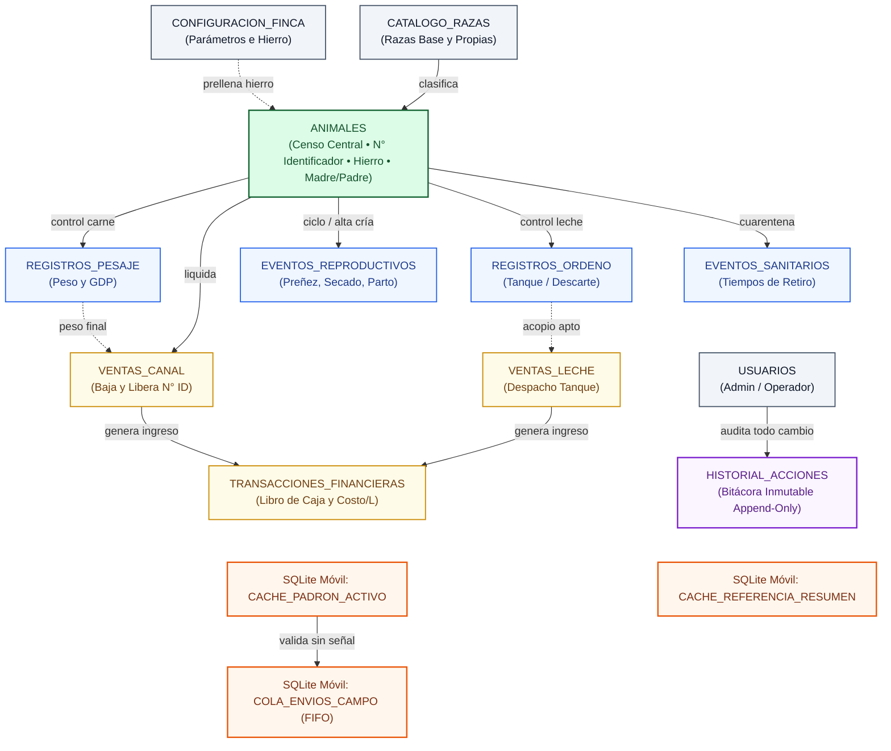
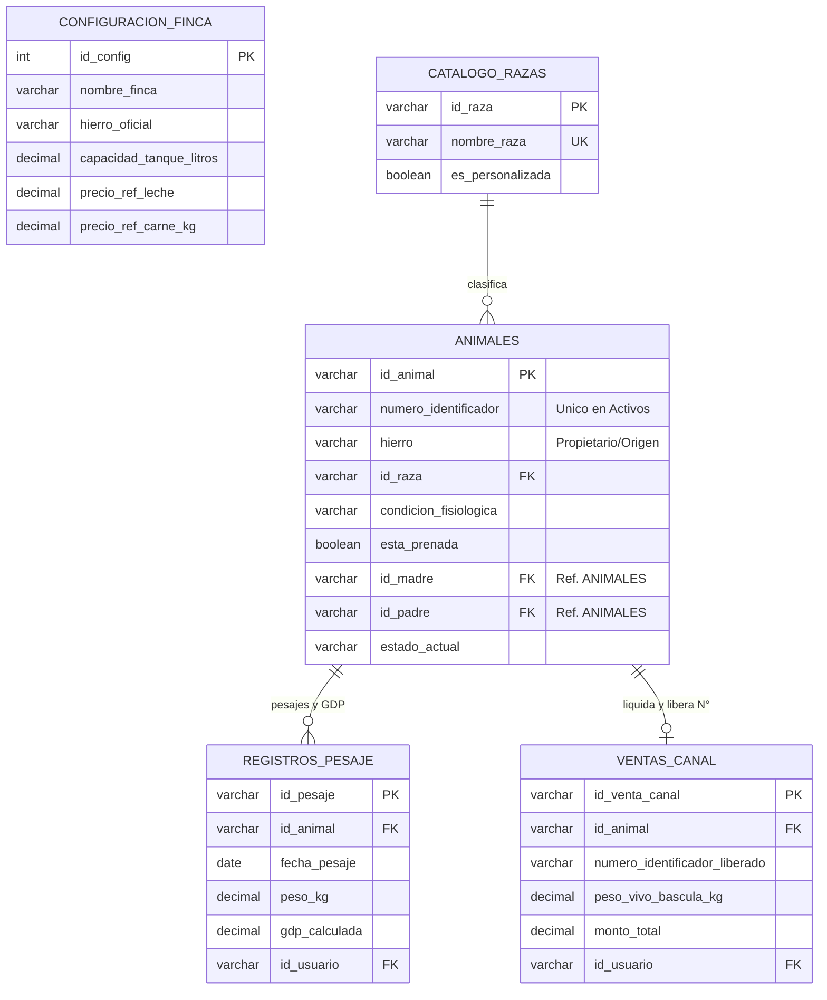
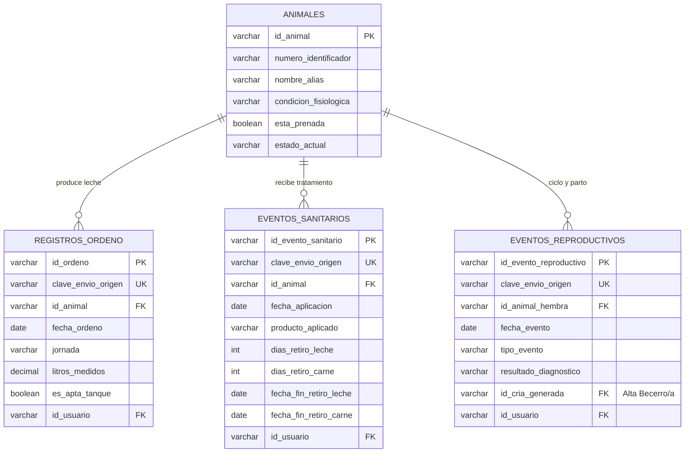
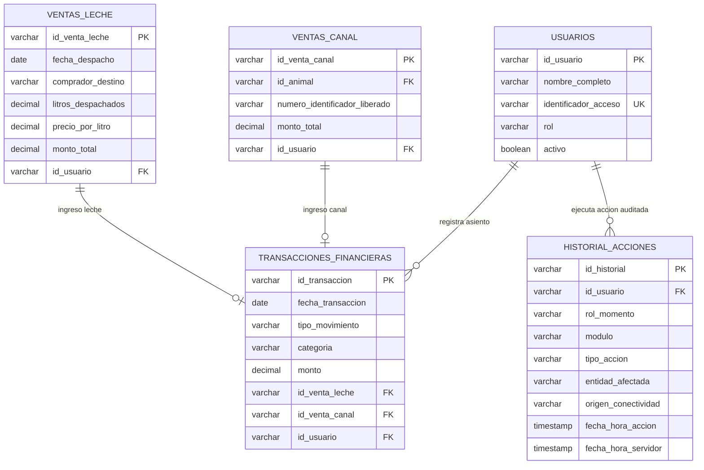
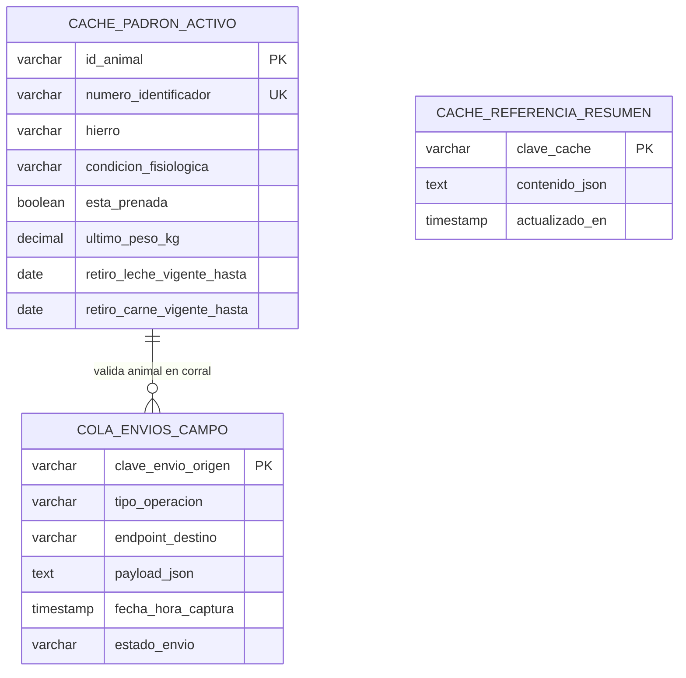

# 🗄️ Modelo de Base de Datos y Arquitectura de Persistencia: FincaControl

> **Proyecto:** FincaControl — Sistema de Gestión Ganadera de Doble Propósito (Leche y Carne)  
> **Equipo de Trabajo:** Johan Maldonado – José Chacón  
> **Enfoque Arquitectónico:** Diseño **Primero Online** (Base de Datos Central como Única Fuente de Verdad) + **Extensión Offline Táctica de Campo** (Caché Ligera y Cola de Envíos en el Dispositivo Móvil)  
> **Diseño de Experiencia:** **Propuesta A** — *Modo Vista Rápida y Control* (`Administrador`) vs. *Modo Terminal de Carga en Campo* (`Trabajador / Operador`)  
> **Independencia Tecnológica:** Especificación lógica y relacional estándar (SQL), independiente de la plataforma o infraestructura de servidor que se seleccione en la fase de despliegue.

---

## 1. Principios Arquitectónicos del Modelo de Datos

El modelo de datos de **FincaControl** se estructura bajo cuatro reglas fundamentales de ingeniería:

1. **Primero Online (Base de Datos Relacional Central como Única Fuente de Verdad):**
   * El **100% de las entidades del negocio**, los históricos productivos, el libro financiero, las liquidaciones comerciales, los saldos calculados (litros disponibles en tanque, ganancia diaria de peso `GDP`, flujo de caja, alertas sanitarias) y la bitácora de auditoría residen y se validan transaccionalmente en la **Base de Datos Relacional Central**.
2. **Extensión Offline Acotada Exclusivamente al Campo (Almacenamiento Local Ligero en SQLite):**
   * El teléfono móvil **no clona ni replica las 12 tablas centrales**. En su lugar, utiliza una base de datos local ligera en **SQLite** con **solo 3 estructuras auxiliares**:
     1. Una **caché de lectura del padrón activo** (`cache_padron_activo`) para validar animales y alertas de retiro sanitario en el corral sin internet.
     2. Una **caché de catálogos y último resumen** (`cache_referencia_resumen`) con las razas disponibles, el hierro oficial y la última instantánea de lectura rápida vista por el Administrador.
     3. Una **cola de operaciones de campo** (`cola_envios_campo` / patrón *Outbox*) que almacena temporalmente ordeños, pesajes, eventos sanitarios y eventos reproductivos/partos capturados sin señal, enviándolos en orden cronológico (`FIFO`) hacia los endpoints Online apenas se recupera conectividad.
3. **Separación de Operaciones por Rol y Conectividad (Propuesta A):**
   * **Operaciones 100% Online (Exclusivas del `Administrador`):** Configuración del sistema, gestión del catálogo maestro de razas, carga inicial del inventario y altas manuales por compra, despacho/venta comercial de leche, liquidación de venta en canal y registro de transacciones financieras.
   * **Operaciones con Soporte Online y Offline (Campo — `Operador` y `Administrador`):** Registro de ordeño diario, pesajes en báscula, eventos sanitarios/tratamientos, eventos reproductivos y **alta automática de crías nacidas en la finca mediante el evento de Parto**.
4. **Trazabilidad Inmutable y Auditoría Total (`historial_acciones`):**
   * Cualquier acción o cambio realizado en el sistema —ya sea por el `Administrador` o por un `Trabajador (Operador)`— genera obligatoriamente un registro inmutable (*append-only*, sin edición ni borrado) en la entidad central `historial_acciones`, conservando tanto la **fecha/hora real en que ocurrió la acción en campo** como la **fecha/hora en que ingresó al servidor central**.

---

## 2. Diagramas Entidad-Relación (MER)

> **Criterio de Diseño Visual (Formato Hoja Tamaño Carta):** Para garantizar lectura nítida a tamaño natural de fuente en una **Hoja Tamaño Carta** sin reducir la tipografía ni generar cruces de líneas, el modelo gráfico se organiza en **un Mapa Relacional General (`2.1`)**, **tres Vistas Entidad-Relación Modulares por Dominio de máximo 3 columnas de ancho (`2.2.A`, `2.2.B`, `2.2.C`)** para las 12 tablas centrales, y **el Esquema Local SQLite (`2.3`)** para las 3 tablas ligeras del móvil. En cada entidad se destacan sus llaves (`PK`, `FK`, `UK`) y atributos nucleares de negocio; la totalidad de columnas y restricciones se especifica en el **Diccionario de Datos (Sección 3)** y en el **DDL SQL (Sección 4)**. La llave foránea transversal `id_usuario FK` se conserva explícita dentro de cada tabla operativa y su vínculo directo con `USUARIOS` e `HISTORIAL_ACCIONES` se detalla en el **Dominio 3 (`2.2.C`)**.

### 2.1 Mapa Relacional General (Vista Panorámica Vertical)

Resumen arquitectónico completo de las **12 entidades de la Base de Datos Relacional Central** y su interacción con las **3 estructuras ligeras en SQLite** del teléfono en campo:



### 2.2 Modelo Relacional Central por Dominios (12 Entidades en el Servidor)

#### 2.2.A Dominio 1: Configuración, Censo Bovino y Producción de Carne

Cubre los parámetros maestros de la finca, la clasificación racial, el inventario individual (`ANIMALES` con genealogía autorreferenciada `id_madre` / `id_padre` y unicidad activa de `numero_identificador`), el control de peso (`GDP`) y la baja por venta en canal:



#### 2.2.B Dominio 2: Producción de Leche, Sanidad (Retiros) y Ciclo Reproductivo / Partos

Cubre las operaciones tácticas sobre el hato activo con idempotencia de sincronización (`clave_envio_origen UK`): desvío automático de leche en cuarentena (`es_apta_tanque`), bloqueo sanitario (`fecha_fin_retiro_leche` / `fecha_fin_retiro_carne`) y trazabilidad reproductiva con alta automática de becerros (`id_cria_generada FK` hacia `ANIMALES`):



#### 2.2.C Dominio 3: Ventas Comerciales, Finanzas, Usuarios y Auditoría Inmutable

Cubre la liquidación comercial 100% Online (`VENTAS_LECHE` y `VENTAS_CANAL`), su conciliación automática en `TRANSACCIONES_FINANCIERAS`, el control de acceso por rol (`USUARIOS`) y la bitácora inmutable `HISTORIAL_ACCIONES` que registra toda operación del `Administrador` y del `Trabajador (Operador)`:



### 2.3 Modelo de Almacenamiento Local del Dispositivo Móvil (SQLite Ligero — 3 Tablas)

Base de datos local ligera en el teléfono para operación táctica en corral sin señal (sin clonar las 12 tablas centrales):



---

## 3. Diccionario de Datos de la Base de Datos Relacional Central (12 Tablas)

### Tabla 1: `configuracion_finca`
Almacena la parametrización maestra de la unidad de producción (registro único `id_config = 1`). Modificable únicamente por el `Administrador` en modo Online.

| Columna | Tipo Lógico | Restricciones | Descripción Funcional |
| :--- | :--- | :--- | :--- |
| `id_config` | `INTEGER` | `PK`, `CHECK (id_config = 1)` | Garantiza una única fila maestra por unidad de producción. |
| `nombre_finca` | `VARCHAR(120)` | `NOT NULL` | Nombre oficial del hato o hacienda. |
| `hierro_oficial` | `VARCHAR(150)` | `NOT NULL` | Descripción de iniciales o figura del hierro de la finca (pre-cargado en altas y partos). |
| `proposito_finca` | `VARCHAR(40)` | `NOT NULL` | `Doble Propósito`, `Lechería Especializada` o `Cría y Ceba`. |
| `ubicacion` | `VARCHAR(160)` | `NOT NULL` | Municipio y estado de ubicación del predio. |
| `capacidad_tanque_litros` | `DECIMAL(10,2)` | `NOT NULL`, `> 0` | Capacidad máxima del tanque de enfriamiento de leche. |
| `precio_ref_leche` | `DECIMAL(10,2)` | `NOT NULL`, `> 0` | Precio unitario referencial por litro de leche (`USD/L`). |
| `precio_ref_carne_kg` | `DECIMAL(10,2)` | `NOT NULL`, `> 0` | Precio unitario referencial por kilogramo en pie/canal (`USD/Kg`). |
| `meta_gdp_kg_dia` | `DECIMAL(6,3)` | `NOT NULL`, `> 0` | Meta zootécnica de Ganancia Diaria de Peso (`kg/día`). |
| `dias_gestacion_promedio` | `INTEGER` | `NOT NULL`, `DEFAULT 283` | Duración estándar de gestación bovina para proyecciones de parto. |
| `dias_previos_secado` | `INTEGER` | `NOT NULL`, `DEFAULT 60` | Días previos al parto para emitir alerta de secado de ubre. |
| `actualizado_en` | `TIMESTAMP` | `NOT NULL` | Fecha y hora de última modificación. |

---

### Tabla 2: `usuarios`
Gestiona las cuentas y el control de acceso basado en roles (`RBAC`), determinando qué experiencia carga la aplicación móvil (**Propuesta A**).

| Columna | Tipo Lógico | Restricciones | Descripción Funcional |
| :--- | :--- | :--- | :--- |
| `id_usuario` | `VARCHAR(36)` | `PK` | Identificador único inmutable (`UUID`). |
| `nombre_completo` | `VARCHAR(120)` | `NOT NULL` | Nombre visible en formularios y en el `historial_acciones`. |
| `identificador_acceso` | `VARCHAR(100)` | `NOT NULL`, `UNIQUE` | Usuario o correo electrónico de inicio de sesión. |
| `credencial_hash` | `VARCHAR(255)` | `NOT NULL` | Contraseña o PIN cifrado de forma irreversible (nunca viaja al SQLite del trabajador). |
| `rol` | `VARCHAR(20)` | `NOT NULL`, `CHECK IN ('ADMINISTRADOR', 'OPERADOR')` | Define permisos y modo visual (*Vista Rápida* vs. *Terminal de Carga*). |
| `activo` | `BOOLEAN` | `NOT NULL`, `DEFAULT TRUE` | Permite revocar el acceso a un trabajador sin borrar su historial auditado. |
| `creado_en` | `TIMESTAMP` | `NOT NULL` | Fecha de alta del usuario. |

---

### Tabla 3: `catalogo_razas`
Catálogo extensible y persistente de razas y cruces bovinos.

| Columna | Tipo Lógico | Restricciones | Descripción Funcional |
| :--- | :--- | :--- | :--- |
| `id_raza` | `VARCHAR(36)` | `PK` | Identificador único de la raza. |
| `nombre_raza` | `VARCHAR(80)` | `NOT NULL`, `UNIQUE` | Nombre de la raza o cruce (*Gyr Mestizo*, *Carora F1*, *Girolando*, etc.). |
| `es_personalizada` | `BOOLEAN` | `NOT NULL`, `DEFAULT FALSE` | `FALSE` si es predeterminada del sistema; `TRUE` si fue creada por el Administrador. |
| `creado_en` | `TIMESTAMP` | `NOT NULL` | Fecha de incorporación al catálogo. |

---

### Tabla 4: `animales`
Entidad nuclear del inventario bovino. Separa la clave primaria técnica inmutable (`id_animal`) del identificador ganadero (`numero_identificador`) y de la marca de propiedad (`hierro`).

| Columna | Tipo Lógico | Restricciones | Descripción Funcional |
| :--- | :--- | :--- | :--- |
| `id_animal` | `VARCHAR(36)` | `PK` | Clave interna inmutable (`UUID`). Preserva históricos aunque el número ganadero se reutilice años después. |
| `numero_identificador` | `VARCHAR(30)` | `NOT NULL` | **N° Identificador** visible del ejemplar (ej. `042`, `104`). **Índice único parcial** cuando `estado_actual = 'Activo'`. |
| `hierro` | `VARCHAR(150)` | `NOT NULL` | Descripción textual de las iniciales o figura del hierro que indica **propietario y procedencia**. |
| `nombre_alias` | `VARCHAR(80)` | `NOT NULL` | Nombre o apodo de manejo del animal. |
| `sexo` | `VARCHAR(10)` | `NOT NULL`, `CHECK IN ('Hembra', 'Macho')` | Sexo biológico del ejemplar. |
| `fecha_nacimiento` | `DATE` | `NULL` | Fecha exacta o estimada de nacimiento. |
| `id_raza` | `VARCHAR(36)` | `NOT NULL`, `FK -> catalogo_razas` | Raza o cruce asignado del catálogo. |
| `proposito` | `VARCHAR(30)` | `NOT NULL` | `Doble Propósito`, `Leche` o `Carne / Ceba`. |
| `condicion_fisiologica` | `VARCHAR(40)` | `NOT NULL` | Estándar venezolano: `Becerro`, `Becerra`, `Maute`, `Mauta`, `Novillo / Torete`, `Novilla de vientre`, `Toro Reproductor`, `Vaca parida`, `Vaca escotera`, `Vaca seca`. |
| `esta_prenada` | `BOOLEAN` | `NULL` | `TRUE` / `FALSE` solo en hembras reproductivas (`Novilla de vientre` y `Vaca`); `NULL` (*No aplica*) en machos y crías (`Becerra`, `Mauta`). |
| `tipo_parto_vaca` | `VARCHAR(20)` | `NULL` | `Primípara` o `Multípara` (aplicable a `Vaca parida`). |
| `id_madre` | `VARCHAR(36)` | `NULL`, `FK -> animales(id_animal)` | Referencia genealógica a la madre (consultada y mostrada al usuario mediante su `numero_identificador`). |
| `id_padre` | `VARCHAR(36)` | `NULL`, `FK -> animales(id_animal)` | Referencia genealógica al toro reproductor padre (opcional). |
| `peso_actual_kg` | `DECIMAL(8,2)` | `NOT NULL`, `> 0` | Último peso vivo validado en kilogramos. |
| `estado_actual` | `VARCHAR(25)` | `NOT NULL`, `DEFAULT 'Activo'` | `Activo`, `Vendido_Canal`, `Muerto`, `Descarte`. Al cambiar a `Vendido_Canal`, su `numero_identificador` queda libre para nuevas crías. |
| `conflicto_numero_pendiente` | `BOOLEAN` | `NOT NULL`, `DEFAULT FALSE` | Se marca en `TRUE` únicamente si un parto registrado offline coincidió con un `numero_identificador` asignado en paralelo, alertando al Administrador para reasignarlo sin perder el parto. |
| `creado_en` | `TIMESTAMP` | `NOT NULL` | Fecha de alta en el sistema. |

---

### Tabla 5: `registros_pesaje`
Historial ponderal del proceso de producción de carne. Admite captura Online y vía Cola Offline de campo.

| Columna | Tipo Lógico | Restricciones | Descripción Funcional |
| :--- | :--- | :--- | :--- |
| `id_pesaje` | `VARCHAR(36)` | `PK` | Identificador único del pesaje. |
| `clave_envio_origen` | `VARCHAR(36)` | `NOT NULL`, `UNIQUE` | Clave de idempotencia generada por el teléfono al capturar el formulario (evita duplicados por reintentos de red). |
| `id_animal` | `VARCHAR(36)` | `NOT NULL`, `FK -> animales` | Animal pesado en báscula. |
| `fecha_pesaje` | `DATE` | `NOT NULL` | Fecha efectiva de la medición en manga. |
| `peso_kg` | `DECIMAL(8,2)` | `NOT NULL`, `> 0` | Peso vivo medido en kilogramos. |
| `peso_previo_kg` | `DECIMAL(8,2)` | `NULL` | Peso inmediato anterior utilizado como base del cálculo. |
| `gdp_calculada` | `DECIMAL(7,3)` | `NULL` | Ganancia Diaria de Peso (`kg/día`) calculada autoritativamente por el servidor. |
| `id_usuario` | `VARCHAR(36)` | `NOT NULL`, `FK -> usuarios` | Trabajador o Administrador que realizó el pesaje. |
| `creado_en` | `TIMESTAMP` | `NOT NULL` | Sello de registro en servidor. |

---

### Tabla 6: `registros_ordeno`
Mediciones diarias de producción láctea e inocuidad de tanque. Admite captura Online y vía Cola Offline de campo.

| Columna | Tipo Lógico | Restricciones | Descripción Funcional |
| :--- | :--- | :--- | :--- |
| `id_ordeno` | `VARCHAR(36)` | `PK` | Identificador único de la medición de ordeño. |
| `clave_envio_origen` | `VARCHAR(36)` | `NOT NULL`, `UNIQUE` | Clave de idempotencia del dispositivo móvil. |
| `id_animal` | `VARCHAR(36)` | `NOT NULL`, `FK -> animales` | Vaca en lactancia (`Vaca parida`). |
| `fecha_ordeno` | `DATE` | `NOT NULL` | Fecha de la jornada de ordeño. |
| `jornada` | `VARCHAR(15)` | `NOT NULL`, `CHECK IN ('Manana', 'Tarde')` | Turno de ordeño en vaquera. |
| `litros_medidos` | `DECIMAL(7,2)` | `NOT NULL`, `> 0` | Volumen ordeñado en litros. |
| `es_apta_tanque` | `BOOLEAN` | `NOT NULL` | `TRUE` si suma al inventario disponible del tanque; `FALSE` (*Descarte*) si la vaca tenía retiro sanitario de leche vigente en `fecha_ordeno`. |
| `id_usuario` | `VARCHAR(36)` | `NOT NULL`, `FK -> usuarios` | Usuario que capturó la medición. |
| `creado_en` | `TIMESTAMP` | `NOT NULL` | Sello de registro en servidor. |

---

### Tabla 7: `eventos_sanitarios`
Control veterinario, vacunaciones oficiales y tiempos de retiro que bloquean ventas de leche y beneficio en canal. Admite captura Online y vía Cola Offline.

| Columna | Tipo Lógico | Restricciones | Descripción Funcional |
| :--- | :--- | :--- | :--- |
| `id_evento_sanitario` | `VARCHAR(36)` | `PK` | Identificador único del evento sanitario. |
| `clave_envio_origen` | `VARCHAR(36)` | `NOT NULL`, `UNIQUE` | Clave de idempotencia del envío móvil. |
| `id_animal` | `VARCHAR(36)` | `NOT NULL`, `FK -> animales` | Ejemplar tratado o vacunado. |
| `fecha_aplicacion` | `DATE` | `NOT NULL` | Fecha de administración del fármaco o biológico. |
| `tipo_evento` | `VARCHAR(40)` | `NOT NULL` | `Tratamiento Antibiótico`, `Desparasitación`, `Vacunación Oficial (INSAI)`, `Vitaminización`, etc. |
| `producto_aplicado` | `VARCHAR(120)` | `NOT NULL` | Nombre comercial o principio activo aplicado. |
| `dosis_observacion` | `VARCHAR(160)` | `NULL` | Dosis aplicada o lote de vacuna. |
| `dias_retiro_leche` | `INTEGER` | `NOT NULL`, `>= 0` | Días de descarte obligatorio en leche a partir de `fecha_aplicacion`. |
| `dias_retiro_carne` | `INTEGER` | `NOT NULL`, `>= 0` | Días de prohibición de sacrificio/beneficio en canal a partir de `fecha_aplicacion`. |
| `fecha_fin_retiro_leche` | `DATE` | `NOT NULL` | Fecha calculada (`fecha_aplicacion + dias_retiro_leche`) de liberación láctea. |
| `fecha_fin_retiro_carne` | `DATE` | `NOT NULL` | Fecha calculada (`fecha_aplicacion + dias_retiro_carne`) de liberación cárnica. |
| `id_usuario` | `VARCHAR(36)` | `NOT NULL`, `FK -> usuarios` | Usuario responsable del registro. |
| `creado_en` | `TIMESTAMP` | `NOT NULL` | Sello de registro en servidor. |

---

### Tabla 8: `eventos_reproductivos`
Bitácora reproductiva de hembras (celos, montas/IA, palpaciones, secados y partos con alta vinculada de cría). Admite captura Online y vía Cola Offline.

| Columna | Tipo Lógico | Restricciones | Descripción Funcional |
| :--- | :--- | :--- | :--- |
| `id_evento_reproductivo` | `VARCHAR(36)` | `PK` | Identificador único del evento reproductivo. |
| `clave_envio_origen` | `VARCHAR(36)` | `NOT NULL`, `UNIQUE` | Clave de idempotencia del envío móvil. |
| `id_animal_hembra` | `VARCHAR(36)` | `NOT NULL`, `FK -> animales` | Vaca o novilla de vientre involucrada. |
| `fecha_evento` | `DATE` | `NOT NULL` | Fecha real del evento en campo. |
| `tipo_evento` | `VARCHAR(35)` | `NOT NULL` | `Celo`, `Inseminación / Monta`, `Diagnóstico Preñez`, `Secado`, `Parto`, `Aborto`. |
| `reproductor_referencia` | `VARCHAR(80)` | `NULL` | `numero_identificador` del toro padre o código de pajuela/semen. |
| `resultado_diagnostico` | `VARCHAR(80)` | `NOT NULL` | Resultado clínico (*Preñada Confirmada*, *Preñada Escotera*, *Vacía*, *Parto Normal*, etc.). |
| `fecha_probable_parto` | `DATE` | `NULL` | Proyección automática al confirmar servicio/preñez. |
| `fecha_probable_secado` | `DATE` | `NULL` | Proyección automática (`fecha_probable_parto - dias_previos_secado`). |
| `id_cria_generada` | `VARCHAR(36)` | `NULL`, `FK -> animales` | Si `tipo_evento = 'Parto'`, referencia al nuevo registro creado automáticamente en `animales` con etapa `Becerro`/`Becerra`. |
| `id_usuario` | `VARCHAR(36)` | `NOT NULL`, `FK -> usuarios` | Usuario que registró el evento. |
| `creado_en` | `TIMESTAMP` | `NOT NULL` | Sello de registro en servidor. |

---

### Tabla 9: `ventas_leche`
Despachos comerciales desde el tanque de enfriamiento. Operación **100% Online exclusiva del `Administrador`**.

| Columna | Tipo Lógico | Restricciones | Descripción Funcional |
| :--- | :--- | :--- | :--- |
| `id_venta_leche` | `VARCHAR(36)` | `PK` | Identificador único del despacho lácteo. |
| `fecha_despacho` | `DATE` | `NOT NULL` | Fecha de entrega comercial. |
| `comprador_destino` | `VARCHAR(140)` | `NOT NULL` | Quesera, receptoría o planta láctea compradora. |
| `litros_despachados` | `DECIMAL(10,2)` | `NOT NULL`, `> 0` | Litros descontados del saldo disponible del tanque (validado contra saldo real en servidor). |
| `precio_por_litro` | `DECIMAL(10,2)` | `NOT NULL`, `> 0` | Precio pactado por litro (`USD/L`). |
| `monto_total` | `DECIMAL(12,2)` | `NOT NULL`, `>= 0` | Total liquidado (`litros_despachados * precio_por_litro`). |
| `id_usuario` | `VARCHAR(36)` | `NOT NULL`, `FK -> usuarios` | Administrador que autorizó la venta. |
| `creado_en` | `TIMESTAMP` | `NOT NULL` | Sello de registro en servidor. |

---

### Tabla 10: `ventas_canal`
Liquidaciones de animales por beneficio/matadero. Desincorpora al ejemplar (`estado_actual = 'Vendido_Canal'`) y libera su `numero_identificador`. Operación **100% Online exclusiva del `Administrador`**.

| Columna | Tipo Lógico | Restricciones | Descripción Funcional |
| :--- | :--- | :--- | :--- |
| `id_venta_canal` | `VARCHAR(36)` | `PK` | Identificador único de la liquidación cárnica. |
| `id_animal` | `VARCHAR(36)` | `NOT NULL`, `UNIQUE`, `FK -> animales` | Animal vendido (validado sin retiro de carne activo en `eventos_sanitarios`). |
| `numero_identificador_liberado` | `VARCHAR(30)` | `NOT NULL` | Conserva constancia histórica del número ganadero que portaba el animal al momento de su venta. |
| `fecha_venta` | `DATE` | `NOT NULL` | Fecha de salida a matadero o frigorífico. |
| `destino_matadero` | `VARCHAR(140)` | `NOT NULL` | Frigorífico, matadero o comprador mayorista. |
| `peso_vivo_bascula_kg` | `DECIMAL(8,2)` | `NOT NULL`, `> 0` | Peso final en báscula al momento de la liquidación. |
| `precio_por_kg` | `DECIMAL(10,2)` | `NOT NULL`, `> 0` | Precio pactado por kilogramo (`USD/Kg`). |
| `monto_total` | `DECIMAL(12,2)` | `NOT NULL`, `>= 0` | Total liquidado (`peso_vivo_bascula_kg * precio_por_kg`). |
| `id_usuario` | `VARCHAR(36)` | `NOT NULL`, `FK -> usuarios` | Administrador que confirmó la liquidación. |
| `creado_en` | `TIMESTAMP` | `NOT NULL` | Sello de registro en servidor. |

---

### Tabla 11: `transacciones_financieras`
Libro mayor operativo de ingresos y egresos directos de la finca. Operación **100% Online exclusiva del `Administrador`**.

| Columna | Tipo Lógico | Restricciones | Descripción Funcional |
| :--- | :--- | :--- | :--- |
| `id_transaccion` | `VARCHAR(36)` | `PK` | Identificador único del asiento financiero. |
| `fecha_transaccion` | `DATE` | `NOT NULL` | Fecha contable del movimiento. |
| `tipo_movimiento` | `VARCHAR(10)` | `NOT NULL`, `CHECK IN ('Ingreso', 'Egreso')` | Naturaleza del flujo de caja. |
| `categoria` | `VARCHAR(60)` | `NOT NULL` | *Venta de Leche*, *Venta de Ganado / Canal*, *Alimentación / Sal*, *Sanidad / Medicinas*, *Mano de Obra*, etc. |
| `monto` | `DECIMAL(12,2)` | `NOT NULL`, `> 0` | Importe monetario de la operación (`USD`). |
| `concepto_detalle` | `VARCHAR(220)` | `NOT NULL` | Glosa descriptiva del movimiento. |
| `id_venta_leche` | `VARCHAR(36)` | `NULL`, `FK -> ventas_leche` | Trazabilidad automática si el ingreso provino de un despacho de leche. |
| `id_venta_canal` | `VARCHAR(36)` | `NULL`, `FK -> ventas_canal` | Trazabilidad automática si el ingreso provino de una venta en canal. |
| `id_usuario` | `VARCHAR(36)` | `NOT NULL`, `FK -> usuarios` | Administrador que generó el asiento. |
| `creado_en` | `TIMESTAMP` | `NOT NULL` | Sello de registro en servidor. |

---

### Tabla 12: `historial_acciones` *(Bitácora Inmutable de Auditoría)*
Registra **absolutamente todas las acciones y modificaciones** efectuadas en el sistema tanto por el `Administrador` como por los `Trabajadores (Operadores)`. Es una tabla de **solo inserción (*append-only*)**: no posee endpoints ni permisos de edición o eliminación.

| Columna | Tipo Lógico | Restricciones | Descripción Funcional |
| :--- | :--- | :--- | :--- |
| `id_historial` | `VARCHAR(36)` | `PK` | Identificador único o secuencial auditable del evento. |
| `id_usuario` | `VARCHAR(36)` | `NOT NULL`, `FK -> usuarios` | Autor real que ejecutó la acción. |
| `rol_momento` | `VARCHAR(20)` | `NOT NULL` | Rol con el que actuó el usuario (`ADMINISTRADOR` u `OPERADOR`). |
| `modulo` | `VARCHAR(40)` | `NOT NULL` | `Configuración`, `Inventario`, `Producción Carne`, `Producción Leche`, `Sanidad`, `Reproducción`, `Ventas`, `Finanzas`. |
| `tipo_accion` | `VARCHAR(60)` | `NOT NULL` | Acción ejecutada (*Alta Manual*, *Registro de Ordeño*, *Parto y Alta de Cría*, *Liquidación Canal*, *Actualización Parámetros*, etc.). |
| `entidad_afectada` | `VARCHAR(80)` | `NOT NULL` | Etiqueta legible del objeto afectado (ej. `Vaca #104 (Canela)`, `Tanque ➔ Quesera Don Pedro`). |
| `id_registro_afectado` | `VARCHAR(36)` | `NOT NULL` | Clave primaria del registro creado o modificado para auditoría cruzada. |
| `descripcion_cambio` | `TEXT` | `NOT NULL` | Resumen legible para la vista de Historial del Administrador. |
| `valores_anteriores` | `TEXT` | `NULL` | Representación JSON del estado previo (cuando se actualiza configuración, peso o condición fisiológica). |
| `valores_nuevos` | `TEXT` | `NOT NULL` | Representación JSON de los nuevos valores aplicados. |
| `origen_conectividad` | `VARCHAR(25)` | `NOT NULL`, `CHECK IN ('ONLINE', 'OFFLINE_SINCRONIZADO')` | Indica si la acción entró en vivo o provino de la cola offline de un teléfono de campo. |
| `fecha_hora_accion` | `TIMESTAMP` | `NOT NULL` | **Hora real en que el usuario realizó la acción** (en el corral o en oficina). |
| `fecha_hora_servidor` | `TIMESTAMP` | `NOT NULL` | **Hora exacta en que el Servidor Central recibió y confirmó el registro.** |

---

## 4. Esquema SQL Estándar (DDL Base de Datos Central y DDL SQLite Móvil)

### 4.1 DDL Relacional Estándar — Base de Datos Central (12 Tablas)

```sql
CREATE TABLE configuracion_finca (
    id_config INTEGER PRIMARY KEY CHECK (id_config = 1),
    nombre_finca VARCHAR(120) NOT NULL,
    hierro_oficial VARCHAR(150) NOT NULL,
    proposito_finca VARCHAR(40) NOT NULL,
    ubicacion VARCHAR(160) NOT NULL,
    capacidad_tanque_litros DECIMAL(10,2) NOT NULL CHECK (capacidad_tanque_litros > 0),
    precio_ref_leche DECIMAL(10,2) NOT NULL CHECK (precio_ref_leche > 0),
    precio_ref_carne_kg DECIMAL(10,2) NOT NULL CHECK (precio_ref_carne_kg > 0),
    meta_gdp_kg_dia DECIMAL(6,3) NOT NULL CHECK (meta_gdp_kg_dia > 0),
    dias_gestacion_promedio INTEGER NOT NULL DEFAULT 283,
    dias_previos_secado INTEGER NOT NULL DEFAULT 60,
    actualizado_en TIMESTAMP NOT NULL
);

CREATE TABLE usuarios (
    id_usuario VARCHAR(36) PRIMARY KEY,
    nombre_completo VARCHAR(120) NOT NULL,
    identificador_acceso VARCHAR(100) NOT NULL UNIQUE,
    credencial_hash VARCHAR(255) NOT NULL,
    rol VARCHAR(20) NOT NULL CHECK (rol IN ('ADMINISTRADOR', 'OPERADOR')),
    activo BOOLEAN NOT NULL DEFAULT TRUE,
    creado_en TIMESTAMP NOT NULL
);

CREATE TABLE catalogo_razas (
    id_raza VARCHAR(36) PRIMARY KEY,
    nombre_raza VARCHAR(80) NOT NULL UNIQUE,
    es_personalizada BOOLEAN NOT NULL DEFAULT FALSE,
    creado_en TIMESTAMP NOT NULL
);

CREATE TABLE animales (
    id_animal VARCHAR(36) PRIMARY KEY,
    numero_identificador VARCHAR(30) NOT NULL,
    hierro VARCHAR(150) NOT NULL,
    nombre_alias VARCHAR(80) NOT NULL,
    sexo VARCHAR(10) NOT NULL CHECK (sexo IN ('Hembra', 'Macho')),
    fecha_nacimiento DATE,
    id_raza VARCHAR(36) NOT NULL REFERENCES catalogo_razas(id_raza),
    proposito VARCHAR(30) NOT NULL,
    condicion_fisiologica VARCHAR(40) NOT NULL,
    esta_prenada BOOLEAN,
    tipo_parto_vaca VARCHAR(20),
    id_madre VARCHAR(36) REFERENCES animales(id_animal),
    id_padre VARCHAR(36) REFERENCES animales(id_animal),
    peso_actual_kg DECIMAL(8,2) NOT NULL CHECK (peso_actual_kg > 0),
    estado_actual VARCHAR(25) NOT NULL DEFAULT 'Activo'
        CHECK (estado_actual IN ('Activo', 'Vendido_Canal', 'Muerto', 'Descarte')),
    conflicto_numero_pendiente BOOLEAN NOT NULL DEFAULT FALSE,
    creado_en TIMESTAMP NOT NULL
);

-- Unicidad parcial: el N° Identificador es único solo entre animales Activos,
-- quedando libre para reutilizarse cuando un animal pasa a Vendido_Canal.
CREATE UNIQUE INDEX idx_animales_numero_activo
    ON animales (numero_identificador)
    WHERE estado_actual = 'Activo' AND conflicto_numero_pendiente = FALSE;

CREATE TABLE registros_pesaje (
    id_pesaje VARCHAR(36) PRIMARY KEY,
    clave_envio_origen VARCHAR(36) NOT NULL UNIQUE,
    id_animal VARCHAR(36) NOT NULL REFERENCES animales(id_animal),
    fecha_pesaje DATE NOT NULL,
    peso_kg DECIMAL(8,2) NOT NULL CHECK (peso_kg > 0),
    peso_previo_kg DECIMAL(8,2),
    gdp_calculada DECIMAL(7,3),
    id_usuario VARCHAR(36) NOT NULL REFERENCES usuarios(id_usuario),
    creado_en TIMESTAMP NOT NULL
);

CREATE TABLE registros_ordeno (
    id_ordeno VARCHAR(36) PRIMARY KEY,
    clave_envio_origen VARCHAR(36) NOT NULL UNIQUE,
    id_animal VARCHAR(36) NOT NULL REFERENCES animales(id_animal),
    fecha_ordeno DATE NOT NULL,
    jornada VARCHAR(15) NOT NULL CHECK (jornada IN ('Manana', 'Tarde')),
    litros_medidos DECIMAL(7,2) NOT NULL CHECK (litros_medidos > 0),
    es_apta_tanque BOOLEAN NOT NULL,
    id_usuario VARCHAR(36) NOT NULL REFERENCES usuarios(id_usuario),
    creado_en TIMESTAMP NOT NULL
);

CREATE TABLE eventos_sanitarios (
    id_evento_sanitario VARCHAR(36) PRIMARY KEY,
    clave_envio_origen VARCHAR(36) NOT NULL UNIQUE,
    id_animal VARCHAR(36) NOT NULL REFERENCES animales(id_animal),
    fecha_aplicacion DATE NOT NULL,
    tipo_evento VARCHAR(40) NOT NULL,
    producto_aplicado VARCHAR(120) NOT NULL,
    dosis_observacion VARCHAR(160),
    dias_retiro_leche INTEGER NOT NULL DEFAULT 0 CHECK (dias_retiro_leche >= 0),
    dias_retiro_carne INTEGER NOT NULL DEFAULT 0 CHECK (dias_retiro_carne >= 0),
    fecha_fin_retiro_leche DATE NOT NULL,
    fecha_fin_retiro_carne DATE NOT NULL,
    id_usuario VARCHAR(36) NOT NULL REFERENCES usuarios(id_usuario),
    creado_en TIMESTAMP NOT NULL
);

CREATE TABLE eventos_reproductivos (
    id_evento_reproductivo VARCHAR(36) PRIMARY KEY,
    clave_envio_origen VARCHAR(36) NOT NULL UNIQUE,
    id_animal_hembra VARCHAR(36) NOT NULL REFERENCES animales(id_animal),
    fecha_evento DATE NOT NULL,
    tipo_evento VARCHAR(35) NOT NULL,
    reproductor_referencia VARCHAR(80),
    resultado_diagnostico VARCHAR(80) NOT NULL,
    fecha_probable_parto DATE,
    fecha_probable_secado DATE,
    id_cria_generada VARCHAR(36) REFERENCES animales(id_animal),
    id_usuario VARCHAR(36) NOT NULL REFERENCES usuarios(id_usuario),
    creado_en TIMESTAMP NOT NULL
);

CREATE TABLE ventas_leche (
    id_venta_leche VARCHAR(36) PRIMARY KEY,
    fecha_despacho DATE NOT NULL,
    comprador_destino VARCHAR(140) NOT NULL,
    litros_despachados DECIMAL(10,2) NOT NULL CHECK (litros_despachados > 0),
    precio_por_litro DECIMAL(10,2) NOT NULL CHECK (precio_por_litro > 0),
    monto_total DECIMAL(12,2) NOT NULL CHECK (monto_total >= 0),
    id_usuario VARCHAR(36) NOT NULL REFERENCES usuarios(id_usuario),
    creado_en TIMESTAMP NOT NULL
);

CREATE TABLE ventas_canal (
    id_venta_canal VARCHAR(36) PRIMARY KEY,
    id_animal VARCHAR(36) NOT NULL UNIQUE REFERENCES animales(id_animal),
    numero_identificador_liberado VARCHAR(30) NOT NULL,
    fecha_venta DATE NOT NULL,
    destino_matadero VARCHAR(140) NOT NULL,
    peso_vivo_bascula_kg DECIMAL(8,2) NOT NULL CHECK (peso_vivo_bascula_kg > 0),
    precio_por_kg DECIMAL(10,2) NOT NULL CHECK (precio_por_kg > 0),
    monto_total DECIMAL(12,2) NOT NULL CHECK (monto_total >= 0),
    id_usuario VARCHAR(36) NOT NULL REFERENCES usuarios(id_usuario),
    creado_en TIMESTAMP NOT NULL
);

CREATE TABLE transacciones_financieras (
    id_transaccion VARCHAR(36) PRIMARY KEY,
    fecha_transaccion DATE NOT NULL,
    tipo_movimiento VARCHAR(10) NOT NULL CHECK (tipo_movimiento IN ('Ingreso', 'Egreso')),
    categoria VARCHAR(60) NOT NULL,
    monto DECIMAL(12,2) NOT NULL CHECK (monto > 0),
    concepto_detalle VARCHAR(220) NOT NULL,
    id_venta_leche VARCHAR(36) REFERENCES ventas_leche(id_venta_leche),
    id_venta_canal VARCHAR(36) REFERENCES ventas_canal(id_venta_canal),
    id_usuario VARCHAR(36) NOT NULL REFERENCES usuarios(id_usuario),
    creado_en TIMESTAMP NOT NULL
);

CREATE TABLE historial_acciones (
    id_historial VARCHAR(36) PRIMARY KEY,
    id_usuario VARCHAR(36) NOT NULL REFERENCES usuarios(id_usuario),
    rol_momento VARCHAR(20) NOT NULL,
    modulo VARCHAR(40) NOT NULL,
    tipo_accion VARCHAR(60) NOT NULL,
    entidad_afectada VARCHAR(80) NOT NULL,
    id_registro_afectado VARCHAR(36) NOT NULL,
    descripcion_cambio TEXT NOT NULL,
    valores_anteriores TEXT,
    valores_nuevos TEXT NOT NULL,
    origen_conectividad VARCHAR(25) NOT NULL
        CHECK (origen_conectividad IN ('ONLINE', 'OFFLINE_SINCRONIZADO')),
    fecha_hora_accion TIMESTAMP NOT NULL,
    fecha_hora_servidor TIMESTAMP NOT NULL
);

CREATE INDEX idx_historial_fecha ON historial_acciones (fecha_hora_accion DESC);
CREATE INDEX idx_historial_modulo_rol ON historial_acciones (modulo, rol_momento);
```

### 4.2 DDL SQLite Ligero — Almacenamiento Local del Dispositivo Móvil (3 Tablas)

```sql
-- 1. Caché de solo lectura del padrón activo para validación instantánea (< 5 ms) en corral
CREATE TABLE cache_padron_activo (
    id_animal TEXT PRIMARY KEY,
    numero_identificador TEXT NOT NULL UNIQUE,
    hierro TEXT NOT NULL,
    nombre_alias TEXT NOT NULL,
    sexo TEXT NOT NULL,
    nombre_raza TEXT NOT NULL,
    condicion_fisiologica TEXT NOT NULL,
    esta_prenada INTEGER,
    ultimo_peso_kg REAL NOT NULL,
    fecha_ultimo_pesaje TEXT,
    retiro_leche_vigente_hasta TEXT,
    retiro_carne_vigente_hasta TEXT,
    sincronizado_en TEXT NOT NULL
);

CREATE INDEX idx_cache_numero ON cache_padron_activo (numero_identificador);

-- 2. Caché ligera de referencia (catálogo de razas, hierro oficial y último Resumen Ejecutivo del Admin)
CREATE TABLE cache_referencia_resumen (
    clave_cache TEXT PRIMARY KEY, -- ej. 'CATALOGO_RAZAS', 'PARAMETROS_CAMPO', 'ULTIMO_RESUMEN_ADMIN'
    contenido_json TEXT NOT NULL,
    actualizado_en TEXT NOT NULL
);

-- 3. Buzón de Salida (Outbox FIFO) para formularios de campo capturados sin conexión
CREATE TABLE cola_envios_campo (
    clave_envio_origen TEXT PRIMARY KEY, -- UUID v4 de idempotencia
    tipo_operacion TEXT NOT NULL CHECK (tipo_operacion IN ('ORDENO', 'PESAJE', 'SANIDAD', 'REPRODUCCION')),
    endpoint_destino TEXT NOT NULL,
    payload_json TEXT NOT NULL,
    fecha_hora_captura TEXT NOT NULL,
    estado_envio TEXT NOT NULL DEFAULT 'PENDIENTE'
        CHECK (estado_envio IN ('PENDIENTE', 'ENVIANDO', 'REQUIERE_REVISION')),
    reintentos INTEGER NOT NULL DEFAULT 0,
    detalle_error TEXT
);

CREATE INDEX idx_cola_orden_fifo ON cola_envios_campo (estado_envio, fecha_hora_captura ASC);
```

---

## 5. Contrato Lógico de Servicios (Endpoints REST de la API Central)

Toda acción de escritura ejecutada en cualquiera de los endpoints siguientes inserta de manera atómica su asiento correspondiente en `historial_acciones`.

### A. Autenticación y Sesión
* `POST /api/v1/auth/login` — Autentica credenciales y devuelve el perfil (`ADMINISTRADOR` u `OPERADOR`) para activar el modo de interfaz correspondiente (**Propuesta A**).

### B. Consulta Rápida y Auditoría del Administrador *(Online + respaldo de lectura)*
* `GET /api/v1/admin/resumen-rapido` — Devuelve en un solo paquete consolidado: saldo real del tanque (`SUM(litros aptos) - SUM(ventas_leche)`), ordeño del día, semáforo de alertas sanitarias/reproductivas, conteo del rebaño por etapa fisiológica, utilidad de caja, costo por litro y últimas acciones de auditoría.
* `GET /api/v1/admin/historial` — Consulta paginada y filtrable (`rol`, `modulo`, `origen_conectividad`, `fecha`, `busqueda`) sobre `historial_acciones`.
* `GET /api/v1/animales` y `GET /api/v1/animales/{id_animal}` — Listado filtrable del inventario (activos e historial en canal) y hoja de vida genealógica completa.

### C. Gestión Administrativa y Comercial *(100% Online — Exclusivo `Administrador`)*
* `GET /api/v1/configuracion` y `PUT /api/v1/configuracion` — Lectura y actualización de parámetros maestros y hierro oficial.
* `GET /api/v1/razas` y `POST /api/v1/razas` — Consulta y alta de nuevas razas personalizadas en `catalogo_razas`.
* `POST /api/v1/animales` — Carga inicial del inventario y altas manuales por compra externa.
* `POST /api/v1/ventas/leche` — Registra despacho en `ventas_leche`, valida saldo del tanque y crea ingreso automático en `transacciones_financieras`.
* `POST /api/v1/ventas/canal` — Valida ausencia de retiro cárnico activo, registra en `ventas_canal`, cambia `animales.estado_actual = 'Vendido_Canal'` (liberando `numero_identificador`) y crea ingreso automático en `transacciones_financieras`.
* `GET /api/v1/finanzas` y `POST /api/v1/finanzas` — Consulta del libro de caja y registro de ingresos/egresos operativos.

### D. Operaciones de Campo *(Online directo o despachadas desde `cola_envios_campo`)*
* `GET /api/v1/campo/padron-activo` — Descarga ligera para refrescar `cache_padron_activo` y `cache_referencia_resumen` en el teléfono.
* `POST /api/v1/campo/ordenos` — Registra medición de ordeño (idempotente por `clave_envio_origen`) y evalúa inocuidad frente a `eventos_sanitarios`.
* `POST /api/v1/campo/pesajes` — Registra pesaje en manga, calcula `gdp_calculada` y actualiza `animales.peso_actual_kg`.
* `POST /api/v1/campo/sanidad` — Registra vacunación o tratamiento y calcula `fecha_fin_retiro_leche` / `fecha_fin_retiro_carne`.
* `POST /api/v1/campo/reproduccion` — Registra servicio, diagnóstico, secado o **Parto** (creando automáticamente la cría vinculada a `id_madre` y actualizando a la madre a `Vaca parida`).
