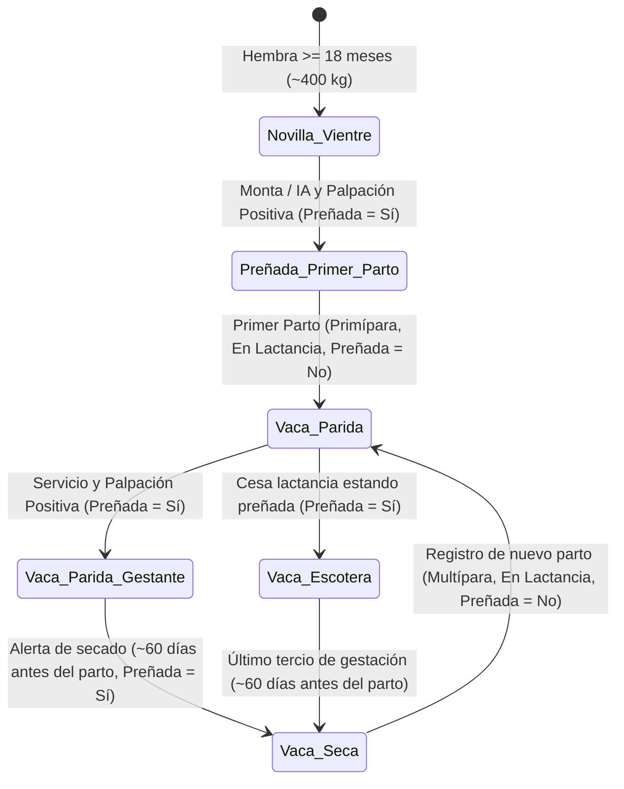

# FincaControl - Manejo Reproductivo, Condiciones Fisiológicas y Ciclo de Cría

Esta guía describe el ciclo de vida reproductivo de la hembra bovina, su clasificación fisiológica en el hato venezolano, la validación del estado de preñez y el flujo automatizado de parto vinculando a la madre mediante su **Número Identificador (`ID_Numero`)**.

---

## 1. Condiciones Fisiológicas Reproductivas y Máquina de Estados

En el hato venezolano, los animales en etapa reproductiva se clasifican según su sexo, condición fisiológica y estado de preñez:

* **Toro / Toro Reproductor:** Macho adulto destinado a la monta o reproducción, incorporado a partir de los 30 meses de vida con pesos superiores a 425 kg. (**Estado de preñez:** *No aplica*).
* **Novilla (Novilla de vientre):** Hembra joven desde los 18 meses (~400 kg o inicio de actividad sexual) destinada a la reproducción hasta su primer parto. Puede estar **Preñada (`Sí`)** o **Vacía (`No`)**.
* **Vaca (Hembra adulta a partir de su primer parto):** Se clasifica en:
  * **Vaca parida:** Aquella que ha tenido su cría y está en lactancia (*primípara* si es su primer parto, o *multípara* si acumula varios). Puede estar recién parida/vacía (`Preñada: No`) o nuevamente gestante durante la lactancia (`Preñada: Sí`).
  * **Vaca escotera:** Vaca que se encuentra preñada (`Preñada: Sí`) pero no está produciendo leche en ese momento (no lactante).
  * **Vaca seca:** Aquella que ha finalizado su periodo de lactancia y se encuentra en el último tercio de gestación (`Preñada: Sí`, ~60 días previos) antes del siguiente parto.

---

## 2. Parámetros Temporales y Fórmulas de Predicción

Para bovinos en sistemas de doble propósito (cruces *Bos taurus* x *Bos indicus*):

| Evento | Parámetro Promedio | Fórmula / Regla |
| :--- | :--- | :--- |
| **Duración de Gestación** | 283 días (Rango: 278 - 290 días) | $\text{Fecha Parto Proyectada} = \text{Fecha Servicio} + 283 \text{ días}$ |
| **Alerta de Secado** | 60 días antes del parto | $\text{Fecha Secado} = \text{Fecha Parto Proyectada} - 60 \text{ días}$ |
| **Traslado a Maternidad** | 15 días antes del parto | $\text{Fecha Maternidad} = \text{Fecha Parto Proyectada} - 15 \text{ días}$ |
| **Intervalo Entre Partos (IEP)**| Meta: < 400 - 420 días | $\text{IEP} = \text{Fecha Parto Actual} - \text{Fecha Parto Anterior}$ |

---

## 3. Flujo Integrado de Registro de Parto (Genealogía por N° Identificador)

El registro de un parto es una transacción atómica que afecta tres módulos del sistema:

1. **Actualización de la Madre:**
   * Cambia su condición fisiológica a **`Vaca parida`** (`En Lactancia`).
   * Actualiza su estado de preñez a **`Esta_Prenada = No`** (recién parida).
   * Registra el número de partos acumulados ($N + 1$, clasificando como *Primípara* si $N=1$ o *Multípara* si $N>1$).
   * Habilita la curva de producción lechera en el Módulo de Ordeño.
2. **Creación Automática de la Cría (`Animal`):**
   * Se solicita:
     * **`ID_Numero` (N° Identificador de la Cría):** Número único del animal (puede ser un número nuevo o un número liberado tras una venta en canal).
     * **`Hierro` (Descripción del Hierro):** Iniciales o figura que indica propietario y procedencia del animal (por defecto hereda el hierro de la finca/madre, editable).
     * **`Nombre_Alias`**, **`Sexo`** (*Macho* / *Hembra*), **`Raza`** (seleccionable del catálogo o permitiendo registrar una **nueva raza personalizada** que queda guardada) y **`Peso_Kg`** al nacer.
   * Se asigna automáticamente la condición fisiológica inicial:
     * **`Becerro`** (si es Macho) o **`Becerra`** (si es Hembra), con `Esta_Prenada = No aplica`.
   * Se asignan automáticamente las relaciones de parentesco usando el **Número Identificador del Animal** (nunca el hierro):
     * **`Madre_Numero`** = `ID_Numero` de la vaca que parió.
     * **`Padre_Numero`** = `ID_Numero` del toro reproductor o código del semen del servicio que originó la preñez.
3. **Validación Preventiva de Endogamia:**
   * Al registrar un servicio, advertir si el macho seleccionado comparte padre o madre (comparando `Madre_Numero` y `Padre_Numero`) con la hembra.

---

## 4. Checklist de Implementación
- [ ] Validar que el atributo `Esta_Prenada` (`Sí / No`) solo pueda activarse en hembras reproductoras (*Vacas* y *Novillas*), bloqueándolo en toros, novillos, mautes y becerros/as.
- [ ] Vincular siempre a la madre (`Madre_Numero`) mediante el **Número Identificador (`ID_Numero`)** de la vaca y no mediante la marca del hierro.
- [ ] Al confirmar diagnóstico de preñez positivo, actualizar `Esta_Prenada = Sí`; al registrar secado, pasar a `Vaca seca`; al registrar parto, pasar a `Vaca parida` (`Esta_Prenada = No`).
