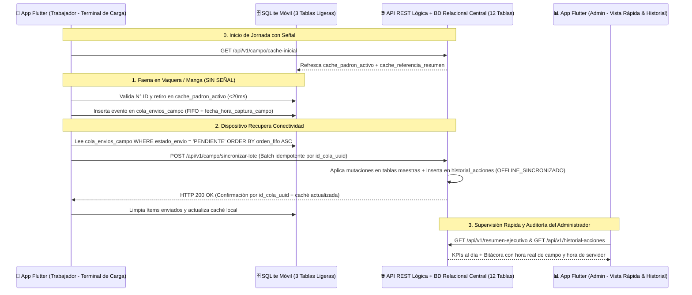

# FincaControl - Arquitectura Primero Online + Extensión Offline de Campo (Flutter + SQLite Móvil Ligero + BD Central)

Esta guía define la arquitectura aprobada para **FincaControl** (detallada formalmente en `modelo_base_de_datos.md`): un núcleo **Primero Online** gobernado por una **Base de Datos Relacional Central** (tecnología e infraestructura de despliegue a definir en fase posterior), combinado con una **Extensión Offline Táctica de Campo** en **Flutter + SQLite ligero** y una interfaz adaptativa por rol (**Propuesta A**) con **Historial Inmutable de Acciones**.

---

## 1. Principios Arquitectónicos Cerrados

1. **Primero Online (Servidor Central = Fuente Única de Verdad):**
   * Todos los saldos maestros (`leche_disponible_tanque`), inventario oficial, unicidad de `numero_identificador` activo, cálculo oficial de `GDP`, flujo de caja (`transacciones_financieras`) y bitácora de auditoría (`historial_acciones`) viven y se calculan en el Servidor Central.
   * **Operaciones 100% Online (Exclusivas del `Administrador`):** Configuración de finca, creación de razas en el catálogo maestro, carga inicial de inventario y compras manuales de animales, venta/despacho de leche del tanque, venta/beneficio en canal y transacciones financieras.
2. **Propuesta A — Una Sola App Flutter con Dos Experiencias por Rol:**
   * **`OPERADOR` (Trabajador — *Terminal Ligera de Carga en Campo*):** Pantalla minimalista con 4 tarjetas táctiles grandes (*Ordeño, Pesaje, Sanidad, Reproducción/Parto*), buscador instantáneo de corral por `numero_identificador` con semáforo sanitario y monitor de su cola local de envíos. Oculta configuración, finanzas, ventas, creación manual de animales/razas e historial de auditoría.
   * **`ADMIN` (Administrador — *Vista Rápida, Control Online y Auditoría*):** Tablero ejecutivo de lectura rápida en el móvil (*Tanque, Rebaño, Retiros, Caja y Últimas Acciones*), módulos administrativos/comerciales Online y acceso exclusivo al **`📜 Historial de Acciones`**.
3. **Extensión Offline Acotada Exclusivamente a Campo (3 Tablas Ligeras en SQLite Móvil):**
   * El teléfono **no** replica las 12 tablas históricas ni financieras de la finca. Solo almacena en SQLite local **3 tablas ligeras** para que el trabajador capture datos sin señal en vaqueras y potreros:
     1. `cache_padron_activo` (lectura rápida y validación de retiro sanitario en corral).
     2. `cache_referencia_resumen` (hierro oficial, catálogo de razas JSON y último snapshot ejecutivo de solo lectura para el Admin).
     3. `cola_envios_campo` (buzón de salida FIFO para `ORDENO`, `PESAJE`, `SANIDAD`, `REPRODUCCION` y `PARTO_CON_CRIA`).
4. **Regla de Altas de Animales:**
   * El inventario inicial y las compras externas (`CARGA_INICIAL`, `COMPRA_EXTERNA`) solo los registra el **`ADMIN` en línea**.
   * En campo, el **`OPERADOR`** únicamente incorpora nuevos animales como crías recién nacidas al registrar un **Parto** (`NACIMIENTO_PARTO`, vinculando a la madre por su `numero_identificador`).
5. **Auditoría Transversal Inmutable (`historial_acciones`):**
   * Toda acción o cambio realizado por `ADMIN` u `OPERADOR` inserta atómicamente un registro *append-only* (sin `UPDATE` ni `DELETE`) con autor, rol, módulo, entidad afectada, detalle del cambio, origen (`ONLINE` vs. `OFFLINE_SINCRONIZADO`), **hora real de captura en campo** y **hora de recepción en servidor**.

---

## 2. Flujo de Sincronización Táctica: Móvil de Campo ➔ API Lógica ➔ Administrador



---

## 3. Esquema SQLite Ligero en el Dispositivo Móvil (Flutter `sqflite` / `drift`)

```sql
PRAGMA foreign_keys = ON;

-- 1. Caché de solo lectura del padrón activo y semáforo sanitario para validación en corral
CREATE TABLE cache_padron_activo (
    id_animal                TEXT PRIMARY KEY,
    numero_identificador     TEXT NOT NULL UNIQUE,
    hierro                   TEXT NOT NULL,
    nombre_alias             TEXT NOT NULL,
    sexo                     TEXT NOT NULL,
    raza_nombre              TEXT NOT NULL,
    condicion_fisiologica    TEXT NOT NULL,
    esta_prenada             TEXT NOT NULL,
    peso_actual_kg           REAL NOT NULL,
    fecha_ultimo_pesaje      TEXT,
    tiene_retiro_leche_activo INTEGER NOT NULL DEFAULT 0,
    fin_retiro_leche         TEXT,
    tiene_retiro_carne_activo INTEGER NOT NULL DEFAULT 0,
    fin_retiro_carne         TEXT,
    sincronizado_en          TEXT NOT NULL
);

CREATE INDEX idx_cache_padron_numero ON cache_padron_activo(numero_identificador);

-- 2. Caché de referencia (Hierro oficial, Razas JSON y último snapshot de Vista Rápida)
CREATE TABLE cache_referencia_resumen (
    id_registro              INTEGER PRIMARY KEY CHECK (id_registro = 1),
    nombre_finca             TEXT NOT NULL,
    hierro_oficial           TEXT NOT NULL,
    catalogo_razas_json      TEXT NOT NULL,
    resumen_ejecutivo_json   TEXT,
    actualizado_en           TEXT NOT NULL
);

-- 3. Buzón local de salida FIFO para capturas de campo sin señal
CREATE TABLE cola_envios_campo (
    orden_fifo               INTEGER PRIMARY KEY AUTOINCREMENT,
    id_cola_uuid             TEXT NOT NULL UNIQUE,
    id_usuario               TEXT NOT NULL,
    usuario_nombre           TEXT NOT NULL,
    usuario_rol              TEXT NOT NULL,
    tipo_operacion           TEXT NOT NULL CHECK (tipo_operacion IN ('ORDENO', 'PESAJE', 'SANIDAD', 'REPRODUCCION', 'PARTO_CON_CRIA')),
    entidad_referencia       TEXT NOT NULL,
    payload_json             TEXT NOT NULL,
    fecha_hora_captura_campo TEXT NOT NULL,
    estado_envio             TEXT NOT NULL DEFAULT 'PENDIENTE' CHECK (estado_envio IN ('PENDIENTE', 'ENVIANDO', 'SINCRONIZADO', 'REQUIERE_REVISION')),
    intentos                 INTEGER NOT NULL DEFAULT 0,
    mensaje_servidor         TEXT
);

CREATE INDEX idx_cola_estado_fifo ON cola_envios_campo(estado_envio, orden_fifo ASC);
```

> **Nota sobre la Base de Datos Relacional Central (12 Tablas):** Consultar el DDL SQL estándar completo, diagrama entidad-relación y diccionario de datos en [`modelo_base_de_datos.md`](../../../modelo_base_de_datos.md) (`configuracion_finca`, `usuarios`, `catalogo_razas`, `animales`, `registros_pesaje`, `registros_ordeno`, `eventos_sanitarios`, `eventos_reproductivos`, `ventas_leche`, `ventas_canal`, `transacciones_financieras` e `historial_acciones`).

---

## 4. Contrato Lógico de Endpoints REST (`/api/v1`)

| Método | Ruta Lógica | Rol | Conectividad | Propósito y Auditoría |
| :---: | :--- | :---: | :---: | :--- |
| `POST` | `/api/v1/auth/sesion` | Todos | Online | Autentica y define la experiencia UI (`ADMIN` vs `OPERADOR`). |
| `GET` | `/api/v1/resumen-ejecutivo` | `ADMIN` | Online | Alimenta `Vista Rápida (Admin)` (KPIs, alertas, últimos ordeños y últimas 4 acciones). |
| `GET` | `/api/v1/campo/cache-inicial` | Todos | Online | Descarga `cache_padron_activo` + `cache_referencia_resumen` al móvil. |
| `POST` | `/api/v1/campo/sincronizar-lote` | `OPERADOR`, `ADMIN` | Al reconectar | Procesa en orden FIFO `cola_envios_campo` (idempotente por `id_cola_uuid`) y registra en `historial_acciones` (`OFFLINE_SINCRONIZADO`). |
| `GET` / `PUT` | `/api/v1/configuracion` | `ADMIN` | **100% Online** | Consulta o actualiza parámetros maestros e hierro oficial + audita. |
| `GET` / `POST` | `/api/v1/razas` | `ADMIN` (`POST`) | **100% Online** | Lista o agrega razas al catálogo maestro + audita. |
| `GET` / `POST` | `/api/v1/animales` | `ADMIN` (`POST`) | **100% Online** | Consulta censo o registra carga inicial/compras manuales + audita. |
| `POST` | `/api/v1/ordenos` | `OPERADOR`, `ADMIN` | Online / Cola Campo | Registra ordeño validando retiro en leche; suma a tanque o descarte + audita. |
| `POST` | `/api/v1/pesajes` | `OPERADOR`, `ADMIN` | Online / Cola Campo | Registra pesaje, calcula `GDP`, actualiza `peso_actual_kg` + audita. |
| `POST` | `/api/v1/sanidad` | `OPERADOR`, `ADMIN` | Online / Cola Campo | Registra tratamiento, activa fechas de retiro en leche/carne + audita. |
| `POST` | `/api/v1/reproduccion` | `OPERADOR`, `ADMIN` | Online / Cola Campo | Registra celo, monta, preñez, secado o **Parto** (alta automática de cría) + audita. |
| `POST` | `/api/v1/ventas-leche` | `ADMIN` | **100% Online** | Valida stock en tanque, descuenta litros, crea ingreso financiero + audita. |
| `POST` | `/api/v1/ventas-canal` | `ADMIN` | **100% Online** | Valida ausencia de retiro en carne, desincorpora res, libera `numero_identificador`, crea ingreso + audita. |
| `GET` / `POST` | `/api/v1/finanzas` | `ADMIN` | **100% Online** | Consulta libro de caja, costo directo por litro (`$/L`) y registra asientos + audita. |
| `GET` | `/api/v1/historial-acciones` | `ADMIN` | **100% Online** | Consulta la bitácora inmutable con filtros por rol, módulo, origen de red y texto. |

---

## 5. Reglas de Integridad y Resolución sin Pérdida en Sincronización de Campo

1. **Idempotencia por `id_cola_uuid`:** Si la red se corta tras procesar un lote antes de que el móvil reciba el `HTTP 200`, el reintento con el mismo `id_cola_uuid` es detectado en `historial_acciones` / tablas de eventos y devuelve confirmación sin duplicar litros en el tanque ni pesajes.
2. **Protección Preventiva Local de Retiro Sanitario:** Si un trabajador aplica un antibiótico estando `Sin Señal`, la app actualiza de inmediato `tiene_retiro_leche_activo = 1` y `tiene_retiro_carne_activo = 1` en `cache_padron_activo` además de encolar el evento, protegiendo los ordeños posteriores en ese mismo teléfono.
3. **Colisión de `numero_identificador` en Parto Offline (`conflicto_numero_pendiente`):** Si en un parto sin señal se asigna a la cría un `numero_identificador` que ya fue ocupado en el servidor, el Backend **nunca rechaza ni pierde el nacimiento**: crea el becerro con sufijo temporal (`<numero>-PEND`), marca `conflicto_numero_pendiente = TRUE` para que el Administrador reasigne el número definitivo en línea y deja constancia en `historial_acciones`.
